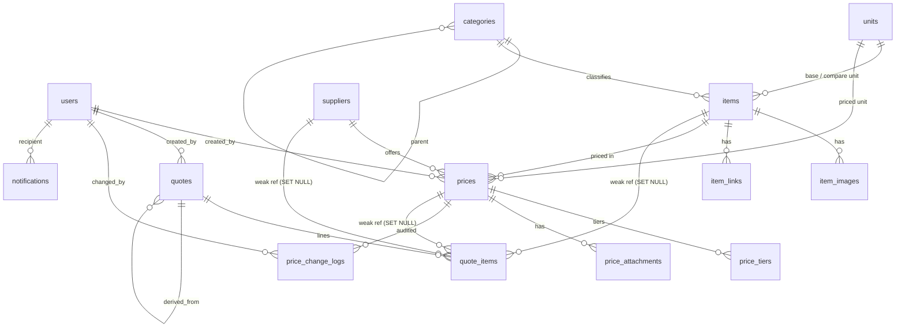

# 活动物料与人员价格库 + 报价单系统 — 技术架构文档

| 项目 | 内容 |
|---|---|
| 文档编号 | 02-ARCHITECTURE |
| 版本 | v1.0（已与 `01-PRD.md` v1、`03-UIUX.md` v1 对齐口径） |
| 作者 | 首席架构师 高见远 |
| 版本核实日期 | 2026-11-04（所有第三方版本号均经联网核实，见 §3.2） |
| 上游输入 | `01-PRD.md`（产品经理）、`03-UIUX.md`（设计师） |
| 下游消费者 | 前端开发、后端开发、测试 |
| 法律效力 | **本文档 + `openapi.yaml` 是实现唯一依据。三者（PRD / 本文档 / openapi.yaml）冲突时以本文档为准，并回写修正另外两份** |
| 状态 | 待评审 |

---

## 0. 与 PRD 的对齐结论（先读这一节）

PRD §6 提出了明确的领域模型草案并要求"需架构师确认"。我逐条确认结果如下，这是理解后续所有表结构的前提。

| PRD 决策 | 我的结论 | 说明 |
|---|---|---|
| 决策 A：物料与人员合成一张 `PricedItem` 表，用 `item_type` 判别 | **采纳，并做了加强** | 我最初倾向拆两张表（字段差异大），但 PRD 的论证正确：三条核心链路（比价、趋势、拼单）在两类主体上完全一致。更重要的是——单表之后 `prices` 只需要**一个**真外键（`item_id`），而不是"两个可空外键 + CHECK + 两条 EXCLUDE 约束 + 两条 partial index"。这是实打实的 30% 核心表复杂度削减。字段稀疏的代价（`items` 上有 3 个 nullable 列专供人员）远小于收益 |
| 决策 B：价格版本化，改价 = 新增，禁止原地覆盖 | **完全采纳** | 见 §6.1，并补充了数据库级强制手段（EXCLUDE 约束），不依赖应用层自律 |
| 决策 C：报价单明细存快照 + 弱关联 | **完全采纳** | 见 §6.3 与 ADR-003，并明确了"金额列 NOT NULL 无默认值"这个让"忘记快照"在类型层面不可能的实现手段 |
| 决策 D：单位做成枚举表，不做自由文本 | **完全采纳，并扩展为 `units` 字典表 + 折算系数** | PRD 只要求单位枚举。但"同一物料、A 供应商按张报、B 供应商按㎡报"是必然场景，只锁枚举无法比价。因此按 PRD v1.1 §6.6.2 采用 `items.compare_unit_code` + `prices.base_unit_qty`（1 个比价基准单位 = N 个本价格单位，**乘法口径**），见 §6.2 |
| Category 分 `material` / `personnel` 两个域，各一棵树 | **采纳** | 取代我原先"物料品类树 + 人员工种平表"的设计。两域共用一张 `categories` 表，用 `domain` 判别 |
| Supplier.type = online/factory/rental/freelancer/internal | **采纳**（修正） | 我原设计用 material/labor/both（按服务对象分），这是错的。PRD 的分法是用户痛点的直接映射（"淘宝 vs 线下定做厂差价大"），而且比价界面必须能标"最低价是线上还是线下"。按服务对象分则丢失这个信息 |
| `PriceBook.unit_price` 为基准档价 + `PriceTier` 带 `max_qty` | **部分采纳** | 保留 `prices.unit_price`（必填，首档价）；`max_qty` **不入库**，由相邻档的 `min_qty` 派生。理由：存 `max_qty` 必然与下一档 `min_qty` 出现不一致，且需要额外约束维护。查询语义不变 |
| `Quotation.version` 改版递增 | **采纳，并定为 P0** | 我原先漏了这个字段，而 PRD 把它作为"改到第五版分不清哪版"痛点的解。实现为 `UNIQUE(quote_no, version)`，旧版本冻结不覆盖 |
| `QuotationLine.is_visible_to_customer` | **采纳** | 用于隐藏内部行/赠送行。客户版导出在服务端按此字段过滤 |
| `pricing_mode`（per_day/per_event/per_person_day/per_hour/per_half_day） | **不落库，作为 API 派生字段返回** | 它与 `items.base_unit_code` **双射**（`person_day` ⇔ `per_person_day`），落库就是第二份真相，迟早与 `base_unit_code` 打架。实现为 `src/shared/derive.ts` 的纯函数 `pricingModeOf(itemType, baseUnitCode)`，API 出参带 `pricing_mode`，前端零感知。映射见 §6.8 表 C。**`includes_travel` 不可派生，落库** |
| `Attachment` 用 `owner_type/owner_id` 多态表 | **改为三张干净表** | `item_images` / `item_links` / `price_attachments`。多态表无法建外键，价格截图会挂到不存在的价格上。三张表各 8-10 列，代码量差异可忽略，完整性收益明确 |
| `PriceBook.attachment_ids uuid[]` | **改为 `price_attachments` 子表** | 数组列无法级联删除、无法约束 MIME、查询要 unnest。子表更干净 |
| 报价单状态 `draft`/`issued`/`void` | **采纳（不扩展）** | 我在初稿里加了 won/lost/expired。按"不做镀金"原则回归 PRD 三态。`expired` 由 `valid_until` 派生，不落库。将来要算赢单率，加两个枚举值即可，无表结构变更 |
| 密码用 bcrypt | **偏差：用 scrypt** | 见 §10.3。`bcrypt` 与 `argon2` 都是原生模块（Alpine/musl 镜像里需要 node-gyp 编译，是 Docker 构建失败高发点）。Node 24 内置 `crypto.scrypt`，零原生依赖，OWASP 2026 列为可接受方案 |

**另外我主动收紧了两处 PRD 的模糊点**：

1. PRD 说"`member` 可读成本用于算毛利，但任何导出/打印通道不得输出成本列；客户版 PDF 由服务端渲染时剥离成本字段，不靠前端隐藏"——这要求**成本字段在客户版通道里根本不发到浏览器**。架构上落地为：打印视图 `/quotes/:id/print?view=customer` 是一个 **Server Component**，在服务端取数时就裁掉成本列，响应 HTML 里不存在任何成本数字。这是全项目唯一一处允许页面直读数据库的例外（REST-first 的其余部分不变），原因写在这里。
2. PRD 说 `effective_to` 的"失效日 = 新价生效日 - 1 天"，说明 PRD 用的是**闭区间**（失效日当天仍有效）。我确认采用闭区间（用户心智一致），但数据库 EXCLUDE 约束内部用半开区间表达（`daterange(from, to+1, '[)')`），既符合用户语义又不会有 off-by-one 漏洞。

### 0.1 对 PRD v1.1（§6.6 口径定义）的同步结论

PRD v1.1 新增 §6.6「计算与比价口径定义」并要求下游"不得自行解释"。我逐条落到 Schema 与接口上，其中 3 处做了加强，2 处做了修正：

| PRD v1.1 要求 | 架构落地 | 判断 |
|---|---|---|
| §6.6.1 `PriceBook.pricing_nature`（purchase / rental_per_day / custom_made）必填，最低价只在同 nature 内比较 | `prices.pricing_nature` 进表且**进 EXCLUDE 唯一键**（见 §7.3.8）。同主体同供应商可以同时存在买断价与租价——这正是现实，若不入唯一键，第二条价永远插不进去 | **加强**。PRD 没说唯一性约束要不要带这个维度，但不带就是硬伤 |
| §6.6.2 `base_unit_qty` 折算系数，乘法口径，选填 | 我初稿用倒数口径 `unit_factor`（1 计价单位 = N 个基准单位）。**按 PRD 翻转**：列名 `base_unit_qty`、语义「1 个比价基准单位 = N 个本价格单位」、所有公式由 `/ unit_factor` 改为 `× base_unit_qty` | **修正（我错）**。两个倒数口径同时存在于 PRD 与架构文档，是必出的符号错。PRD 的乘法方向更抗错，采纳 |
| §6.6.2 三级降级：单位一致直接比 / 填了系数折算比 / 没填系数不参与但仍在列表 | 比价接口返回 `compare_state`：`comparable` / `converted` / `not_comparable`。**不过滤掉行**，只在 `is_lowest` 上置 false 并给标记 | **采纳** |
| §6.6.3 含税/不含税跨口径不标最低价（MVP 不记税率） | 比价分组的可比性判定再叠一层：同 nature 组内若 `tax_included` 不一致 → 该组 `comparable=false`，返回 `reason='MIXED_BASIS'` + `basis_dimension='tax'`，不标最低 | **采纳**，并与"双口径并存"冲突做了取舍（见下） |
| §6.6.4 价格状态四级（有效 / 软陈旧 / 硬失效 / 被替代），软陈旧计时起点 `max(updated_at, last_used_at)` | DB 只存 `status`（active / superseded / archived）与 `effective_to`，**四级全部查询时派生**（`effective_state` + `staleness_days`）。新增 `prices.last_used_at` | **采纳**。PRD 自己也说"建议不新增 DB 状态值"，一致 |
| §6.6.4 出单时回写 `last_used_at` | `POST /quotes/:id/issue` 在同一事务内更新被引用 `prices.last_used_at = now()`。**不用异步**：这是同库单表 UPDATE，量级 = 单张单的行数（≤50），事务内做掉最简单也最不会漂（§9.8） | **修正（我更严）**。PRD 建议"异步或延后批量，最终一致即可"，但异步带来的最终不一致要额外兜底，而这里的成本根本不值得省 |
| §6.4 单位枚举补 `根`、`卷` | `units` 种子 15 → 17（§6.8 表 A） | **采纳** |
| §8.1 第 14 项「发送前自检 + 出单通知」P0 | 自检 = `POST /quotes/:id/risk-check`（5 条规则，§9.6）；通知 = 新增 `notifications` 表 + `GET/PATCH /notifications`（§7.3.16、§8.3 K） | **采纳**。站内通知必须落库，否则"发过没发过"无从判断 |
| §6.6.7 只有三态，不加审批态；但"别把状态判断散落在十几处" | `src/domain/quote-status.ts` 集中导出 `assertCanEdit/CanIssue/CanVoid`，全项目只准从这里判断状态 | **采纳**，并升级为 lint 约束（§11.2 第 9 条） |
| §6.2(3) `PricedItem.pricing_mode` | **不落库**，作为派生只读字段（见上表） | **偏差，已说明理由** |

**一处必须说明的取舍（v1.3 已推翻，见 §0.3）**：我曾判断「同一供应商同一主体同一期间不允许含税与不含税两条价并存」，理由是会让 `resolvePrice()` 不再单值。**PRD v1.3 驳回了这个判断，我接受**——理由见 §0.3 第 1 条。当前实现为六元组唯一键 `(item_id, supplier_id, pricing_nature, tax_included, unit_mode, 生效区间)`（v1.4 加第六维，见 §0.4），`resolvePrice()` 增加 `tax_basis` 入参后仍返回单值。

### 0.2 对 PRD v1.2（R3/R4 结案）的同步结论

| PRD v1.2 要求 | 架构落地 | 判断 |
|---|---|---|
| §6.6.8 出单时成本默认取当前最低有效价，允许逐行换供应商，**两个值都记** | `quote_items` 新增 `cost_source`（price_book/manual）+ `reference_lowest_price`（录单时最低有效价快照）；`cost_unit_price` + `supplier_id` 记实际采用的那家。见 §6.2.4 | **采纳**。这两列是「事后复盘」的唯一答案来源，而且 `cost_source` 是两个质量指标的分母，不落库指标就算不出来 |
| §6.6.8 阻断边界：**只有未填成本才阻断，填了就放行** | 阻断点前移到 `POST /quotes/:id/items`（400 `40002`），`issue` 不再因成本阻断——`cost_unit_price` 是 `NOT NULL`，行存在即成本已定 | **采纳并更严**。系统里永远不会存在"没有成本的行"，比 PRD 的字面实现更不可能出事故 |
| §6.6.8 「按旧价重新录价」按钮 | **不新增端点**：前端用旧价的值调 `POST /prices`（`effective_from=今天`、`close_previous=true`），走 §9.4 的标准事务，旧价自动 superseded | **采纳**。零额外成本，且把一次报价动作转化成一次录价动作——这条设计比"静默用旧价"高明得多 |
| §6.6.9 单口径 + 报价单口径声明行，不做双口径导出 | `quotes.tax_statement`（快照，创建时从 `app_settings.tax_statement_default` 复制，出单前可改）；`resolvePrice()` 增 `tax_basis` 入参（直接参与候选集过滤），`quotes.tax_statement` 与它同名同值域、零映射 | **采纳**。没有税率就换算不出正确值，硬换是编数——"一个会算错的开关比没有开关更糟"（PRD 原话） |
| §12.1 两个质量指标口径 | `has_overdue_price` / `manual_cost_line_ratio` 由 `GET /dashboard/summary` 统一算，只读 `quote_items` 快照列，不 JOIN | **采纳** |
| §10.1 移动端三档边界 + **禁止免登录 token 路由** | §1.2 按三档写死；无 API 差异；**任何 `/q/:token/view` 形式的免登录路由禁止出现**（泄露客户名 + 金额且不可追溯） | **采纳**。原架构写的是"只做响应式只读"，太粗，已改 |
| §11.3 **member 不得导出内部版** | `export.xlsx?view=internal` 走 `requireAdmin()` → 403 `40302`；`view=customer` 走 `requireUser()`。打印页同理 | **采纳**。屏幕可见是即时行为，导出文件是可转发资产，两者权限分开是对的 |
### 0.3 对 PRD v1.3（驳回我的含税判断）的同步结论

PRD v1.3 采纳了我 2 条加强、驳回了我 1 条，我逐条接受并已改 Schema：

| PRD v1.3 | 我的原判断 | 最终落地 | 说明 |
|---|---|---|---|
| ① 唯一键加 `tax_included`，**允许含税/不含税双价并存** | 我主张不允许并存，理由是 `resolvePrice()` 会失去单值性 | **改判：采纳 PRD（我错了）**。EXCLUDE 键改为六元组 `(item_id, supplier_id, pricing_nature, tax_included, unit_mode, 生效区间)`（第六维由 v1.4 补，见 §0.4）；`resolvePrice()` 增 `tax_basis` 入参，仍返回单值 | 我犯的错是**把「实现上的单值」当成「业务上的唯一」**。「要票 3200 / 不要票 2900」是活动行业的常态报价，砍掉一个口径就是逼用户把它塞回 `source_note` 自由文本——那是这套系统要消灭的行为。PRD 的解法（`tax_basis` 从报价单口径声明继承，用户零操作）成本只有「键多一维 + 函数多一入参」，比我原来切掉一个业务事实便宜得多 |
| ② `pricing_mode` 不落库，但派生函数必须判 `item_type` | 我只写了双射，漏了物料也有 `天`/`场` 单位 | **已补**：`pricingModeOf(item) = item.item_type === 'personnel' ? map(base_unit_code) : null` | 我漏的分支很致命：一个「租赁按天」的**物料**会被派生成 `per_day`，前端渲染成人员表单（多出「是否含差旅」）。判 `item_type` 一行修掉 |
| ③ `last_used_at` 回写**只动这一个字段**，严禁顺带 `updated_at` | 我的 §9.8 SQL 本来就只 `SET last_used_at`，没中招 | 保持原样，并补一句显式警告 | 顺手写全量更新模板会让「被使用」在趋势图里显示成「被调价」，图形彻底失真；审计日志也会被出单记录淹没 |
| ④ 自检 8 条；「客户名/活动名为空」只在 `issue` 阻断、`draft` 不阻断 | 我定了它是唯一 blocker | 一致，无改动 | PRD 原先允许代填「待补」，v1.3 改成阻断——「待补」会变成永久垃圾数据，比空着更糟 |
| ⑤ `base_unit_qty` 可空 + 填 1 拒绝 | 我的判断 | 一致，无改动 | PRD 补了更强的一层论证：`NOT NULL DEFAULT 1` 会把所有「我不知道」静默变成「我断言 1:1」——**让错误看起来像正确，且永不报错** |
### 0.4 对 PRD v1.4（加第六维 + 列表禁裸最低价）的同步结论

| PRD v1.4 | 落地 | 说明 |
|---|---|---|
| ① 唯一键加第六维，让「按场 2800」与「按天 1500」能并存 | EXCLUDE 改六元组，第六维用 **GENERATED 列 `unit_mode`**（由 `unit_code` 派生，见 §7.3.8） | **没选 PM 给的 (a)(b)(c) 任一个**：真实列是第二份真相；(b) 引用了 `items` 的列不可行；纯应用层挡不住并发与导入脚本。生成列既不引入可写字段，又能在 DB 层参与约束。同时不破坏「`pricing_mode` 不落库」——落库的是**价格的** `unit_mode`，主体的 `pricing_mode` 仍是 API 派生字段 |
| ② 人员比价也分组，按计价方式 | 分组键从 `pricing_nature` 扩为 **(pricing_nature, unit_mode)**，见 §6.2.6 | 物料（非时间类单位）的 `unit_mode` 恒 NULL，退化为原来的按 nature 分组，**物料侧行为零变化**；时间类单位与人员则自动细分 |
| ③ 列表/搜索不得只给一个裸最低价 | `ItemListItem.lowest_summary = { is_multi_group, groups[] }`，见 §6.2.5；**`lowest_base_price` 标量字段彻底删除**，不留兼容 | 由后端判定而不是前端藏：前端"取第一个/取最小"是 5 秒能写出来的错误，而且会在另一个调用方再错一次。**接口不给标量，前端就没机会错** |
| ④ 自检第 3 条改取值基准（同性质+同税口径+同计价方式） | §9.6 R3 SQL 加三重同组过滤 | 原写法会拿 ¥500 的租价去劝一张买断单"你贵了"——**这条会从最有价值的一条变成最危险的一条**，因为"系统说的"用户更会信 |
| ⑤ 不要为人员分组新造 `charge_mode` 概念 | 未采纳该命名；文档只用 `pricing_nature` + `unit_mode`/`pricing_mode`，无第三个概念 | 同一原理的两个实例，不需要两个名字 |

### 0.5 对 PRD v1.7（口径切换试算 + 静默默认值禁令）与 Phase 1 冻结裁决的同步结论

**(A) PRD v1.7 三条**

| PRD v1.7 | 落地 | 说明 |
|---|---|---|
| §6.6.9.2 切口径确认框必须给出切换前后的整单合计 | 新增只读端点 `POST /quotes/:id/tax-basis/preview`（`I20`），设计见 §6.2.7 | **不做成前端算**。前端算需要另一口径的全部候选价格，等于把口径逻辑写第二遍；一旦两边算出不同的数，没有任何机制能发现。接口内部只是把 `tax_basis` 换个值再跑一遍既有 `resolvePrice`，**零新逻辑** |
| §6.6.9.2 缺价行的 `sale_unit_price` 保持原值 | §6.2.7 列为不变量，§9.5 重算因此无需改动 | **对客价是商务判断，成本缺失是数据问题。** 用数据问题去清商务判断，用户会在切口径那一刻丢掉已经跟客户谈定的售价，而且他自己不会注意。`total_after` 里缺价行按**原对客价**计入 |
| §6.6.9.1 「会报错的错误是安全的，不报错的错误才是危险的」 | 新增 §6.9「静默默认值禁令 + 全量自查表」 | 按此判据扫了 47 个 schema / 53 个 path：**新发现并修掉 5 处断言型默认值**（另有 1 处 `base_unit_qty DEFAULT 1` 在 v1.3 已修），判 8 处合规并逐条写明理由，1 处风险留档到 Phase 2。判定标准不是"有没有 DEFAULT"，而是"这个默认值是不是在替用户做一个会导致算错的决定" |

**(B) 总监冻结裁决的术语**（详见附录 A.1，全项目唯一真值）

- `suppliers.type`：`online` / `factory` / `rental` / `freelancer` / `internal`
- `prices.pricing_nature` 第三值：`custom_made`
- `pricing_mode`：`per_day` / `per_event` / `per_person_day` / `per_hour` / `per_half_day`
- 对外入参 `tax_basis`（`inclusive` / `exclusive`）与对内列 `prices.tax_included`（boolean）两个名字必须不同

> 第四项与裁决表的字面值有一处差异（裁决表写 `included`/`excluded`，全项目实测是 `inclusive`/`exclusive`），已在附录 A.1 用证据说明，**没有让两套值并存**。

**(C) `categories.default_pricing_nature`**（总监 Q2）：见 §7.3.4，只做表单预填，不进唯一键、不进候选集。

### 0.6 对 PRD v1.8 与 Phase 1 最终冻结裁决的同步结论

| 来源 | 落地 | 说明 |
|---|---|---|
| **R15 录价权限 = 分层开放（客户选 c）** | §6.7 权限矩阵 + §11.2 R12：两个函数 `canCreatePrice(role)` / `canOverridePrice(role)`；`POST /prices` 对 member 开放，`PATCH`/`archive`/`refresh-prices`/删主体/删供应商仅 admin | **不合并成 `canEditPrice`**（总监明确要求）。合并版在"某人能录价但不能改别人的价"这条需求到来时必须拆开，而拆开意味着所有调用点重新选择用哪个 |
| **Q3 毛利红线按项目类型** | `quotes.project_type`（5 值枚举，可空）+ 新表 `margin_thresholds`（§7.3.17）+ 唯一出口 `resolveMarginWarnRate()` + R1 返回 `warn_rate_used` / `warn_rate_source` | 用独立表而非 `app_settings` jsonb：它要参与 `group by`、需要 `CHECK (0,1)`、且是 8 行配置不是一个配置项。**阈值只是占位默认，必须可配**；**只影响展示与 R1 warning，任何情况下不拦截 `issue`** |
| **Q2 衍生：`pricing_nature` 加第四值 `service`**（PM v1.8 发现的真缺陷） | §7.3.8：人员恒取 `service`，表单不出现该选择；`CHECK` 四值；两条 CI 元数据断言 | 原本人员取 NULL，而 `WITH =` 对 NULL 恒为假 → **EXCLUDE 对人员整段静默失效**：同一讲师可插两条相同按天价、不报错、取价取决执行计划。`service` 不是分类，是把约束修回有效。文档已写明「该列 `NOT NULL` 是约束有效性的前提，不得改为可空」 |
| **Q7 定稿：成本取价口径只跟本单声明** | §6.2 取消"该口径无价时回退另一口径"；`/price-lookup` 返 42205 + `other_basis_exists` / `other_basis_price`（仅提示，不进金额） | 回退会让含税单拿到不含税成本：150−100 毛利 33.3%，150−113 毛利 24.7%，**两个数都"看起来正常"**。打标救不了——用户以为系统已处理。宁可缺价让人填一次 |
| **R16 三个字段名** | 附录 A.1 + `openapi.yaml` 核对：`prices.unit_code`（短码，可写）/ `prices.unit_mode`（带前缀，生成列只读）/ `items.pricing_mode`（派生不落库） | 三项与文档现状一致。**唯一偏差**：总监举例写了 `per_sqm`，而 `unit_mode` 值域只能是 5 个时间口径（理由与破坏面见 §7.3.8 与 `OD-17`）——非时间类单位 → NULL，按㎡ 与按张的并存靠 `base_unit_qty` 折算而不是加维度 |

### 0.7 v1.1 增补（Phase 1 关闸前的最后一批，就地记录不重写全文）

本节只列**与 v1.0 的差异**，正文各处已同步改过；写这一节是为了让后端在实现时不必逐节比对两版文档。

| # | 变更 | 落点 |
|---|---|---|
| 1 | `quotes.project_type` 枚举值定稿为 `annual_meeting` / `product_launch` / `exhibition_booth` / `roadshow` / `framework_client`（v1.0 曾误用 `brand_launch` / `exhibition` / `framework`，**已全部替换，无残留**） | §7.3.12 字段 + CHECK；`openapi.yaml` 6 处 enum |
| 2 | 加台账索引 `(project_type, status, created_at DESC) WHERE deleted_at IS NULL` | §7.3.12 索引清单 |
| 3 | 全局默认阈值配置键名统一为 **`app_settings.default_margin_threshold`**（v1.0 写作 `margin_warn_rate`，同一语义两个键名是必现 bug，已整篇替换） | §7.3.15 / §7.3.17 / §9.6 R1 / `openapi.yaml` `QuoteSettings` |
| 4 | `risk-check` R1 的阈值解析写成**三级链**并明确**永不产出 blocker**：`project_type → margin_thresholds → default_margin_threshold → 常量 0.25 + 告警`；返回体带 `warn_rate_used` + `warn_rate_source` | §9.6 R1 |
| 5 | `openapi.yaml` 新增 `QuoteUpdate`（`PATCH` 专用，与有三项必填的 `QuoteCreateInput` 分开）；`/quotes/summary` 加 `group_by` 参数（`project_type` / `status`） | `openapi.yaml` |
| 6 | 新增 **R19 只读字段服务端强制**（`supplier_id`/`unit_code`/`pricing_nature`/`base_unit_qty` 变更 → 422 `42207`）与 **R20 业务语义列禁止 `DEFAULT`** | §11.2 + §8.2 错误码 |

**未变**：六元组唯一键、`resolvePrice(tax_basis)` 无回落、`last_used_at` 同步回写、快照不可污染、`v_price_state` 视图、`refresh-prices` 九条不变量、`I20` 试算。**Phase 2 的起点就是这一版。**

---

## 1. 需求边界（Out of Scope 先行）

### 1.1 本次做（对齐 PRD §8.1 的 14 项 P0）

账号与角色 → 供应商档案（五类型）→ 分类体系（双域树）→ 物料价格库 → 人员价格库 → 价格有效期 → 数量阶梯价 → 多供应商比价（按交易性质分组标最低 + 数量档切换）→ 历史价格趋势 → 图片与链接附件 → 搜索 → 勾选生成报价单（快照 + 成本毛利）→ 导出（客户版隐成本 / 内部版含毛利）→ **发送前自检 + 出单通知**。

### 1.2 本次不做（与 PRD §10 一致，逐条点名到架构层面）

| 不做 | 架构层面的含义 |
|---|---|
| 复杂项目成本核算 / 审批流 / ERP 集成 / 合同开票 | 不做 project、budget、approval、invoice 相关表与端点 |
| 库存管理 | 不做 stock、movement 表；物料无数量结存概念 |
| 人员排期 / 档期 | 不做 schedule 表；`labors` 无档期字段 |
| 客户 CRM | 客户只是 `quotes.customer_name` 字符串，不建 customers 表 |
| 报价单在线签署 | 只导出文件，无签署链路 |
| 增值税额拆分（专票/普票） | `prices.tax_included` 只做布尔标记，不做税额计算；`quotes` 无税额列 |
| 移动端 App / 小程序 | 不建独立移动端。`>= 1024px` 全功能；`375-1023px` 只读三个页面（报价单详情 / 主体价格详情 / 比价结果单列），其余页面提示"请在电脑上打开"；`< 375px` 仍可看报价单金额。**只读页必须走登录态，禁止任何免登录 token 路由（`/q/:token/view` 这类）**——链接一旦转发等于把客户名与金额泄露给任意第三方且无法追溯。无 API 差异（都是同一套 REST 端点），差异只在前端布局与按钮可用性。**`pointer: coarse` 只做体验降级（放大点击区、隐藏 hover 态），不是权限边界**：严禁把 pointer 判断写进后端鉴权，也严禁用它隐藏本应可见的数据 |
| 多币种 / 汇率 | `currency` 字段存在但恒为 CNY，无汇率表 |
| 智能比价建议 / 自动涨价预警 | 无算法模块 |
| 对外公开目录 / 客户自助查价 | 无公开路由，全部端点需登录（除 login / health） |
| 别名同义词搜索（PRD P2 #18） | `items.aliases` 字段保留（零成本），但 MVP 搜索不查它 |
| 人数 × 天数自动换算（P2 #19） | 明细行只有 `qty` 一个数量字段，不做拆解 |
| 首页看板（P2 #20） | 只有极简 `/` 工作台（待办 + 最近报价单 + 计数），不做图表看板 |
| 供应商评分（P2 #21） | 无评分字段 |
| Feature Flag 灰度 | 内部 10 人系统全量发布，引入 flag 表与中间件是净成本 |
| 全文检索引擎 / Redis / 消息队列 | 数据量极小（见 §2），PostgreSQL `pg_trgm` + 无状态 JWT 足够 |

---

## 2. 规模与容量假设

对齐 PRD §11.1（其估算比我的初稿更保守，采用 PRD 数字）：

| 维度 | 首年 | 三年 | 架构含义 |
|---|---|---|---|
| 物料 SKU | 200-600 | 800-2,000 | 单表，无分表 |
| 人员条目 | 80-150 | 200-400 | 与物料同表（`items`） |
| 供应商 | 50-120 | 150-250 | 单表 |
| 价格记录 | 5,000-12,000 | 20,000-40,000 | 单表 + 区间索引 |
| 阶梯价行 | 10,000-30,000 | 60,000 | 单表 |
| 报价单 | 100-300 | 500-900 | 单表 |
| 报价单行 | 4,000-15,000 | 30,000-70,000 | 单表 |
| 附件 | 2-6 GB | < 10 GB | 本地磁盘 + volume |
| 并发 | 峰值 10 人 | 20 | 单实例，无负载均衡 |

**PRD 的原话值得抄在这里**：「这个产品的复杂度全在价格解析逻辑和表单体验，不在规模。建议架构师不要在基建上过度设计。」我完全同意，因此：无 Redis、无队列、无搜索中间件、无分库分表、无 CDN、无微服务。唯一"多余"的基础设施是 `counters` 表（20 行），因为报价单号必须原子生成。

性能目标（PRD §11.2，架构上均可达成）：

| 指标 | 目标 | 达成手段 |
|---|---|---|
| 比价页首屏 | < 1.5s | 单物料比价查询是 1 次索引扫描，实测 < 20ms；瓶颈在图片，用缩略图 + 懒加载 |
| 搜索建议 | < 300ms | `pg_trgm` GIN 索引 + `LIMIT 20`，2000 行表上是毫秒级 |
| 报价单保存 | < 800ms | 单事务内批量 upsert + 一次汇总 UPDATE |
| 导出 | < 5s | Excel 服务端生成（< 300ms）；PDF 走浏览器打印（无服务端耗时） |

---

## 3. 技术选型

### 3.1 方案对比矩阵

四个候选方案，权重按本项目实际痛点分配。

| 维度 | 权重 | 说明 |
|---|---|---|
| 开发速度 | 25% | MVP 需 2-3 周出可用系统 |
| 本场景匹配度 | 25% | 能否自然表达"有效期区间 + 阶梯价 + 快照 + 单位归一化比价" |
| 运维成本 | 20% | 无专职运维，1 台服务器，1 人维护 |
| 后续扩展 | 10% | 加字段、加报表、将来可能拆前后端 |
| 团队上手 | 10% | 后续接手者需快速读懂 |
| 落地风险 | 10% | 依赖维护状态、版本稳定性、已知坑 |

| 方案 | 构成 | 开发速度 | 场景匹配 | 运维成本 | 后续扩展 | 团队上手 | 落地风险 | 加权得分 |
|---|---|---|---|---|---|---|---|---|
| **A. Next.js 全栈单体** | Next.js 16.4（App Router + Route Handlers）+ Prisma 7 + PostgreSQL 18 | 5 | 5 | 5 | 4 | 3 | 4 | **4.55** |
| B. 前后端分离（重） | React 19 + Vite 8 SPA / NestJS 12 + Prisma | 3 | 5 | 3 | 5 | 4 | 4 | 3.90 |
| C. 前后端分离（轻） | React 19 + Vite 8 SPA / Express 5 + Prisma | 4 | 4 | 3 | 3 | 4 | 3 | 3.60 |
| D. 低代码/表格方案 | Baserow / NocoDB / 飞书多维表格 | 5 | 1 | 4 | 1 | 5 | 2 | 3.10 |

**方案 D 只得 1 分（场景匹配）的原因**：这类平台无法表达"同一供应商同一主体的生效期间不得重叠"（无 range 类型、无 exclusion constraint）；也无法在写入报价单时把单价固化成不可变快照（关联字段永远实时 join，供应商一改价，去年发的单金额跟着变，而这正是本项目要严格禁止的）；"标最低价"需要在数据库里按单位归一化后比较，低代码平台只能做简单聚合。**它不是简化版实现，它做不了核心业务。**

**方案 B 被否的原因**：两个部署单元、两套依赖树、CORS 与鉴权双写、共享类型要额外建包。本项目 12 个页面、70 余个端点，收益抵不上成本。且 NestJS 12（2026-08）刚完成 ESM 迁移、`@nestjs/config` 校验从 Joi 改 Standard Schema，属于磨合期版本，为一个 10 人系统承担框架大版本迁移风险不划算。

**方案 A 得 3 分（团队上手）的原因**：App Router + RSC 的心智负担确实存在。**通过 §11 的分层约束消解**：全项目 REST-first（业务逻辑在 service 层，经 `/api/v1/*` 暴露），页面是普通客户端组件 + TanStack Query，代码形态与普通 React SPA 一致。唯一例外是客户版打印页（Server Component，理由见 §0 结尾）。

### 3.2 最终结论（锁定）

> **方案 A：Next.js 16.4 全栈单体 + Prisma 7 + PostgreSQL 18，单 Docker 镜像 + DB 容器 + 反向代理。**

理由：单一部署单元把运维压到最低；PostgreSQL 的 `numeric`、`daterange` + `EXCLUDE USING gist` 直接解决本项目两个最硬的点（金额精确、价格区间不重叠）；REST-first 的强制约束保证 API 契约是一等公民，将来拆前后端时 service 层可原样搬走。

#### 3.2.1 完整版本清单（已联网核实 2026-11-04）

| 层 | 技术 | 锁定版本 | 许可证 | 核实说明 |
|---|---|---|---|---|
| 运行时 | Node.js | **24.x LTS（Krypton，≥ 24.11）** | MIT | nodejs.org 发布表：24.x 为 Maintenance LTS，支持至 2028-04-30。不选 26.x（Active LTS）：Prisma 7 官方兼容矩阵列出 Node 20.19+/22.12+/24+，26.x 未列入；本项目无性能诉求，不为 10 人系统当新运行时的小白鼠 |
| 包管理 | pnpm | **10.x** | MIT | Docker 多阶段构建缓存友好，磁盘占用低 |
| 前端框架 | Next.js | **16.4.2** | MIT | 2026-10-15 发布，含 2026-10-14 安全公告（CVE-2026-96889 SVG 图片优化 RCE、GHSA-673q-mjm6-r5xr `use cache`）的修复。**必须 ≥ 16.4.2，且锁精确版本** |
| UI 运行时 | React / React DOM | **19.3.1** | MIT | npm `react@latest` = 19.3.1（2026-09-09 发布 19.3.0，其后补丁至 19.3.1）。`react` 与 `react-dom` 必须同版本 |
| 类型系统 | TypeScript | **5.9.x** | Apache-2.0 | Prisma 7 要求 TS ≥ 5.4 |
| 样式 | Tailwind CSS | **4.3.3** | MIT | 2026-07-16 发布，当前稳定线。需配 `@tailwindcss/postcss` 或 `@tailwindcss/vite` 同版本。v4 为 CSS-first 配置（`@theme`），`tailwind.config.js` 非必需 |
| 组件基座 | shadcn/ui CLI | **4.19.x，基座锁定 Radix** | MIT | shadcn CLI 自 2026-07 起新项目默认 Base UI（1.6.0）。**本项目显式执行 `npx shadcn@latest init -b radix`**：Radix 有五年生产验证与最多现成示例；Base UI 成为默认仅四个月，磨合期内不值得赌 |
| 图标库 | **lucide-react** | **1.64.0** | ISC | 2026-10-29 发布，当前 major 为 v1（1.0.0 于 2026-03-23 发布）。**设计师 `03-UIUX.md` 中引用的 `v0.469.0` 需按本行更正**，见 §4 |
| 服务端状态 | @tanstack/react-query | **5.x 线** | MIT | React 适配器无 v6（v6 仅 Svelte），不要按 v6 API 写 |
| 数据表格 | @tanstack/react-table | **8.21.3** | MIT | v9 自 2026-06 起仍为 beta，生产锁 v8 |
| 图表 | recharts | **3.10.1** | MIT | 2026-07-25 发布。shadcn 的 chart 组件基于 Recharts v3 |
| 表单 | 不用第三方库（受控 state） | — | — | **实施时移除**：`react-hook-form` 与 `@hookform/resolvers` 全项目零 import，且后者把 `effect@^4` 作为 peer 依赖，与 `@prisma/config` 锁死的 `effect@3.20.0` 冲突，导致 `npm ci` 在 Linux 构建机上直接 EUSAGE 失败。见 `04-Spec.md` 偏差表 |
| 校验 | zod | **4.x** | MIT | 前后端共用同一套 schema |
| ORM | Prisma | **7.10.x**（`prisma` / `@prisma/client` / `@prisma/adapter-pg` 同锁 7 线） | Apache-2.0 | **关键坑**：npm 上 `prisma@latest` 指向 Prisma 8 **release candidate**（8.0.0-rc.x），而 `@prisma/client@latest` 仍是 7.10.x。裸 `npm i prisma` 会装出"8 的 CLI + 7 的 client"的裂开组合。**必须显式 `prisma@7`，并使用 `prisma7.config.ts`**（Prisma 7.10+ 专用文件名，避免与 8 的 `prisma.config.ts` 冲突） |
| DB 驱动 | pg（node-postgres） | **8.x** | MIT | Prisma 7 通过 driver adapter 连接，需 `@prisma/adapter-pg` |
| 数据库 | PostgreSQL | **18.6** | PostgreSQL License | 2026-08-13 发布。扩展：`btree_gist`、`pg_trgm`、`citext` |
| JWT | jose | **6.2.x** | MIT | 零依赖、ESM、Web Crypto 实现。`jsonwebtoken` 已不推荐用于新项目 |
| 密码哈希 | Node 内置 `node:crypto` scrypt | 随 Node 24 | — | 理由见 §10.3 |
| 图片处理 | sharp | **当前 0.x 稳定版**（首次 `pnpm add` 后以锁文件为准） | Apache-2.0 | 生成 480px 缩略图 + 读取宽高 + 真实类型嗅探。原生模块但有官方预编译包；若 Alpine 下安装失败，改用 `debian-slim` 基础镜像（Dockerfile 已注释备选） |
| Excel 导出 | exceljs | **4.4.0** | MIT | 见 §6.6 维护状态说明与隔离方案 |
| 容器 | Docker Engine | **29.x** | Apache-2.0 | 只用 Compose 基础能力，版本敏感度低 |

**禁止引入的依赖（防止"顺手加了"）**：`moment`、`lodash` 全量、`axios`、`jsonwebtoken`、`bcrypt`、`argon2`、`xlsx`（npm 上的 SheetJS 停在 1.17.4，带两个高危公告且已停止向 npm 发布）、`antd`/`@mui/*`/`element-plus`（与 shadcn 混用会双套样式体系）、`puppeteer`/`playwright`（见 §6.6）。

### 3.3 数据库选型：PostgreSQL vs MySQL vs SQLite

| 维度 | PostgreSQL 18 | MySQL 8 | SQLite 3 |
|---|---|---|---|
| 金额精确 | `numeric(14,4)`，Prisma 映射 `Decimal` | `DECIMAL` 也有 | **无 DECIMAL**，只能 `INTEGER` 存分或 `REAL`（浮点误差）。本项目单价需 4 位小数（如 12.3456 元/㎡），REAL 必错 |
| **价格期间不重叠约束** | **`daterange` + `EXCLUDE USING gist (... WITH &&)`，数据库强制，并发安全** | 无 range 类型、无 exclusion constraint；只能应用层"先查后插"，并发下可插入重叠区间 | 同 MySQL，且无 `btree_gist` |
| 区间查询 | range 类型 + GiST 索引，`@>` 操作符 | `BETWEEN` + B-tree，可用但边界逻辑要手写 | 同 MySQL |
| 中文模糊搜索 | `pg_trgm` + GIN 索引 | `LIKE '%x%'` 无法走索引 | `LIKE` |
| 大小写不敏感 | `citext` 扩展（邮箱、供应商名） | 依赖排序规则 | `COLLATE NOCASE` |
| 并发写 | MVCC，读写不互斥 | 可用 | **单写者锁**，并发退化为串行 |
| 备份 | `pg_dump -Fc` + 时间点恢复 | 类似 | 复制单文件（唯一优势） |
| 结论 | **选它** | 淘汰：约束能力不足 | 淘汰：金额类型与并发是硬伤。仅当客户要求"离线单机版"时作备选 |

**决定性理由**：本项目最贵的 bug 是"同一供应商对同一主体存在两条同时生效的价格"——它让比价与取价结果不确定，且不报错（沉默逻辑错误）。PostgreSQL 能把这条变成写入时立即失败的显式错误：

```sql
CREATE EXTENSION IF NOT EXISTS btree_gist;

ALTER TABLE prices ADD CONSTRAINT prices_no_overlap
  EXCLUDE USING gist (
    item_id WITH =,
    supplier_id WITH =,
    daterange(effective_from, COALESCE(effective_to + 1, 'infinity'::date), '[)') WITH &&
  ) WHERE (status <> 'archived');
```

注意 `effective_to + 1`：`effective_to` 对用户是**含当天**的闭区间，索引表达式内部转成半开区间，避免 off-by-one。

---

## 4. 图标库锁定（P0 规则 1）

> **全项目锁定 `lucide-react@1.64.0`（ISC 许可）。禁止 emoji 作为任何功能图标，禁止混用第二套图标库，禁止手写一次性 SVG。**

### 4.1 选型理由

| 候选 | 版本 | 图标数 | 许可 | 体积策略 | 与 shadcn/ui 契合度 | 判定 |
|---|---|---|---|---|---|---|
| **lucide-react** | 1.64.0 | 1,891 | ISC | 具名导入，tree-shaking 后单图标约 1KB | shadcn 的默认图标方案（`components.json` 中 `iconLibrary: "lucide"`） | **选用** |
| @heroicons/react | 2.x | 约 600 | MIT | 按需导入 | 需手写适配 | 图标数量不足，缺仓储/报价/比价类语义图标 |
| @tabler/icons-react | 3.x | 5,000+ | MIT | 按需导入 | 需额外适配 | 图标过多导致风格不统一，团队易随手挑到不一致的线宽 |
| @phosphor-icons/react | 2.x | 1,500+ | MIT | 多字重变体，体积偏大 | 需额外适配 | 多字重带来"该用哪个"的决策成本 |

### 4.2 使用硬约束（前端必须遵守）

> 本节的线宽与外发方式以设计师 `03-UIUX.md` §B.8 与 §F 为准，双方已对齐。

1. **唯一出口**：只允许从 `src/components/icons.tsx` 导入图标。该文件 `export { ... } from 'lucide-react'` 显式列出本项目用到的全部图标（约 40 个）。任何组件禁止从 `lucide-react` 裸导入，由 ESLint `no-restricted-imports` 强制。
2. **尺寸规范**：只允许 `16` / `20` / `24` 三档，通过 `<Icon size={20} />` 传参。禁止用 `className="w-5 h-5"` 间接指定（与实际渲染尺寸不一致）。
   - 16px：表格内行内操作、tag 前缀、密集列表
   - 20px：按钮、输入框前缀、导航菜单
   - 24px：页面标题、空状态、卡片主图标
3. **线宽**：全局锁定 `strokeWidth={1.75}`。在 `icons.tsx` 里用默认 props 统一注入，调用处不再重复指定。16px 以下不额外调整（1.75 在小尺寸已足够清晰）。
4. **颜色**：继承 `currentColor`，不写死颜色，由父级文字色控制。
5. **无障碍**：装饰性图标必须 `aria-hidden="true"`；纯图标按钮必须有 `aria-label`。
6. **禁止 emoji 作功能图标**：按钮、菜单、状态标记、表头、空状态、Toast 一律不允许。状态用"文字 + 语义色"表达。唯一允许出现 emoji 的场景是用户在自由文本字段（备注、活动名）里自己输入的内容，前端原样展示，不作为图标。
7. **禁止手写一次性 SVG**：lucide 未覆盖的图标，先在 lucide 里找语义近似的替代；确实没有时，提交给架构师评估是否引入新图标（而不是随手画一个）。

---

## 5. 系统架构

### 5.1 分层图

```
                        ┌────────────────────────────────────────────────┐
                        │  浏览器（Chrome / Edge / Safari 最新两版）      │
                        │  React 19.3 Client Components                  │
                        │  TanStack Query 5 / TanStack Table 8           │
                        │  shadcn(Radix) + Tailwind 4.3 + lucide-react   │
                        └──────────────────┬─────────────────────────────┘
                                           │ HTTPS + httpOnly Cookie(JWT)
                                           │ REST /api/v1/*  (JSON)
┌──────────────────────────────────────────v──────────────────────────────────────────┐
│  Next.js 16.4.2 单实例（Docker 容器 app:3000）                                        │
│                                                                                      │
│  ┌─────────────────────────────────────────────────────────────────────────────────┐ │
│  │ 表现层  src/app/                                                                │ │
│  │   login/                        登录页                                          │ │
│  │   (shell)/                      带侧边栏的业务页面（均为 Client Component）        │ │
│  │     page.tsx                    工作台 /                                          │ │
│  │     materials/  materials/[id]/                                                    │ │
│  │     staff/      staff/[id]/                                                        │ │
│  │     vendors/                                                                       │ │
│  │     quotes/     quotes/[id]/edit/   quotes/[id]/preview/                            │ │
│  │     settings/                                                                      │ │
│  │   quotes/[id]/print/            A4 打印视图（Server Component，唯一直读 DB 的页面）  │ │
│  └────────────────────────────────┬────────────────────────────────────────────────┘ │
│                                   │ 依赖只向下                                       │
│  ┌────────────────────────────────v────────────────────────────────────────────────┐ │
│  │ 接口层  src/app/api/v1/**/route.ts                                              │ │
│  │   只做三件事：解析请求 → zod 校验 → 调 service → 包统一响应/错误                  │ │
│  │   禁止写业务分支、禁止直接调 prisma                                              │ │
│  └────────────────────────────────┬────────────────────────────────────────────────┘ │
│  ┌────────────────────────────────v────────────────────────────────────────────────┐ │
│  │ 业务层  src/server/services/*.service.ts                                        │ │
│  │   auth / user / supplier / category / item / price / quote / export             │ │
│  │   * 唯一允许开事务、唯一允许跨表业务编排的层                                       │ │
│  └────────────────────────────────┬────────────────────────────────────────────────┘ │
│  ┌────────────────────────────────v────────────────────────────────────────────────┐ │
│  │ 数据访问层  src/server/repositories/*.repo.ts                                   │ │
│  │   封装 Prisma 查询与原生 SQL（比价、趋势、区间查询用 $queryRaw）                   │ │
│  │   不做业务判断                                                                   │ │
│  └────────────────────────────────┬────────────────────────────────────────────────┘ │
│  ┌────────────────────────────────v────────────────────────────────────────────────┐ │
│  │ 基础设施  db.ts（PrismaClient 单例 + PrismaPg adapter）                          │ │
│  │          storage/（StorageAdapter 接口 + LocalAdapter）                          │ │
│  │          lib/（money / date / errors / pagination / response）                  │ │
│  └────────────────────────────────┬────────────────────────────────────────────────┘ │
└───────────────────────────────────┼──────────────────────────────────────────────────┘
                                    │
        ┌───────────────────────────┴───────────────────────────┐
        │                                                       │
┌───────v─────────────────────────┐            ┌────────────────v──────────────────┐
│ PostgreSQL 18.6                 │            │ 本地磁盘 /data/uploads            │
│ 扩展 btree_gist / pg_trgm /     │            │ Docker named volume                │
│      citext                     │            │ 反向代理直出 /uploads/*            │
│ 容器 postgres:18.6              │            │ （不经 Node 转发）                  │
└─────────────────────────────────┘            └───────────────────────────────────┘

                     ┌───────────────────────────────────────┐
                     │ Caddy（自动 HTTPS）/ Nginx（+certbot） │
                     │ TLS 终止 + 静态图片 + 反向代理到 app    │
                     └───────────────────────────────────────┘
```

### 5.2 三条主链路

**链路 1：录价 → 进入比价池**

```
管理员在主体详情页点「新增报价」
  → POST /api/v1/prices
  → price.service.ts 事务内：
      1) 校验 base_unit_qty（选填；填了则必须 > 0 且 ≠ 1；unit_code = compare_unit 时只允许 NULL/1）
      2) 查该 (item, supplier, pricing_nature) 是否有区间重叠的旧价
           ├─ 有 → 返回 409 PRICE_PERIOD_OVERLAP，附 proposed_close（旧价失效日 = 新价生效日 - 1 天）
           │       前端弹「将结束旧价」确认 → 带 close_previous=true 重发
           └─ 无 → 直接插入
      3) 插入 prices（EXCLUDE 约束兜底，并发也拦得住）
      4) 批量插入 price_tiers（若有阶梯）
      5) 插入 price_change_logs（action='created'，含完整快照）
  → 前端 invalidate ['prices','comparison','trend', itemId]
```

**链路 2：比价 → 拼报价单**

```
/materials/:id 比价页（数量档切换器：100 / 300 / 500 / 自定义）
  → GET /api/v1/items/:id/compare?qty=&on_date=
  → 返回按 pricing_nature 分组的分段卡片（买断价 / 租赁价·按天 / 定制加工价），
    组内按 base_unit_price 升序，is_lowest=true 标最低，带 supplier_type 标签（线上/定做/租赁）；
    compare_state='not_comparable' 的行排在组尾并标「未折算，不能比」
  → 点「加入报价单」：GET /api/v1/price-lookup?item_id=&qty=&pricing_nature= 取归一化单价
  → POST /api/v1/quotes/:id/items（提交快照字段）
  → quote.service.ts：
      1) 服务端按 quote_item 自有字段重算 line_cost / line_price / line_profit / line_margin
         （不信任前端传来的金额）
      2) 若传 sale_unit_price 为空，按 quotes.target_margin_rate 反推：sale = cost / (1 - rate)
      3) 写入行，事务内重算 quotes 汇总列
```

**链路 3：供应商调价 → 历史报价单不受影响**

```
调价 → POST /api/v1/prices（close_previous=true）
  → 旧记录 effective_to = 新记录 effective_from - 1 天，status = 'superseded'
  → 新记录 status = 'active'
  → 已 issued 的报价单金额不变（quote_items 是快照，任何查询/导出都不 JOIN prices）
  → 草稿报价单在 /quotes/:id/risk-check 中被列为 stale_draft_items
```

---

## 6. 关键技术难点设计判断

### 6.1 价格有效期与阶梯价建模

**结论：单表 `prices`（一个 `item_id` 真外键）+ 子表 `price_tiers`（仅存 `min_qty`，`max_qty` 派生）。改价 = 关闭旧记录 + 新建记录，永不 UPDATE 金额。**

```
prices
  item_id         uuid NOT NULL  → items(id)          -- 物料与人员同一张 items 表
  supplier_id     uuid NOT NULL  → suppliers(id)
  unit_code       text NOT NULL  → units(code)        -- 本价格的计价单位
  base_unit_qty   numeric(12,6) NULL              -- 1 个比价基准单位 = N 个本价格单位（乘法口径）；NULL = 未填
  pricing_nature  text NOT NULL                     -- purchase | rental_per_day | custom_made。无默认值（§6.9 第 2 处）
  unit_price      numeric(14,4) NOT NULL              -- 首档/基准档单价（无阶梯时即唯一价）
  currency        char(3) NOT NULL DEFAULT 'CNY'
  tax_included    boolean NOT NULL                    -- 只做标记，不做税额拆分。无默认值（§6.9 第 1 处），表单二选一必选
  tax_rate        numeric(5,2) NULL                   -- P1 才采集，MVP 建列不写入
  moq             numeric(12,3) NULL                  -- 最小起订量，出单时校验
  effective_from  date NOT NULL
  effective_to    date NULL                           -- 含当天（闭区间）；NULL = 长期有效
  status          text 'active' | 'superseded' | 'archived'
  last_used_at    timestamptz NULL                    -- 最近一次被报价单引用的时刻（软陈旧计时用）
  source_note     text NULL                           -- "2026-10 老王微信问价"
  created_by      uuid NULL → users(id)

price_tiers
  price_id   uuid → prices(id) ON DELETE CASCADE
  min_qty    numeric(12,3) NOT NULL    -- 该档起点（含），以【计价单位】计
  unit_price numeric(14,4) NOT NULL    -- 该档单价，以【计价单位】计
  PRIMARY KEY (price_id, min_qty)
```

**为什么 `max_qty` 不入库**：它是下一档 `min_qty - 1`（或无穷）。存下来就必须用触发器或应用逻辑维护它与下一档的一致性，而任何两处冗余都必然漂移。查询只需"满足 `min_qty <= priced_qty` 的最大一档"，天然不需要上界。PRD 里 `max_qty` 的用处（展示"50-99 张 85 元"）由服务端派生后返回给前端，不入库。

**状态语义（对齐 PRD §6.6.4 的四级）**：DB 只存 3 个值，对外暴露 4 个派生状态 + 1 个陈旧天数。**没有任何"软陈旧"落库**，因为它随时间自然变化，存了就要定时任务刷，必然与事实脱节。

| DB `status` | 派生 `effective_state` | 判定 | 比价 | 出单 | 展示 |
|---|---|---|---|---|---|
| `active` | `valid` | 今天 ∈ `[effective_from, effective_to]` 且 `staleness_days <= 90` | 参与 | 可用 | 正常 |
| `active` | `soft_stale` | 在有效期内，但 `staleness_days > 90` | **参与** | 可用 | 琥珀 `(!) 187 天未核价` |
| `active` | `hard_expired` | `effective_to < today` | **不参与** | 红色阻断，提示手填成本 | 灰（历史） |
| `superseded` | `superseded` | `status='superseded'` | 不参与 | 不可选 | 灰（只进趋势图） |
| `archived` | `archived` | 手工作废 | 不参与 | 不可选 | 灰 + "已作废" |

`staleness_days = today - date(COALESCE(GREATEST(updated_at, last_used_at), updated_at))`，阈值 90 天取自 `app_settings.stale_days_threshold`（**可配，不硬编码**，PRD §6.6.4 要求）。`GREATEST` 在 PostgreSQL 中自动忽略 NULL，无需 `max()` 包装。

> 软陈旧为什么必须"被用过就重置计时"：一个价 187 天没改、但上周刚进了报价单且客户没异议，提醒它过期是噪音。用户一旦对提醒脱敏，真正的硬失效也会被忽略——**这比不提醒更危险**。

**避免区间重叠的三道防线**：

| 防线 | 位置 | 拦截时机 |
|---|---|---|
| 1. 应用层预检 | `price.service.ts` 插入前查一次交集，返回友好的 409 + `proposed_close` 供用户确认 | 正常路径，给可读提示 |
| 2. **数据库 EXCLUDE 约束** | 一条 partial GiST 索引 | 并发、脚本导入、手工改库也拦得住 |
| 3. 状态守卫 | `PATCH /prices/:id` 只允许改 `source_note` / `moq` / `tax_included` / 提前 `effective_to`；改金额/单位/折算系数/交易性质/期间一律 409 `PRICE_IMMUTABLE` | 防止"就地改价"污染历史。**`pricing_nature` 与 `base_unit_qty` 也在禁改名单里**——改它们等于换了一个价 |

"改价 = 新建 + 关闭旧"带来的地基性收益：

- `prices` 本身就是一条不可变时间序列 → 历史趋势直接查它，不需要额外的价格历史表（§6.4）
- 报价单的 `price_id` 指向永不变化的记录 → "当时的价格"永远可举证
- `price_change_logs` 只承担"谁在何时做了什么操作"的审计职责，不承担数据版本职责（职责单一）

**闭区间 vs 半开区间**：用户理解的是"失效日当天仍然有效"（PRD §7.1 明确写"失效日 = 新价生效日 - 1 天"）。所以对外语义用闭区间，`effective_to = NULL` 表示长期。数据库 EXCLUDE 表达式内部 `daterange(from, to+1, '[)')` 转半开，既符合用户语义，又不给 off-by-one 留缝。

### 6.2 价格解析函数与"自动标最低价"的边界

**结论：价格解析是一个五元函数 `resolvePrice(item, supplier, onDate, qty, nature)`，返回单一有效价。最低价只在同一个 `item_id`、同一个 `pricing_nature`、同一税口径的分组内部比较，且只有在单位可折算（或一致）时才比。**

#### 6.2.1 解析函数（唯一取价入口）

```
resolvePrice(item_id, supplier_id, on_date, qty_base, nature, tax_basis, unit_mode?)
  1) 候选集 = prices WHERE item_id = ? AND supplier_id = ? AND pricing_nature = ?
                AND tax_included = (tax_basis = '含税')          -- 按本单口径选，仍单值
                AND unit_mode IS NOT DISTINCT FROM $unit_mode   -- 未指定时不限（时间类单位需指定）
                AND status = 'active'
                AND effective_from <= on_date
                AND (effective_to IS NULL OR effective_to >= on_date)   -- 闭区间
     → 六元组 EXCLUDE 保证候选集最多 1 条（§7.3.8）。>1 条即数据异常，抛 500 并告警
  2) qty_priced  = qty_base × COALESCE(p.base_unit_qty, 1)   -- 换算成该供应商的计价单位数量
  3) tier        = 满足 min_qty <= qty_priced 的最大一档；无阶梯用 p.unit_price
  4) base_price  = tier.unit_price × COALESCE(p.base_unit_qty, 1)  -- 归一为「元 / 比价基准单位」
  5) 返回 { price_id, tier_min_qty, unit_code, base_unit_qty, unit_price, base_price,
            tax_included, effective_state, staleness_days, moq, source_note }
```

`tax_basis`（`inclusive` / `exclusive`）来自本报价单的口径声明 `quotes.tax_statement`，**同名字段直接透传、零映射**，用户零操作，不是逐行选择。它直接参与候选集过滤：同一供应商同时有含税 1130 与不含税 1000 两条价时，本单声明什么口径就取哪条。

若该口径下没有价（供应商只报了另一种口径），**不回退换价**（PRD v1.8 / Q7 定稿）：

- 返回 `42205 NO_VALID_PRICE`（该供应商、该口径、该日期无有效价），**不用另一口径的价顶替**；
- 同时返回 `other_basis_exists: true` + `other_basis_price`（**只作提示，不进任何金额计算**）。这两个字段**只出现在 422 的错误体 `data` 里**（`PriceLookupMiss`），200 的 `PriceLookupResult` 不带——查到了本口径的价就没有"另一口径"要提，留在 200 里只会变成一个恒为 false 的死字段。前端文案是「该供应商只报了不含税价 ¥1,000，本单声明含税——请让供应商补报含税价，或手工填成本」；
- 该行落入 `price_missing` + `cost_source='manual'`，走手填路径。

**为什么取消原来的"回退 + 打标"**：Q7 定的是「成本取价口径默认跟随本单声明」。若允许回退，一张声明含税的单会拿到 1,000（不含税）的成本、却按 1,130 的含税对客价报价，**毛利从 24.7% 虚高成 33.3%，两个数看起来都正常**（PRD v1.8 原话）。打标提醒救不了它——用户会以为"系统已经处理了"。**宁可缺价让人填一次，不要虚高的毛利进单。** 这条与 §6.9 的判据同源：两个值都能算出一个数、其中一个是错的，就必须停止并显式确认。

**绝不跨口径换算**——没有税率，换出来的数是编的。

**口径一律是乘法**（PRD §6.6.2）：`base_unit_qty` 的含义是「1 个比价基准单位 = N 个本价格单位」。喷绘布基准 ㎡、淘宝按张 5 元/张、12 张/㎡ → `base_unit_qty = 12` → `5 × 12 = 60 元/㎡`；阶梯选档也要乘（`qty_priced = qty × 12`）。两个方向都乘，代码里**不出现除法**——这是刻意的：除法让"乘/除写反"这类错误有机会发生，乘法不会。

反例（说明为什么必须归一化）：主体"喷绘布 510g"，基准单位 `sqm`，需求 60 ㎡。
- 供应商甲（factory 定做厂）按 `sheet`（张）报 5.00 元/张，`base_unit_qty = 12` → 归一 = **60.00 元/㎡**
- 供应商乙（online 淘宝店）按 `sqm` 报 6.50 元/㎡，`base_unit_qty = 1` → 归一 = **6.50 元/㎡**
- 不归一化直接比 5 vs 6.5 会标"甲最低"，实际甲贵 9 倍。报价单会因此把成本报高，且**不报错**——典型沉默逻辑错误

#### 6.2.2 三组分组键（缺一组就出事故）

比价接口返回的是**分组的行**，不是一维列表。三个分组键依次生效：

| 层级 | 分组键 | 为什么要分 | 违反后果 |
|---|---|---|---|
| 第一层 | `pricing_nature` + `unit_mode` | 租价与买断价混排会标"租赁商最便宜 500 元/天"；「按场 2800」与「按天 1500」混排同理 | 按租价报一个要买断的活动，**一单亏几千**（PRD §6.6.1）；按按天价报一场按场收费的活，亏一半以上（PRD v1.4 §2） |
| 第二层 | `tax_included` | 含税 1000 vs 不含税 1050，无法反算谁便宜 | 两种口径下结论相反，给出错误最低价比不给更危险（PRD v1.3 允许双价并存，故**按本单口径先过滤再比**；过滤后仍混排则整组不标最低） |
| 第三层 | `compare_state` | 单位不可折算的行无法比较 | 5 元/张 vs 60 元/㎡ 被标最低 |

`compare_state` 三级（PRD §6.6.2）：

| 值 | 条件 | `is_lowest` | 界面 |
|---|---|---|---|
| `converted` | `unit_code != compare_unit` 且填了 `base_unit_qty` | 可参与 | 显示「折算 60 元/㎡（原 5 元/张）」 |
| `comparable` | `unit_code == compare_unit` | 可参与 | 直接显示 |
| `not_comparable` | 单位不一致且未填 `base_unit_qty`，或主体未设 `compare_unit` | **恒为 false** | 排在已折算行之后，琥珀「未折算，不能比」；**仍可见、仍可加入报价单（按原单位）** |

**`not_comparable` 的行必须原样返回，不得过滤。** "这家供应商有这个物料但单位没法比"是有用信号——用户看到它会去补折算系数；过滤掉就变成"这家没报价"，用户永远补不上。

响应结构（`GET /items/:id/compare`）：

```
{
  item: { id, name, base_unit_code, compare_unit_code, base_unit_name },
  qty: 60,
  on_date: '2026-11-04',
  tier_breakpoints: [1, 50, 200],        // 全组阶梯 min_qty 的并集（升序去重），前端数量档切换器直接用它
  groups: [
    { pricing_nature: 'custom_made', comparable: true, lowest_base_unit_price: '60.0000',
      rows: [ { supplier_id, supplier_name, supplier_type, unit_code, base_unit_qty,
                tier_min_qty, tier_unit_price, base_unit_price, compare_state, is_lowest,
                tax_included, effective_state, staleness_days, moq, price_id,
                tiers: [ {min_qty:1, max_qty:49, unit_price:'5.0000', base_unit_price:'60.0000'},
                         {min_qty:50, max_qty:null, unit_price:'4.2000', base_unit_price:'50.4000'} ] } ] },
    { pricing_nature: 'rental_per_day', comparable: false, reason: 'SINGLE_ROW', rows: [ ... ] }
  ],
  missing_suppliers: [ {supplier_id, supplier_name, supplier_type, reason: 'NO_VALID_PRICE'} ]
}
```

**`tiers` 必须整组返回，不是只返回当前档。** 数量档切换（100/300/500/自定义）是比价页最高频的交互，每次切档都发请求会让首屏 1.5s 的目标直接失守。服务端把该行全部阶梯算好（`base_unit_price` 已经是折算后的值）一次给完，前端本地命中：`tiers.filter(t => t.min_qty <= qtyPriced).at(-1)`。
- `max_qty` 由下一档 `min_qty - 1` 派生返回，不入库（§6.1）
- `tier_breakpoints` 是前端切换器的刻度来源，避免前端自己合并 5 家的档位
- **排序仍由服务端给出**（`groups[].rows` 已按 `compare_state → base_unit_price` 排好）：切档后前端要重排，但重排规则必须与服务端一致，所以排序键一并返回、逻辑放 `src/domain/compare.ts` 共用一份，禁止前端另写一套

- `comparable=false` 的组里 `is_lowest` 全为 false，`reason` 取下列四值 + 一个 `basis_dimension`：
  | reason | 含义 | `basis_dimension` |
  |---|---|---|
  | `MIXED_BASIS` | 组内口径混排，且请求未指定口径 | `tax` / `unit` / `nature` / `pricing_mode` |
  | `ONLY_OTHER_BASIS` | 指定了口径，但部分供应商只报了另一口径 | 同上 |
  | `NO_COMPARABLE_UNIT` | 全部行单位不可折算 | — |
  | `SINGLE_ROW` | 组内只有一行，无所谓最低 | — |
- **另一种口径的行不要挪进 `missing_suppliers`**：它仍有价，只是不能与本单口径直接比。删除它会显示成「这家没报价」，用户以为要去询价，实际是已报过价。正确做法是留在 `rows` 里，`compare_state='not_comparable'` + `reason='ONLY_OTHER_BASIS'` + `basis_dimension='tax'`
- **为什么不叫 `TAX_BASIS_MISMATCH`**：这条规则会被复用到跨单位、跨性质、跨计价方式三种场景（PM 已把它升格为通则：「凡是存在但不可比的行，一律留在列表里并标记」）。枚举里带 `TAX` 会让后面三个场景的代码读起来是错的。**枚举值一旦进代码就难改，现在只有一处，改名最便宜。**
- `missing_suppliers` 不放进 `groups`：它的语义是"这个供应商没报价"，与"有报价但不可比"是两件事

#### 6.2.3 边界规则（每条都必须实现）

| 边界 | 规则 |
|---|---|
| `unit_code == item.compare_unit_code` | `base_unit_qty` 允许 NULL 或 1，前端隐藏该输入框（等价口径，无需填） |
| `unit_code != compare_unit_code` | `base_unit_qty` 选填（PRD 明确选填）；**填了就必须 `> 0` 且 `!= 1`**，否则 422 `42201`——填 1 等于谎称单位一致，比留空更坏（留空至少会老老实实标"不可比"） |
| 未设 `compare_unit` 的主体 | 全部行 `compare_state = comparable`（按 `base_unit_code` 比），不做折算——没有基准就无从折算 |
| 无阶梯档 | 用 `prices.unit_price`（等价于单一 `min_qty=1` 的档） |
| 有阶梯但 `qty` 小于所有档 | 用最小 `min_qty` 那一档（响应返回 `tier_below_min: true`） |
| 阶梯档位重复 `min_qty` | 由 PK 拒绝（422 `TIER_INVALID`） |
| 某供应商当日无有效价 | 不出现在 `groups`，但在 `missing_suppliers` 中列出 |
| 供应商已停用 | 不参与比价；历史价格仍可查 |
| 并列最低价 | 全部 `is_lowest = true`，不做"随便挑一个"的隐式决策 |
| 数量 ≤ 0 | 400 `VALIDATION_ERROR` |
| 跨主体 | **禁止**。品类均价仅作参考指标，本期不做 |
| `moq` 校验 | 出单时若 `qty < moq`，返回 `warning`（不阻断，前端标黄） |
| 比价必须同时返回 `supplier_type` | PRD 的核心痛点是"最低价是线上还是线下"，界面要标出来 |
| 比价必须同时返回 `effective_state` 与 `staleness_days` | 硬失效的行不进 `groups`；软陈旧的行进，但带提醒 |

#### 6.2.4 出单取价的三个落库值与阻断边界（PRD §6.6.8）

出单时每行落三个值，缺一个就会让事后复盘断链：

| 落库字段 | 含义 | 不存会怎样 |
|---|---|---|
| `cost_unit_price` + `supplier_id` | 实际采用的那家 | 算不出毛利 |
| `reference_lowest_price` | 录单那一刻的最低有效价 | 三个月后最低价变了，无法回答「当时为什么没选最便宜的」 |
| `cost_source` | `price_book` / `manual` | `manual_cost_line_ratio` 指标没有分母，「价格库被用起来了吗」无法度量 |

**阻断边界只有一条**：行没成本时不能进单，成本一填就必须能出单（PRD 原话「阻断只能是未填成本时阻断」）。

实现上把阻断点前移到「加入行」而不是「发出」：

- `POST /quotes/:id/items` 若 `cost_source='manual'` 且未提供 `cost_unit_price` → 400 `40002 MANUAL_COST_REQUIRED`。
- `POST /quotes/:id/issue` **不再因成本阻断**——因为 `cost_unit_price` 是 `NOT NULL`，行存在即成本已定（ADR-003 铁律 1）。系统里永远不会存在「没有成本的行」，这比 PRD 的字面实现更不可能出事故。
- 该主体所有价格都硬失效时，接口返回 `expired_price_reference`（旧价 + 失效日），前端把它做成灰色占位符（不可一键采用），旁边给「按旧价重新录价」按钮。

**「按旧价重新录价」不新增端点**：前端直接用旧价的值调 `POST /prices`（`effective_from = 今天`、`close_previous = true`），走 §9.4 的标准调价事务，旧价自动 superseded，然后本行改为引用新 `price_id`。它把一次报价动作转化成一次录价动作——**不是静默用旧价，而是显式确认这仍是当前价并把它变成一条新记录**。这是 PRD §6.6.8 里最聪明的一条设计，架构侧零额外成本。

#### 6.2.5 列表页的"最低价"摘要：多组时禁止返回标量（PRD v1.4 §4）

比价页的危险是"混排标最低"，**列表页更危险**：它没有 Tab、没有上下文，用户扫一眼「最低 ¥380」就记住了，后面那个 `¥8,000` 的买断价根本没进脑子。

所以凡是返回「最低价」摘要的地方（物料库列表 / 人员库列表 / 搜索 / 勾选侧栏 / 常用卡片），**当条目存在多个分组（性质不同或计价方式不同）时，不返回标量，只返回分组数组**：

```json
"lowest_summary": {
  "is_multi_group": true,
  "groups": [
    { "pricing_nature": "rental_per_day", "unit_mode": "per_day", "group_lowest": "380.0000", "unit_code": "day" },
    { "pricing_nature": "purchase",       "unit_mode": null,      "group_lowest": "8000.0000", "unit_code": "block" }
  ]
}
```

| 情形 | 返回 | 前端渲染 |
|---|---|---|
| 只有一组（90% 的物料） | `is_multi_group: false`，`groups` 长度 1 | 允许渲染裸数字「最低 ¥380」 |
| 多组 | `is_multi_group: true` | **必须渲染为多行**「租赁 ¥380/天 · 买断 ¥8,000/块」，不允许取 `groups[0]` 显示 |
| 无任何有效价 | `groups: []` | 「暂无报价」 |

**为什么由后端决定而不是前端判断**：前端"取第一个/取最小"是一个 5 秒就能写出来的错误，而且它会在另一个调用方（勾选侧栏）里再错一次。**接口不给标量，前端就没有机会错**——这条字段干脆不设计。

#### 6.2.6 人员也要分组：按计价方式（PRD v1.4 §2）

「人都是租，性质对人员无意义」是错的。人员有「按场 ¥2,800」和「按天 ¥1,500」，混在一列标「最低 ¥1,500」，与 LED 屏买断/租赁是**同一种事故**：一场按场收费的活动，报价员照按天的价报，亏一半以上。

所以比价接口的分组键从单一 `pricing_nature` 扩展为 **(pricing_nature, unit_mode)**：

| 主体 | 分组结果 | 例 |
|---|---|---|
| 物料（单位非时间类） | `unit_mode` 恒为 NULL → 等价于原来的按 nature 分组 | 买断价 / 定制加工价 / 租赁价 |
| 物料（单位是时间类） | 同 nature 内再按时间口径细分 | 租赁·按天 / 租赁·按场 |
| 人员 | nature 通常是 `rental_per_day`，实际由 `unit_mode` 区分 | 按场 / 按天 / 按人天 / 按小时 / 按半天 |

- 组内独立 `is_lowest`，跨组不比较，**仍然不返回全局最低价字段**
- `unit_mode` 由价格的 `unit_code` 派生（`day→per_day`、`session→per_event`、`person_day→per_person_day`、`hour→per_hour`、`half_day→per_half_day`，其余单位 → NULL），落库为一个 **GENERATED 列**（见 §7.3.8），不是第二份真相
- API 返回的 `groups[].pricing_mode` 就是该组的 `unit_mode`，前端 Tab 直接用；组标题 `pricing_nature_label + ("·" + mode_label)`

这与 §6.8 表 C 的 `pricingModeOf()` 是两件事，不要混：
- **`items` 的 `pricing_mode`（API 派生字段）= 该主体默认计价方式**，物料恒 null（防物料被渲染成人员表单，PM TC-5B.3）
- **`prices` 的 `unit_mode`（库内 GENERATED 列）= 该条价格的计价方式**，用于唯一键与分组

两者可以不一致：一个 `base_unit=person_day` 的讲师，某供应商按场报价时，该价格行的 `unit_mode=per_event`，而主体的 `pricing_mode=per_person_day`。这是正常的，不是数据错误。

#### 6.2.7 切换税口径的试算接口（PRD v1.7 §6.6.9.2）

用户把报价单口径从「含税」改成「不含税」之前，确认框要显示切换前后的整单合计。**这个数不能由前端算。**

**为什么不能前端算**，三个理由按严重程度排：

1. **口径逻辑会写第二遍**。算「切换后的成本」= 用另一个 `tax_basis` 重跑一遍 `resolvePrice`（候选集过滤 + 阶梯选档 + 折算乘系数 + 三级可比性）。这套逻辑已经在 `src/server/pricing/` 里，前端再写一份，两份就开始各自演化。
2. **不一致时没有仲裁者**。前端给出「合计 ¥12,308.33」，落库后重算是「¥12,356.67」，用户会看见两个数。那时候谁对？**两个数都是"系统给的"，系统没有第二个系统可以裁决。**
3. **算错了没人知道**。金额偏差不会抛异常，只会出现在一张已经发给客户的单子上。

**端点**：`POST /quotes/{id}/tax-basis/preview`（`I20`）

```
body: { tax_statement: "exclusive" }
resp: {
  affected_lines: [{
    line_id, item_name_snapshot,
    pricing_mode: "auto" | "manual",
    old_cost, new_cost, old_sale, new_sale,
    will_be_missing: bool,
    old_price_id, new_price_id
  }],
  summary: {
    total_before, total_after,        // 含 discount_amount，与落库口径完全一致
    changed_lines, auto_priced_lines, manual_priced_lines,
    missing_after
  }
}
```

**四条硬约束**：

| 约束 | 内容 | 理由 |
|---|---|---|
| 零副作用 | 不落库、不改 `last_used_at`、不写 `price_change_logs`、不触发通知 | 它是"如果……会怎样"，一旦产生写操作，就变成了"点取消也没用" |
| 算术只有一份 | 必须调用与 `POST /quotes/:id/issue` / `/recalculate` **同一个** `recalcQuoteTotals(lines, discount)` 内部函数；禁止在 preview 处理函数里另写一遍求和 | 这是本接口存在的全部意义。若两边各写一遍，那还不如前端算 |
| 缺价行按原对客价计入 | `new_sale = old_sale`，`new_cost` 保留旧口径值，`will_be_missing=true` | 见下方不变量 |
| 只读权限 | `requireUser`（登录即可试算），不要求 admin | 试算不改变任何东西，改口径本身才写库 |

**不变量（PRD v1.7 §6.6.9.2，写进 §9.5 与 vitest 4C 组）**：

> 切换口径导致某行在新口径下无有效价时：
> - `sale_unit_price` **保持原值**，不清零、不置 null
> - `cost_unit_price` 保留旧口径的值，`price_missing` 置 true，`cost_source` 转 `manual`，`price_id` 置 NULL
> - 该行仍以原对客价参与 `total_after`

为什么不把 `cost_unit_price` 置 NULL：`quote_items` 的金额列是 `NOT NULL` 无默认值（ADR-003 铁律 1），这是快照不可污染的前提。而这里"缺价"的准确含义不是"这一行没有内容"，而是**"这个数不再有价格库支撑，必须有人复核"**——两者用 `price_missing=true` 区分，不是用 NULL 区分。把它置 NULL 需要放松 NOT NULL，代价是整个快照体系。

为什么 `cost_source` 转 `manual`：它现在的确是"人给的值"，不是"价格库给的值"。这个转换会让 `manual_cost_line_ratio` 上升，**这是对的**——它如实反映了"这一单里有多少行的成本没有价格库支撑"。

**两条反例断言（PM 4C 组，vitest 必须红）**：

- 提示文案只说"成本会变"→ 判错。因为 3 行自动定价行的**对客价也会变**，用户看到的合计会变，只说成本等于没说。
- 提示文案说"金额不变"→ 判错。`total_before != total_after` 是本次切换的常见结果，说不变就是撒谎。

**实现注意**：preview 与真实切换必须共用同一个 service 函数 `planTaxBasisSwitch(quoteId, targetBasis)`，返回结构就是响应体；真实切换 = `planTaxBasisSwitch()` 的结果 + 一个事务落库。**如果两个入口各自调 `resolvePrice`，就又有两份逻辑了。**

#### 6.2.8 价格状态的唯一实现：`v_price_state` 视图

`effective_state`（`valid` / `soft_stale` / `hard_expired` / `superseded`）与 `staleness_days` 有三处消费方：比价/取价接口、`GET /prices/expiring`、工作台的"待核价"计数。**三处各写一次 `GREATEST(updated_at, last_used_at)`，迟早有一处漏掉 `last_used_at`**，然后同一个供应商在工作台显示"要核价"、在详情页显示"有效"——**用户从此不信这个标**，而这个标是本系统防"用两年前的价报今天的单"的唯一抓手。

所以状态派生只准有一份实现，落成视图：

```sql
CREATE VIEW v_price_state AS
SELECT p.*,
       CASE
         WHEN p.status <> 'active'                                        THEN p.status   -- superseded / archived
         WHEN CURRENT_DATE <  p.effective_from                             THEN 'not_started'
         WHEN p.effective_to IS NOT NULL AND CURRENT_DATE > p.effective_to THEN 'hard_expired'
         WHEN (CURRENT_DATE - (GREATEST(p.updated_at, COALESCE(p.last_used_at, p.updated_at)))::date)
              > (SELECT (value->>0)::int FROM app_settings WHERE key = 'stale_days_threshold')
                                                                           THEN 'soft_stale'
         ELSE 'valid'
       END AS effective_state,
       (CURRENT_DATE - (GREATEST(p.updated_at, COALESCE(p.last_used_at, p.updated_at)))::date)
                                                                            AS staleness_days
FROM prices p;
```

- **三个消费方都读视图，禁止在自己的 SQL 里重算**（包含 `risk-check` R5 与 `dashboard/summary` 的 `stale_price_count`）。
- **`soft_stale` 不阻断**：软陈旧的行照常进 `groups`、照常可以 `is_lowest`，只是带提醒（§6.1）。
- **`hard_expired` 不进候选集**，但可以出现在"按旧价重新录价"的参考信息里（§6.2.4）。
- 视图里读 `stale_days_threshold` 是刻意的：阈值可配，**配了就必须立刻生效**，不能靠应用层传参（传参就会有调用方忘了传、用了写死的 90）。
- 派生值不进表（§7.3.8 的 `status` 只有三值），因为状态依赖"今天"，落库的瞬间就过期了——**一张三年后的备份恢复出来，落库的状态全是错的，视图算出来的才对**。

### 6.3 报价单必须是快照，不是引用（硬要求）

**结论：`quote_items` 冗余存全部展示与计算字段（`*_snapshot` + 金额列），全部 `NOT NULL`。`item_id` / `price_id` 只作可空弱引用（`ON DELETE SET NULL`），不参与任何金额计算。任何查询/导出路径都不得 JOIN `prices`。**

```
quote_items
├── 快照：展示
├── item_name_snapshot     text NOT NULL
├── spec_snapshot          text NULL
├── category_snapshot      text NULL     打印分组用
├── unit_snapshot          text NOT NULL 单位中文名
├── supplier_name_snapshot text NULL
├── 业务数据
├── qty                    numeric(12,3) NOT NULL  数量（基准单位）
├── cost_unit_price        numeric(14,4) NOT NULL  成本单价（基准单位）
├── sale_unit_price        numeric(14,4) NOT NULL  对客单价（基准单位）
├── 快照：计算（服务端算完落表）
├── line_cost              numeric(14,2) NOT NULL
├── line_price             numeric(14,2) NOT NULL
├── line_profit            numeric(14,2) NOT NULL
├── line_margin            numeric(6,4)  NOT NULL
├── 弱引用溯源（不参与计算）
├── item_id                uuid NULL → items(id)   ON DELETE SET NULL
├── price_id               uuid NULL → prices(id)  ON DELETE SET NULL
├── source_tier_min_qty    numeric(12,3) NULL
├── price_effective_from   date NULL
├── price_effective_to     date NULL
└── 业务标记
    price_missing          boolean GENERATED ALWAYS AS
                             (cost_source = 'manual' AND price_id IS NULL) STORED
    is_visible_to_customer boolean NOT NULL DEFAULT true   客户版是否显示
```

六条实现铁律：

1. **金额列全部 `NOT NULL` 且无默认值**。让"忘记快照、靠 JOIN 补"在 Prisma 类型层与 DB 约束层双重不可能。
2. **任何查询/导出报价单的代码路径都不得 JOIN `prices` / `items` / `suppliers` 取展示字段或金额**。只有溯源展示可 JOIN `price_id`，且不用于重算金额。Code Review 硬性检查项。
3. **`item_id` / `price_id` 用 `ON DELETE SET NULL`，不用 `RESTRICT`**。价格只会归档不硬删，但若有人硬删，历史报价单**不能因此打不开**。溯源可丢，金额绝不能丢。
4. **金额列可重算验证**：`line_price = round(qty × sale_unit_price, 2)` 必须恒成立。`POST /quotes/:id/recalculate` 用这个恒等式校验历史数据，发现不一致立即报告（说明某处写入绕过了 service 层），不静默修复。
5. **草稿态与发出态由状态机区分"能不能改"**，不靠 UI 隐藏按钮：`draft` 可改行；`issued` 后行金额只读（API 返回 409 `QUOTE_NOT_EDITABLE`）；`void` 只读保留。
6. **`price_missing = true` 的行**（PRD §7.3：未命中有效价、成本手填）在内部版导出中必须标红，`risk-check` 中列出。这是"这张报价单里有一行成本是拍的"的显式标记，不能靠人回忆。

**为什么冗余 `supplier_name_snapshot` / `category_snapshot` / `unit_snapshot`**：供应商改名、品类重组、单位中文名调整都是常见操作。若历史报价单显示"改名后的新名字"，客户手上的文件和系统记录就对不上——这是审计事故，不是显示问题。同理 `unit_snapshot` 必须快照：若将来把 `sheet` 的中文名从"张"改成"片"，历史单不能跟着变。

#### 6.3.1 `refresh-prices` 的不变量（全系统唯一能改写草稿快照的入口）

`POST /quotes/:id/refresh-prices` 是 `draft` 状态下唯一允许"把已落库的快照值换成新值"的端点。**它有逃逸口的所有特征**（能改金额、能批改多行、由用户随手点），所以边界必须写成不变量而不是功能描述：

| # | 不变量 | 为什么 |
|---|---|---|
| 1 | **`status <> 'draft'` 一律 409 `40905`**，零行被改写 | 已发出的单是给客户的文件，任何批量改写都是事故 |
| 2 | **只改 `cost_unit_price` / `price_id` / `source_tier_min_qty` / `price_effective_from` / `price_effective_to` / `reference_lowest_price` / `reference_lowest_supplier_id`；`sale_unit_price` 一律不动** | 对客价是商务判断。刷新成本顺手改售价，等于系统替用户降价（R14） |
| 3 | **每一行被改写必须写 `price_change_logs`**（`entity='quote_item'`、`change_kind='refresh'`、`old_value` / `new_value` / `changed_by` / `changed_at`） | 「这一行是刷新时改的」必须可追。没有它，用户看到金额变了会怀疑系统出错，而我们无法自证 |
| 4 | **用户显式确认后才落库**：接口带 `dry_run=true` 时只返回差异清单（`{line_id, old_cost, new_cost, reason}`），`dry_run=false` 才写 | 批量改金额必须先看差异。这与 `I20`（切口径试算）是同一个模式：**先给数，再落库** |
| 5 | **`cost_source='manual'` 的行默认跳过**（返回在 `skipped[]` 里带 `reason='manual_cost'`），除非请求显式带 `include_manual=true` | 手填值是人的判断，自动刷新不得覆盖。要覆盖必须点两次 |
| 6 | **新价找不到时不清空旧值**：该行保持原 `cost_unit_price`，进 `skipped[]` 带 `reason='no_valid_price'`，并置 `price_missing` 相关字段按 §6.2.7 的规则走 | 与切口径缺价同一条原则：数据缺失不得清掉已有值 |
| 7 | **幂等**：同一请求连点两次，第二次返回 `updated: []`（因为成本已等于目标值） | 用户会连点。第二次还报"改了 3 行"说明它把相同值当成变更，日志会被污染 |
| 8 | **预览必须诚实**：`dry_run=true` 的差异清单必须与随后 `dry_run=false` 的实际写入逐行一致；不一致时 `dry_run=false` 的响应回 `preview_matches_write: false`，前端必须提示重看差异 | 试算说会改 3 行、真跑改了 2 行，这个预览就是在骗人，而用户正是拿它做决定。**检测**不等于**防止**：本端点不引入 `preview_token`，两段式事务不在 MVP 范围（`OD-19`），但"骗人的预览静默发生"必须被看见 |
| 9 | `include_manual=true` 时响应必须回 `affected_manual_count` | 手填成本往往是用户刚跟供应商口头确认过的价。**静默覆盖等于用库里的旧价打败刚问到的新价**——所以要给一个数让前端做二次确认 |

这九条是 PM 写 14D 组 TC 的依据。**请求体**：`{ item_ids?: uuid[], dry_run: boolean (必传，无默认值 —— §6.9 判据), include_manual?: boolean }`。`dry_run` **必传**：给它一个默认值就是"替用户决定要不要真的改金额"。

### 6.4 历史价格趋势：数据源与性能

**结论：直接查 `prices` + `price_tiers`，不建独立的价格历史表，不做物化视图，不加缓存。**

由 §6.1 的"改价 = 关闭旧 + 新建"，`prices` 天然是不重叠、连续的时间序列。再建一张历史表就是同一事实存两处，必然不一致。

性能测算：单主体 × 单供应商历史记录约每年 2-6 条 × 3 年 ≈ 20 条。单主体 × 全部供应商 × 3 年最坏 250 × 20 = 5,000 行，实际只看 5-10 家常合作供应商（约 200 行）。`idx_prices_item_period` 覆盖查询走 Index Scan，聚合在内存里做（< 1ms）。**不需要任何缓存层。**

趋势的"点"定义：每条 `prices` 贡献一个点，x = `effective_from`，y = 指定档位的归一化单价。**前端用阶梯线（`type="stepAfter"`）绘制，不插值**——价格在有效期内是常数，直线插值会画出"从未存在过的价格"。

`price_change_logs` 与趋势解耦：

| 表 | 回答什么问题 | 保留策略 |
|---|---|---|
| `prices` / `price_tiers` | "这个主体在 3 月 15 日卖什么价" | 永久，只归档不删 |
| `price_change_logs` | "谁在 3 月 14 日把价从 80 改成 90，改前完整状态是什么" | 永久，append-only（应用账号只有 INSERT/SELECT 权限） |

PRD §11.5 要求"价格变更日志保留 ≥ 2 年"——本设计是永久保留，超出要求。

### 6.5 图片与链接附件存储

**结论：本地磁盘 + Docker named volume（`/data/uploads`），反向代理直接静态出图；DB 只存相对路径与元数据。抽象 `StorageAdapter` 接口，将来可无痛切对象存储。**

| 方案 | 判定 | 理由 |
|---|---|---|
| **本地磁盘 + volume** | **选用** | 总量 < 10GB；无 AK/SK 与网络依赖；代理直出不占 Node 进程；备份就是 `rsync` + `pg_dump` 两条命令 |
| 对象存储（COS/OSS/S3） | 本期不用 | 需要密钥管理、SDK、外网依赖、按量计费。对数千张图是明显的过度设计 |
| base64 存库 | 禁止 | 图片进 TOAST 后备份体积膨胀、列表查询被拖慢、无法被代理/CDN 缓存、无法懒加载 |

存储约定：

```
/data/uploads/
  2026/11/{uuid}.webp      → 入库为相对路径 "2026/11/{uuid}.webp"
  2026/11/{uuid}_thumb.webp → 缩略图（长边 480px）
```

- `storage_key` 存**相对路径**，不存绝对路径、不存完整 URL。换域名/换存储只改配置，不动数据。
- 文件名一律重命名为 `{uuid}.{ext}`，原始名存 `original_name` 列（防路径穿越、防中文名编码问题、防同名覆盖）。
- 上传校验：MIME 白名单（`image/jpeg`、`image/png`、`image/webp`、`application/pdf`——PRD §11.3 要求允许 PDF）、单文件 ≤ 5MB、用 `sharp` 按魔数嗅探真实类型（**不信任 `Content-Type` 头**）、服务端生成缩略图。
- **`image/svg+xml` 明确不入白名单，且不得用 `image/*` 通配**（PRD v1.8 §6.6.10）：SVG 是 XML，可内嵌 `<script>` 与外部引用，用户上传后同源打开即 XSS。白名单必须是**逐项枚举**，不是前缀匹配——写成 `image/*` 就等于把它放进来了。DB 侧配 `item_images.mime` / `price_attachments.mime` 的 CHECK 兜底，**应用层漏了 DB 还挡一次**。
- 删除策略：先删 DB 行，物理文件由每周清理任务（对比 DB key 与磁盘文件）回收。**不做"删 DB 同时删文件"的强一致**——文件残留可容忍，误删不可容忍。**删主体/删价格也不物理删附件文件**（PRD §6.6.10）：报价单快照里存的是 `storage_key`，物理文件没了，几个月后打开旧单就是图裂，而那时候没人会想到是三个月前一次"清理"造成的。
- **客户版导出与客户打印页不带 `price_attachments`**（PRD §6.6.10）：供应商报价截图几乎必然带供应商名与成交价。**成本不只在数字字段里，也在截图里**——客户版只带 `item_images`（物料参考图），不带任何价格附件。这条由导出器的独立 DTO 保证，与"客户版不含成本列"是同一道裁剪，只是裁剪对象多一类。
- `StorageAdapter` 接口：`put(buffer, key)` / `getUrl(key)` / `delete(key)`。本期只有 `LocalAdapter`；接口存在是为了将来换 COS 时只加一个实现类，不改调用方。
- **外链只做超链接，不服务端抓取、不内嵌 iframe**（PRD §11.3）。淘宝链接是数据，不是待渲染内容。**只接受 `http` / `https` scheme**，其它 scheme（`javascript:` / `data:` / `file:`）一律 42201——存进去就是给前端留一个 XSS 汇。

### 6.6 Excel / PDF 导出

**结论：Excel 走服务端（exceljs 生成 Buffer 直接下发）；PDF 走浏览器原生打印（专用 `/quotes/:id/print` Server Component 页面 + `@page` CSS），不引入 Playwright / Puppeteer。**

#### Excel（服务端，`exceljs@4.4.0`）

| 决策点 | 结论 | 理由 |
|---|---|---|
| 前端还是服务端 | **服务端** | 内部成本版需要从 DB 取完整成本数据；前端生成意味着把成本明细下发到浏览器；服务端可复用同一份汇总逻辑 |
| 库选型 | exceljs 4.4.0 | **维护状态需知晓**：4.4.0 发布于 2023-10，仓库最后提交 2025-01，`npm audit` 有 2 个 moderate。缓解：所有调用集中在 `src/server/export/excel.ts` 单一文件，对外只暴露 `buildQuoteWorkbook(data): Promise<Buffer>`。将来换 `@protobi/exceljs`（API 兼容的活跃 fork）或 `excelize-wasm`，只改这一个文件 |
| 不选 SheetJS | — | npm 上 `xlsx` 停在 1.17.4，带 GHSA-3r6h-8v6p-xvw6（原型污染）与 GHSA-6pgg-2g8v-p4x9（ReDoS）两个高危公告；SheetJS 已停止向 npm 发布，改为自有 CDN 分发。为一个包改 registry 不值得 |
| 两个视图 | `?view=customer`（无成本列，先过滤 `is_visible_to_customer = true`）/ `?view=internal`（含成本、毛利、供应商） | **默认 customer**，防止手滑把成本发给客户 |
| 客户版自检（PRD §6.6.6 硬要求） | 生成 Buffer 后、下发前跑一次断言：解压 xlsx，遍历所有 sheet / cell / definedName / 隐藏行列，统计命中「成本」「毛利」「加价」「cost」「profit」「margin」的单元格与命名区域，**计数必须为 0，否则抛 500 并中止下载** | 不做这个断言，等于把"成本没泄露"寄托在模板作者记得删列上。断言是唯一能自动化验证的安全边界 |
| 中文 | 无坑（xlsx 内部是 UTF-8 XML） | — |

#### PDF（浏览器打印）

| 决策点 | 结论 | 理由 |
|---|---|---|
| 方案 | **专用打印页 + 浏览器"打印 → 另存为 PDF"** | 见下 |
| 不选 Playwright/Puppeteer | — | 容器内需装 Chromium（镜像 +400MB）、装 Noto Sans CJK（+20MB）、冷启动 1-2 秒、内存常驻 200-500MB，且把浏览器攻击面暴露在服务端（SSRF、本地文件读取）。年数百份的导出量不配这个运维代价 |
| 不选 pdfmake / pdf-lib | — | 中文字体必须嵌入 TTF（CJK 字体 10-20MB，subset 后仍 3-5MB），pdfmake 的自动换行对 CJK 断行支持不佳需写 linebreak 回调，排版精度不如浏览器。等于用更多代码换更差效果 |
| 中文字体 | **不嵌入字体文件**，用系统字体栈 `"PingFang SC","Microsoft YaHei","Noto Sans CJK SC",sans-serif` | 打印在用户机器上执行，系统必有中文字体，渲染 100% 正确且零传输成本 |
| 分页 | `@page { size: A4; margin: 14mm 12mm; }`；表格用真实 `<thead>`（浏览器自动在每页重复表头）；行用 `break-inside: avoid`，**整表不要用** `break-inside: avoid`（只会导致大表整体溢出） | 这三条是中文报价单打印最常见的坑 |
| 页码 | `@page` 的 `@bottom-center { content: "第 " counter(page) " / " counter(pages) " 页" }`（Chrome/Edge 支持）；不支持则降级为不显示 | 不做服务端页码计算（做不到） |
| 成本隔离 | `view=customer` 时**打印页是 Server Component，在服务端取数阶段就裁掉成本字段**，响应 HTML 中不存在任何成本数字 | 满足 PRD §11.3「不靠前端隐藏」 |
| 客户版自检 | 打印页渲染完成后、返回 HTML 前，对 HTML 字符串做一次断言：不得出现 `line_cost` / `cost_unit_price` / `line_profit` / `margin_rate` 字段名与对应数值格式，命中即抛 500 | 与 Excel 同一思路：安全靠断言，不靠人记得 |
| 已知限制（接受） | 无法程序化批量生成、无法自动邮件发送、不同浏览器分页可能差一行 | 三项都不在 MVP 范围。若将来需要"系统自动发 PDF 给客户"，引入 Playwright 作为独立导出服务即可，不动主应用 |

### 6.7 认证与权限

**结论：JWT（HS256，`jose@6.2`）存 httpOnly Cookie，TTL 72 小时，无 refresh token；用 `users.token_version` 实现"立即失效"；角色两个（admin / member）。**

| 维度 | JWT + httpOnly Cookie（选用） | 服务端 Session（DB 存 opaque token） |
|---|---|---|
| 每请求开销 | 验签即可（本项目每请求本就要查 DB，差异可忽略） | 1 次 DB 查询 |
| 立即失效 | 需额外机制（token_version） | 天然支持 |
| 实现复杂度 | 低（无 session 表、无过期清理任务） | 中（建表 + 定时清理） |

选 JWT 但不做 refresh token：10 人内部系统，每天上班登录一次可接受，省掉 refresh 轮换的全部复杂度（重放、旋转、并发刷新）。

`token_version` 机制：JWT payload 带 `ver`，守卫验签后比对 `users.token_version`，不等则 401。触发 bump 的场景：管理员停用账号 / 管理员重置密码 / 用户改自己密码 / 用户"退出所有设备"。**这让"停用账号立即生效"成立**——纯无状态 JWT 做不到，内部系统不可接受。

权限矩阵（对齐 PRD §6.2(9) 与 §8.1 P0 #1）：

| 能力 | admin | member |
|---|---|---|
| 查价、比价、看趋势（含成本与毛利） | 是 | 是（PRD：member 可读成本用于算毛利） |
| 创建/编辑报价单、客户版导出、打印 | 是 | 是 |
| **内部版导出（含成本）** | 是 | **否（403 `40302`）**（PRD §11.3 v1.2：屏幕可见是即时行为，导出文件是可转发资产） |
| **新增价格（`POST /prices`）** | 是 | **是（R15 已拍板：方案 c 分层开放）** |
| **修改价格（`PATCH /prices/:id`）、归档（`POST /prices/:id/archive`）、`refresh-prices`、删主体、删供应商** | 是 | **否（403 `40301`）** |
| 每条价格显示录入人/最后修改人 | 是 | 是（`created_by` / `last_modified_by`）；管理员工作台另有「成员最近改价」**可见清单，只可见不阻断**（与「自检+通知」替代审批流是同一套思路） |
| 物料/人员/供应商/分类 CRUD | 是 | 否 |
| 用户管理、公司抬头/阈值设置 | 是 | 否 |
| **客户版导出/打印输出成本列** | **否** | **否**（服务端裁剪，与角色无关） |

倒数第二行是 v1.2 新加的：**member 能在屏幕上看到成本，但不能把它导成文件带走。** 两条通道分开判权——`export.xlsx?view=internal` 走 `requireAdmin()`，`?view=customer` 走 `requireUser()`。
最后一行是关键：**成本隔离不是角色问题，是通道问题**。客户版通道对 admin 也不输出成本。

**R15 录价权限（客户已选方案 c：分层开放）的落法**：

| 动作 | 端点 | 判定函数 |
|---|---|---|
| 新建价格 | `POST /prices` | `canCreatePrice(role)` → member 也 true |
| 改价（新建 + `close_previous`）、归档、`refresh-prices`、删主体、删供应商 | 其余写端点 | `canOverridePrice(role)` → 仅 admin |

**两个函数，禁止合并成一个 `canEditPrice`**（总监明确要求）。理由是可预见的下一步：客户迟早会提「某个人能录价但不能改别人的价」，那时候合并版函数要拆开，而拆开意味着所有调用点重新判断该用哪个——**合并省下的是今天 10 行，付出的是下次一个下午加一次回归风险**。

`canOverridePrice` 单独存在的第二个理由：**"不能改"是这套系统的成本数据质量底线**。新建价是往库里加事实，改价是覆盖别人记的事实，两者的风险等级不同，风险等级不同的东西不应该共用一个布尔值。

安全基线（缺一视为不合格）：

| 项 | 要求 |
|---|---|
| Cookie | `httpOnly; Secure(生产); SameSite=Lax; Path=/; Max-Age=259200` |
| CSRF | `SameSite=Lax` + 所有非 GET 请求校验 `Origin`/`Referer` 属于 `PUBLIC_BASE_URL` 白名单。不引入 CSRF token（对内部系统是净复杂度） |
| 登录限流 | 单 IP 15 分钟失败 5 次 → 429 + 指数退避（内存 Map，单实例够用；重启丢失可接受） |
| 密码策略 | 长度 ≥ 10，不得与邮箱相同。不强制大小写/符号组合（该规则已被 NIST 废弃，反而降低熵） |
| 密码哈希 | 见 §10.3 |
| 越权 | 所有详情接口校验资源归属；写接口统一由 `requireAdmin()` 守卫，不靠前端隐藏按钮 |
| 不做注册 | 账号只由管理员创建（PRD §11.3） |

### 6.8 单位异构对金额计算的影响

**结论：`units` 字典表（17 个种子单位）+ `items.base_unit_code`（计价基准）+ `items.compare_unit_code`（比价基准，选填）+ `prices.unit_code` / `prices.base_unit_qty`（该条价格的计价口径）；所有金额在"比价基准单位口径"下用 `numeric` 计算，禁止浮点。**

**表 A：单位字典种子数据**

| code | 名称 | kind | 主要用途 |
|---|---|---|---|
| `pcs` | 个 | quantity | 通用计数 |
| `piece` | 件 | quantity | 礼品、宣传册 |
| `block` | 块 | quantity | KT 板、LED 屏箱体 |
| `sheet` | 张 | quantity | 喷绘、写真、亚克力板 |
| `set` | 套 | quantity | 桌椅套、音响套、签到台套装 |
| `group` | 组 | quantity | 灯光组、花艺组 |
| `root` | 根 | quantity | **桁架按根**（PRD v1.1 新增） |
| `roll` | 卷 | quantity | **地毯/布幔按卷**（PRD v1.1 新增） |
| `batch` | 批 | quantity | 一次性采购 |
| `sqm` | 平方米 | area | 桁架背景板、地贴、布幔 |
| `linear_m` | 延米 | length | 吧台、围挡（与"米"语义不同，单独一类） |
| `meter` | 米 | length | 线材、地毯长度 |
| `day` | 天 | time | 租赁按天（`rental_per_day`） |
| `session` | 场 | time | 按场（`per_event`） |
| `half_day` | 半天 | time | 按半天（`per_half_day`） |
| `person_day` | 人天 | time | 人员按人天（`per_person_day`） |
| `hour` | 小时 | time | 按小时（`per_hour`） |

**表 B：三层单位**

| 概念 | 归属 | 语义 | 例 |
|---|---|---|---|
| 计价基准单位 `base_unit_code` | `items` | 该主体对内的默认计量口径 | 喷绘布 → `sqm`；桁架 → `meter`；主持人 → `person_day` |
| 比价基准单位 `compare_unit_code` | `items` | 横向比价的统一口径，**选填**；不填则各供应商各比各的（等价于不折算） | 喷绘布 → `sqm`；桁架 → `meter` |
| 本价格计价单位 `unit_code` | `prices` | 这家供应商实际按什么单位报 | 甲厂按 `sheet`；乙店按 `sqm` |
| 折算系数 `base_unit_qty` | `prices` | **1 个比价基准单位 = N 个本价格单位**（乘数，PRD §6.6.2 口径） | 12 张/㎡ → 12；1 根 = 3 m → 0.3333 |

> 为什么不用倒数口径（`1 张 = 0.0833 ㎡`）：录价的人手上拿到的事实是"12 张/㎡"，让他填 0.0833 就是逼他做一次除法，而除法方向恰恰是最容易错的。**乘数口径把"填什么"和"算什么"都变成乘法**，这是选它的全部理由。

**表 C：PRD 的 `pricing_mode` 映射（API 派生字段，不落库）**

| PRD `pricing_mode` | 派生自 `items.base_unit_code` | 若供应商按其他口径报价 |
|---|---|---|
| `per_day`（按天） | `day` | 按半天 → `unit_code=half_day`, `base_unit_qty=0.5` |
| `per_event`（按场） | `session` | 按天 → `unit_code=day`, `base_unit_qty=2`（一场 = 2 天） |
| `per_person_day`（按人天） | `person_day` | 按场（3 人半天）→ 按实际换算填 `base_unit_qty` |
| `per_hour`（按小时） | `hour` | 按人天 → `unit_code=person_day`, `base_unit_qty=0.125`（1 小时 = 1/8 人天） |
| `per_half_day`（按半天） | `half_day` | 按人天 → `unit_code=person_day`, `base_unit_qty=0.5` |

> 映射是**双射**（5 个 mode ⇔ 5 个 time 类单位），所以派生无损。派生函数 `pricingModeOf()` 放在 `src/shared/derive.ts`，纯函数、无 DB 依赖、单测覆盖 5 个 mode 的双向断言。落库的唯一后果是有人改了 `base_unit_code` 而忘改 `pricing_mode`，然后两者不一致且没人发现。
>
> **派生函数必须先判 `item_type`**：`pricingModeOf(item) = item.item_type === 'personnel' ? map(base_unit_code) : null`。因为物料也有 `day`（租赁按天）与 `session`（按场收费的棚拍），不加这一判会让一个「租赁按天」的物料被派生成 `per_day`，前端渲染成人员表单（多出「是否含差旅」）。

**对报价单的四个直接影响**：

1. **数量口径统一**：`quote_items.qty` 永远以基准单位计。用户输入"3 张"时前端即时换算显示"3.6 ㎡"，落库是 3.6。
2. **单价口径统一**：`cost_unit_price` / `sale_unit_price` 永远是基准单位单价。界面上可以切换"按张看/按㎡看"，但 Excel 与打印统一输出基准单位（否则同一张单里单位混排，客户会质疑）。
3. **阶梯档判定**：`price_tiers.min_qty` 以**计价单位**计（供应商说"50 张以上 4.5 元/张"），查询时先 `qty_priced = qty × base_unit_qty` 再选档。**漏掉这一步就会出现"买 60 ㎡（=720 张）却按 50 张以下的价算"的错**，而且算出来还比实际便宜，用户不会觉得有问题。
4. **精度与舍入**：
   - 单价 `numeric(14,4)`（平方单价常需 4 位小数）
   - 金额 `numeric(14,2)`，舍入 `ROUND_HALF_UP`（财务惯例；JS `toFixed` 是 half-even 近似，不可直接用）
   - 计算链：先算 base 单价（保留 4 位）→ 乘数量 → 舍入到 2 位。**不要先舍入单价再乘数量再舍入**，会累积误差导致"明细加总 ≠ 合计"
   - 总计校验：`quotes.total_price` 必须恒等于 `SUM(quote_items.line_price)`；`recalculate` 端点重建这两列作为自洽性检查
   - 服务端金额运算统一走 `src/server/lib/money.ts`（封装 Decimal 运算与舍入），**禁止在业务代码里用 `+` `*` 直接算金额**

**毛利率定义（与 PRD §7.3 一致）**：`margin_rate = (sale - cost) / sale`。目标毛利 40% → `sale = cost / 0.6`。单行手改价后该行 `line_margin` 独立计算并在界面单独显示，不再跟随整单率（PRD 要求）。

**`MoneyInput` 的组件契约（前后端共用一套解析，不在前端写两遍）**：输入框内部存字符串，`onParse` 必须一次吐出两样东西：

```ts
type ParsedMoney = {
  value: string | null;   // 规范值，Decimal 字符串；解析失败为 null
  hint: string;           // 人话解释，如「已按 1.2 万 = 12000 解析」「含税 ¥45 → 45」「识别到 3×4，按 12 计算」
  ok: boolean;
};
```

必须支持的真实输入：`1,200` / `1.2万` / `¥45` / `45元` / `3*4` / `12张`（只取数字部分并提示）/ `1200.5` / `1 200`（空格千分位）/ `-100`（拒绝并提示）。**提示语必须说明"系统是怎么理解的"**，否则用户看到 12000 不知道是 1.2 万还是 12 万。

解析函数放 `src/shared/parse-money.ts`（前端表单与后端 zod 前处理共用同一份），禁止各写一套。

**人员"人数 × 天数"不自动换算**（PRD §6.4 MVP 简化）：明细行只有 `qty` 一个数量字段，用户填"6"（3 人 × 2 天）表示 6 人天。不拆人数/天数字段（PRD P2 #19 明确后置）。

### 6.9 静默默认值禁令与全量自查（PRD v1.7 §6.6.9.1）

**判据**（PRD 原话，不翻译）：

> 会报错的错误是安全的，不报错的错误才是危险的。凡是"两个值都合法、都能算出一个数、但其中一个是错的"的地方，系统必须强制二选一或显式确认，绝不允许静默使用默认值。

**判据的正确用法**：不是"有 DEFAULT 就删"。DEFAULT 有三类，只有第一类违规：

| 类别 | 例子 | 判定 |
|---|---|---|
| **断言型**：默认值在替用户断言一个业务事实，而另一个值同样合法 | `prices.tax_included DEFAULT true`（"这条价是含税的"） | **违规，必须删默认值** |
| 计量型：默认值是唯一合法的起点，不存在"另一个合法值" | `quotes.version DEFAULT 1`（第一版就是 1）、`sort_order DEFAULT 0`、`status DEFAULT 'draft'` | 合规 |
| 占位型：默认值会被无条件下一次写入覆盖，且不参与任何计算分支 | `total_cost DEFAULT 0`（recalc 必写）、`created_at now()` | 合规 |

**扫描范围**：47 个 schema + 53 个 path + 全部 service 层兜底写法（`COALESCE(x, 1)` / `?? 'purchase'` / `|| 0`）。

**发现的断言型默认值（5 处新发现，全部修掉）**：

| # | 位置 | 原写法 | 修成 | 不修的后果 |
|---|---|---|---|---|
| 1 | `prices.tax_included` | `NOT NULL DEFAULT true` | `NOT NULL`，**无默认** | 给一家只报不含税价的供应商录价时忘点口径 → 系统当成含税价参与比价，与含税价直接比较并可能被标最低。金额全部偏大 13%，**没有任何一处会报错** |
| 2 | `prices.pricing_nature` | `NOT NULL DEFAULT 'purchase'` | `NOT NULL`，**无默认**；表单值来自 `categories.default_pricing_nature`（见 §7.3.4） | 以租赁为主的业务（总监 Q2 原话）里，默认"买断"是错的那一个。一条按天租的 LED 屏被记成买断价后，会与真正的买断价放进同一组比价并标最低 |
| 3 | `quote_items.cost_source` | `NOT NULL DEFAULT 'price_book'` | `NOT NULL`，**无默认**（API 层 `required`） | 忘传时这行的成本被宣称"来自价格库"，但它可能是人填的。`manual_cost_line_ratio` 这个质量指标从此永久失真，且失真的方向是"看起来价格库用得比实际好" |
| 4 | `quote_items.price_missing` | `NOT NULL DEFAULT false` | **GENERATED 列** `(cost_source='manual' AND price_id IS NULL)` | 两列本来就已经表达了同一个事实，第三列靠默认值保持同步，就多了一条会失败的同步路径 |
| 5 | `quotes.tax_statement` | `NOT NULL DEFAULT 'inclusive'` | `NOT NULL`，**无默认**；建单时由 service **显式**从 `app_settings.tax_statement_default` 复制 | 建单代码漏了复制这一步时，一张本该声明"不含税"的单会静默按含税取价，每一行成本都取错一条记录 |

> 第 4 处为什么用 GENERATED 而不是"记得同时改两列"：这是本项目第二次用同一个解法（第一次是 `prices.unit_mode`）。**凡是能从本行已有列推出来的列，就不要让它成为可写字段**——可写字段意味着有一条路径可以把它改成不一致。

**判定合规并写明理由的（8 处，不改）**：

| 位置 | 写法 | 为什么合规 |
|---|---|---|
| `GET /items/:id/compare` 的 `tax_basis` | 可选参数 | 省略时**两种口径都返回，且整组 `comparable=false` + `reason='MIXED_BASIS'`**。它没有替用户选一个，而是把"没得选"这个事实返回给前端 |
| `GET /price-lookup` 的 `tax_basis` | **必传** | 取价必须单值，所以不给默认值，缺参直接 422 |
| `prices` 的价格口径无价时 | **不回退**，回 42205 + `other_basis_exists` 提示 | PRD v1.8 定稿：回退会让含税单拿到不含税成本，毛利率 24.7% 虚高成 33.3% 且两个数都"看起来正常"。宁可缺价让人填一次 |
| `app_settings.tax_statement_default` | 种子值 `inclusive` | 它是**设置页可见可改的配置项**，不是代码里的隐形默认。用户改过一次之后，全系统行为随之改变——这是"用户设定的规则"，不是"系统替用户猜" |
| `categories.default_pricing_nature` | 可空，NULL 回退 `purchase` | 同上，且它只做**表单预填**，用户必须看见并确认；一旦 NULL 回退 `purchase` 是 PRD 明文规定的业务规则（总监 Q2） |
| `quote_items.is_visible_to_customer` | `DEFAULT true` | 不参与任何金额计算，错了只影响展示范围；且客户版导出有独立自检断言（命中成本字段即 500）兜底 |
| `quotes.currency` | `DEFAULT 'CNY'` | 多币种在 Out of Scope（§1.2），值域只有一个成员，不存在"另一个合法值" |
| `quote_items.qty` / 价格类列 | 无默认 | 本来就没给默认值 |

**留档到 Phase 2 的 1 处（本次不改，代价已评估）**：

`resolvePrice(item_id, supplier_id, on_date, qty_base, nature, tax_basis, unit_mode?)` 的 `unit_mode` 参数省略时，语义等价于"只取非时间口径的行"（`unit_mode IS NOT DISTINCT FROM NULL`）。**一个 `person_day` 的讲师，供应商按场报价时，调用方若忘了传 `unit_mode` 会静默拿到空集**，然后走"无有效价 → 手填"路径。

- 空集会让用户看见"缺价"，所以不是静默算错数，危害等级低于上面 5 处；
- 但职责不对：缺价应该因为"真的没有价"，不应该因为"调用方少传一个参数"；
- **Phase 2 修法**（已记入 `OPEN-DECISIONS.md`）：`unit_mode` 改为必传（显式 `null` 与省略在 TS 类型上区分开），并在候选集为空时补一次"去掉 unit_mode 约束"的存在性查询，命中则返回 `hint='MISSING_UNIT_MODE'` 供前端提示"该主体有按场报价，但你选的是按天"。

**配套的代码级禁令（ESLint R13，§11.2）**：

> `src/server/pricing/**` 与 `src/server/quotes/**` 下禁止 `COALESCE(x, 1)`、`COALESCE(x, 'purchase')`、`?? ` 兜底标量、`|| 0` 用于金额/单位/口径/性质字段。缺值必须显式分支：要么回 422 带业务错误码，要么走"降级 + 打标"路径（`not_comparable` / `price_missing` / `other_basis_exists`）。

```jsonc
// eslint 自定义规则的最小检测形态（禁用兜底默认值）
{
  "selector": "CallExpression[callee.property.name=/^(coalesce|coalesceOr|orDefault)$/]",
  "message": "禁止为金额/口径/单位/性质字段提供隐式兜底（见 ARCHITECTURE §6.9）。缺值请显式分支。"
}
```

---

## 7. 数据库设计

### 7.1 ER 图



> `prices` 的唯一性键是 (item_id, supplier_id, **pricing_nature**, 生效区间)，图上无法表达复合键，故在 §7.3.8 的 EXCLUDE 约束里说明。

### 7.2 表清单

| # | 表名 | 用途 | 预估行数（三年） |
|---|---|---|---|
| 1 | `users` | 系统账号 | 20 |
| 2 | `suppliers` | 供应商 | 250 |
| 3 | `categories` | 分类树（material / personnel 双域） | 120 |
| 4 | `items` | 计价主体（物料 + 人员统一表） | 2,400 |
| 5 | `item_images` | 主体参考图 | 6,000 |
| 6 | `item_links` | 主体外部链接（淘宝/1688） | 3,000 |
| 7 | `units` | 单位字典（种子，只读） | 17 |
| 8 | `prices` | 价格条目（版本化） | 40,000 |
| 9 | `price_tiers` | 数量阶梯 | 60,000 |
| 10 | `price_attachments` | 报价截图/参考图 | 8,000 |
| 11 | `price_change_logs` | 价格变更审计（append-only） | 45,000 |
| 12 | `quotes` | 报价单（含版本） | 900 |
| 13 | `quote_items` | 报价单行（快照） | 70,000 |
| 14 | `notifications` | 站内通知（出单通知等） | 6,000 |
| 15 | `app_settings` | 全局配置 | 20 |
| 16 | `counters` | 原子计数器（单号） | 10 |
| 17 | `margin_thresholds` | 按项目类型的毛利预警阈值（可配） | 8 |

### 7.3 完整字段定义

通用约定：所有表含 `id uuid PRIMARY KEY DEFAULT gen_random_uuid()`、`created_at timestamptz NOT NULL DEFAULT now()`、`updated_at timestamptz NOT NULL DEFAULT now()`（Prisma `@updatedAt` 维护）。下文只列特殊字段。

#### 7.3.1 `units`

| 字段 | 类型 | 可空 | 默认 | 说明 |
|---|---|---|---|---|
| code | text | 否 | — | PK，见 §6.8 表 A |
| name | text | 否 | — | 中文名 |
| kind | text | 否 | — | CHECK IN (`quantity`,`area`,`length`,`time`) |
| sort_order | int | 否 | 0 | — |

#### 7.3.2 `users`

| 字段 | 类型 | 可空 | 默认 | 说明 |
|---|---|---|---|---|
| email | citext | 否 | — | UNIQUE。citext 免去大小写归一化代码 |
| password_hash | text | 否 | — | `scrypt$N$r$p$salt_b64$hash_b64` |
| display_name | text | 否 | — | 姓名 |
| role | text | 否 | `'member'` | CHECK IN (`admin`,`member`) |
| is_active | boolean | 否 | true | 停用而非删除（`created_by` 需保留） |
| token_version | integer | 否 | 0 | 见 §6.7 |
| last_login_at | timestamptz | 是 | NULL | — |

索引：`UNIQUE (email)`。

#### 7.3.3 `suppliers`

| 字段 | 类型 | 可空 | 默认 | 说明 |
|---|---|---|---|---|
| name | citext | 否 | — | UNIQUE。"老王桁架厂" |
| type | text | 否 | — | CHECK IN (`online`,`factory`,`rental`,`freelancer`,`internal`)。线上电商/线下定做厂/租赁商/个人兼职/自有人员 |
| contact_name | text | 是 | NULL | 联系人 |
| contact_phone | text | 是 | NULL | 电话/微信 |
| shop_url | text | 是 | NULL | 店铺/主页链接（`online` 类型尤其重要） |
| region | text | 是 | NULL | 城市/区域，异地供应商影响运费与差旅 |
| default_lead_time_days | int | 是 | NULL | 常规交期天数，判断"来不来得及" |
| note | text | 是 | NULL | 备注、议价经验 |
| is_active | boolean | 否 | true | 停用不删除（历史价格要保留） |

索引：`UNIQUE (name)`；`INDEX (type, is_active)`。

#### 7.3.4 `categories`

| 字段 | 类型 | 可空 | 默认 | 说明 |
|---|---|---|---|---|
| domain | text | 否 | — | CHECK IN (`material`,`personnel`)。**两棵树互不混入** |
| parent_id | uuid | 是 | NULL | → categories(id) ON DELETE RESTRICT |
| name | text | 否 | — | 如"场地与搭建"、"主持与串场" |
| sort_order | int | 否 | 0 | — |
| default_pricing_nature | text | 是 | NULL | CHECK (`default_pricing_nature` IN (`purchase`,`rental_per_day`,`custom_made`) OR `default_pricing_nature` IS NULL)。**录价表单的交易性质预填值**（总监 Q2 裁决）。取值顺序：本节点 → 父节点（两级树，最多上溯一次）→ `purchase` |

约束与索引：
- `CHECK (parent_id <> id)` 防自引用
- `UNIQUE (domain, parent_id, name)`；`parent_id IS NULL` 的根节点用 partial unique index 单独约束
- 业务限制：**最多两级**（PRD §6.3）。DB 允许任意深度，由 service 层在创建/移动时校验，超出返回 422
- `CHECK`：子节点 `domain` 必须与父节点一致（由 service 保证 + 一个触发器兜底）

**`default_pricing_nature` 的三条边界（重要，别扩张）**：

1. **只做预填，不参与任何计算**。它不进 `prices` 的任何唯一键，不进 `resolvePrice()` 的候选集过滤，不进比价分组。`prices.pricing_nature` 仍然 `NOT NULL` **无默认值**，写库必须显式传（§6.9 第 2 处修复）。
2. **不做写时复制**。子节点不把父节点的值复制到自己的列里，查询时上溯。理由：父节点（"设备器材"）从买断改成租赁后，所有子节点应当立刻跟随；复制到列里就会出现"有的跟着变了、有的没变"，而没人能看出哪些是没变的。
3. **它不违反 §6.9 的禁令**。禁令针对的是"系统替用户猜一个业务事实"；这里预填的是**用户自己配置的分类规则**（"我这个分类下的设备都是按天租的"）。区别在于：规则一次配置、长期可见、可随时改，而默认值藏在代码里。**预填值必须在表单上可见且未锁定**——用户能改，改了就按他改的走。

种子建议（不写死，由 admin 在分类页设置，此处只作为初始化引导）：设备器材类（LED 屏 / 音响 / 灯光 / 桌椅 / 投影 / 发电机 / 空调）→ `rental_per_day`；定做类（喷绘 / 桁架背景板 / 美陈道具）→ `custom_made`；标品采购类（礼品 / 宣传册 / 耗材）→ `purchase`。

> 为什么不只做一个全局默认（总监原话"不要只做全局默认"）：这家公司同时有"按天租 LED 屏"和"买断采购礼品"，全局默认必然对一半的分类是错的那一个。**默认值离业务对象越近，猜错的概率越低**；而分类是这套系统里最接近"业务对象"的层级。

#### 7.3.5 `items`（计价主体，物料 + 人员统一表）

| 字段 | 类型 | 可空 | 默认 | 说明 |
|---|---|---|---|---|
| item_type | text | 否 | — | CHECK IN (`material`,`personnel`) |
| category_id | uuid | 否 | — | → categories(id) ON DELETE RESTRICT。**其 `domain` 必须与 `item_type` 一致** |
| name | text | 否 | — | "桁架背景板 6m×3m"、"外聘讲师（中级）" |
| spec | text | 是 | NULL | 物料：材质/尺寸/工艺；人员：资历/语言/擅长领域 |
| base_unit_code | text | 否 | — | → units(code)。**有价格后不可改**（422）。对外含义见 §6.8 表 B |
| compare_unit_code | text | 是 | NULL | → units(code)。**比价基准单位**（PRD v1.1 §6.2(3)）；只在同一主体下各供应商单位不一致时才需要填。NULL = 不折算，各按 `base_unit_code` 比 |
| code | text | 是 | NULL | 物料内部编码（`item_type='material'` 常用） |
| aliases | text[] | 是 | NULL | 别名（PRD P2 预留字段，MVP 搜索不查） |
| employment_type | text | 是 | NULL | **仅 personnel**：CHECK IN (`internal_staff`,`external_expert`,`external_parttime`)；`item_type='material'` 时必须为 NULL |
| includes_travel | boolean | 是 | NULL | **仅 personnel**：该主体单价是否含差旅（PRD v1.1 §6.2(3)）。不可派生，落库 |
| phone | text | 是 | NULL | **仅 personnel** |
| note | text | 是 | NULL | — |
| is_active | boolean | 否 | true | 停用后不出现在选料列表 |
| created_by | uuid | 是 | NULL | → users(id) ON DELETE SET NULL |

约束：`CHECK (item_type = 'personnel' OR (employment_type IS NULL AND phone IS NULL AND includes_travel IS NULL))`
索引：
- `INDEX (item_type, category_id, is_active)`
- `INDEX (is_active, name)`
- `UNIQUE (code) WHERE code IS NOT NULL`
- `GIN (name gin_trgm_ops)`、`GIN (spec gin_trgm_ops)` — 支持 `ILIKE '%关键词%'` 走索引

> 字段稀疏说明：`employment_type` / `phone` / `includes_travel` 对 2,000 条物料是 NULL；`code` 对 400 条人员是 NULL；`compare_unit_code` 大多数主体是 NULL。共 5 个 nullable 列，是单表方案的确定代价，PRD 已明确接受。
>
> `pricing_mode` **不在此表**：它与 `base_unit_code` 双射（§6.8 表 C），落库即第二份真相。API 出参由 `pricingModeOf()` 派生。

#### 7.3.6 `item_images`

| 字段 | 类型 | 可空 | 默认 | 说明 |
|---|---|---|---|---|
| item_id | uuid | 否 | — | → items(id) ON DELETE CASCADE |
| storage_key | text | 否 | — | 相对路径 `2026/11/{uuid}.webp` |
| thumb_key | text | 是 | NULL | 缩略图相对路径 |
| original_name | text | 否 | — | 原始文件名（仅展示） |
| mime | text | 否 | — | CHECK IN (`image/jpeg`,`image/png`,`image/webp`,`application/pdf`) |
| size_bytes | int | 否 | — | CHECK > 0 AND ≤ 5242880 |
| width | int | 是 | NULL | — |
| height | int | 是 | NULL | — |
| sort_order | int | 否 | 0 | 首图取最小 |

索引：`INDEX (item_id, sort_order)`；`UNIQUE (storage_key)`。

#### 7.3.7 `item_links`

| 字段 | 类型 | 可空 | 默认 | 说明 |
|---|---|---|---|---|
| item_id | uuid | 否 | — | → items(id) ON DELETE CASCADE |
| label | text | 否 | — | "淘宝-同款参考" |
| url | text | 否 | — | CHECK `url ~* '^https?://'` |
| platform | text | 是 | NULL | CHECK IN (`taobao`,`alibaba`,`offline`,`other`) |
| note | text | 是 | NULL | — |
| sort_order | int | 否 | 0 | — |

索引：`INDEX (item_id, sort_order)`。

#### 7.3.8 `prices`（核心表）

| 字段 | 类型 | 可空 | 默认 | 说明 |
|---|---|---|---|---|
| item_id | uuid | 否 | — | → items(id) ON DELETE RESTRICT |
| supplier_id | uuid | 否 | — | → suppliers(id) ON DELETE RESTRICT |
| unit_code | text | 否 | — | → units(code)。本价格的计价单位 |
| base_unit_qty | numeric(12,6) | 是 | NULL | CHECK > 0。**1 个比价基准单位 = N 个本价格单位**（乘法口径）。**NULL = 未填写**（PRD 要求选填），此时若 `unit_code != compare_unit_code` 则该行 `not_comparable`，不参与标最低但仍可进单 |
| pricing_nature | text | 否 | — | CHECK IN (`purchase`,`rental_per_day`,`custom_made`,`service`)。**进 EXCLUDE 唯一键**——同主体同供应商可同时有买断价与租价。**无默认值**（§6.9 第 2 处）：录价表单的预填值来自 `items → categories.default_pricing_nature`（人员恒取 `service`，不给用户选），用户必须看见并确认后才落库。**`NOT NULL` 是 EXCLUDE 约束有效性的前提，不得改为可空**——见下方论证 |
| unit_mode | text | 是 | 派生 | **GENERATED ALWAYS AS ... STORED**：由 `unit_code` 派生（`day→per_day`、`session→per_event`、`person_day→per_person_day`、`hour→per_hour`、`half_day→per_half_day`，其余 → NULL）。**进 EXCLUDE 唯一键**——让「按场 2800」与「按天 1500」能并存。用户不可写、不可改，由 PG 维护 |
| unit_price | numeric(14,4) | 否 | — | CHECK >= 0。首档/基准档单价，无阶梯时即唯一价 |
| currency | char(3) | 否 | `'CNY'` | 本期恒 CNY |
| tax_included | boolean | 否 | — | 只标记，不做税额拆分；跨口径不标最低价（§6.2.2）。**无默认值**（§6.9 第 1 处）：录价表单的口径是**二选一必选**，不预选。理由——「要票 3200 / 不要票 2900」两个值都合法、都能算出数，其中一个是错的，属于 PRD §6.6.9.1 点名要强制显式确认的五处之一 |
| tax_rate | numeric(5,2) | 是 | NULL | **P1 才采集**。MVP 建列不写不读，为将来免一次迁移 |
| moq | numeric(12,3) | 是 | NULL | 最小起订量，出单时校验超量提示 |
| effective_from | date | 否 | — | 生效日（含） |
| effective_to | date | 是 | NULL | 失效日（**含当天**）；NULL = 长期 |
| status | text | 否 | `'active'` | CHECK IN (`active`,`superseded`,`archived`)。**不存 `expired` / `soft_stale`**，两者查询时派生（§6.1） |
| last_used_at | timestamptz | 是 | NULL | 最近一次被 `issued` 报价单引用的时刻。出单事务内回写（§9.8） |
| source_note | text | 是 | NULL | 报价来源，"2026-10 老王微信问价" |
| created_by | uuid | 是 | NULL | → users(id) ON DELETE SET NULL |
| last_modified_by | uuid | 是 | NULL | → users(id) ON DELETE SET NULL。**只被"新建新版本价"这类改写动作更新，`last_used_at` 回写不算修改**。用于「每条价显示录入人/最后修改人」与管理员工作台「成员最近改价」清单（PRD v1.6 §3） |

约束：

```sql
-- 1. 区间合法（闭区间：to 必须晚于 from）
ALTER TABLE prices ADD CONSTRAINT prices_period_valid
  CHECK (effective_to IS NULL OR effective_to >= effective_from);

-- 2. 折算系数为正（NULL 合法 = 未填；0 或负会让归一化单价变成 0 / 负数，静默污染比价）
ALTER TABLE prices ADD CONSTRAINT prices_base_unit_qty_positive
  CHECK (base_unit_qty IS NULL OR base_unit_qty > 0);

-- 3. 单位换算自洽（触发器：unit_code = 该主体 compare_unit_code 时 base_unit_qty 必须为 NULL 或 1；
--    unit_code <> compare_unit_code 时 base_unit_qty 不得为 1——填 1 等于谎称单位一致）
--    见迁移 0001 中的 trg_prices_base_unit_qty_check

-- 4. 同供应商同主体同交易性质同税口径同计价方式，生效期间不得重叠（数据库强制，并发安全）
ALTER TABLE prices ADD CONSTRAINT prices_no_overlap
  EXCLUDE USING gist (
    item_id WITH =,
    supplier_id WITH =,
    pricing_nature WITH =,
    tax_included WITH =,
    unit_mode WITH =,
    daterange(effective_from, COALESCE(effective_to + 1, 'infinity'::date), '[)') WITH &&
  ) WHERE (status <> 'archived');
```

**`pricing_nature` 为什么必须 `NOT NULL` —— 这是 EXCLUDE 约束有效性的前提，不得改为可空**

PM v1.8 发现的真实缺陷：`pricing_nature` 进的是 `EXCLUDE ... WITH =`，而 PostgreSQL 里 `NULL = NULL` 的结果是 **NULL（不是 true）**，`EXCLUDE` 因此**不认为两行冲突**。若人员价取 NULL：

- 同一讲师、同一供应商、同一天，可以插入**两条完全相同的按天价**，不报错；
- 然后 `resolvePrice()` 返回哪一条取决于执行计划，**"取价不可预期"这种 bug 无法复现、无法测试、无法解释**；
- 表现成"偶尔同一价格有两条记录"，而没有任何一处会报错 —— 这正是 PRD §6.6.9.1 定义的最危险那类错误。

所以第四值 `service` 不是给人员"加个分类"，是**把一个会静默失效的约束修回有效**：

| 主体 | `pricing_nature` 取值 | 谁来定 |
|---|---|---|
| 物料 | `purchase` / `rental_per_day` / `custom_made` | 分类预填（`categories.default_pricing_nature`），用户可见可改 |
| 人员 | **恒 `service`** | 系统按 `items.item_type='personnel'` 强制写入，**表单不出现这个选择**（给一个只有一个合法值的选项是假选择） |

**对 `service` 行，六元组 EXCLUDE 依然完整生效**，逐维确认：

| 维度 | 对 service 行的行为 |
|---|---|
| `item_id WITH =` | 正常，都是具体 uuid |
| `supplier_id WITH =` | 正常 |
| `pricing_nature WITH =` | **`'service' = 'service'` 为 true（text 等值，非 NULL 比较），这一维不退化为恒真也不退化为无效** |
| `tax_included WITH =` | 正常（boolean NOT NULL） |
| `unit_mode WITH =` | **人员"按天"与"按场"能并存的唯一原因**：`per_day` 与 `per_event` 不等，故不冲突；同为 `per_day` 的两条重叠区间必被拒 |
| `daterange(...) WITH &&` | 正常 |

因此「同一讲师同一天可以既有按天价又有按场价」成立，且「同一讲师同一天不能有两条按天价」也成立。**两者都对，靠的是第六维而不是放松第五维。**

两条 CI 元数据断言（比手工实验强在"每次都验"，写进 vitest 的元数据组）：

```sql
-- 断言 1：pricing_nature 必须 NOT NULL（防有人"为了兼容脏数据"改成可空，静默毁掉约束）
SELECT attnotnull FROM pg_attribute
WHERE attrelid = 'prices'::regclass AND attname = 'pricing_nature';   -- 必须为 true

-- 断言 2：EXCLUDE 的 conkey 必须含六维（防有人重建约束时漏一维）
SELECT array_length(conkey, 1) FROM pg_constraint WHERE conname = 'prices_no_overlap';  -- 必须为 6
```

`unit_mode` 的定义（生成列，不占维护成本）：

```sql
ALTER TABLE prices ADD COLUMN unit_mode text GENERATED ALWAYS AS (
  CASE unit_code
    WHEN 'day'        THEN 'per_day'
    WHEN 'session'    THEN 'per_event'
    WHEN 'person_day' THEN 'per_person_day'
    WHEN 'hour'       THEN 'per_hour'
    WHEN 'half_day'   THEN 'per_half_day'
    ELSE NULL
  END
) STORED;
```

**`unit_mode` 的值域是 5 个时间口径，不是"所有单位的 `per_` 前缀版"** —— 这一条要写死，因为总监的裁决表里举例写的是 `per_sqm`：

| | 取值 | 说明 |
|---|---|---|
| `prices.unit_code` | `sqm` / `sheet` / `day` / `session` … 17 个短码 | 计量单位本身（`units` 字典） |
| `prices.unit_mode` | **仅** `per_day` / `per_event` / `per_person_day` / `per_hour` / `per_half_day`，非时间类单位 → **NULL** | 计价口径，生成列 |

若按 `per_sqm` 那样给所有单位都派生 `per_<unit_code>`，会连带破坏两处**已成立的行为**：

1. **EXCLUDE 会开始允许"同一供应商同一主体同期并存 sqm 价与 sheet 价"**（因为 `per_sqm ≠ per_sheet`）。这两条价其实是同一个价的两种写法，允许并存后 `resolvePrice()` 就得在两条里挑一条，回到"取价不可预期"。
2. **`resolvePrice()` 的 `unit_mode` 过滤会失效**：物料行的传参是 `NULL`（"只取非时间口径"），`per_sqm` 不等于 NULL，**所有物料价会被过滤掉**，比价页面全空。

所以这里按 PM 的 5 值执行，`per_sqm` 理解为举例笔误。**如果确实需要"按㎡ 计价"与"按张计价"并存**，正确做法不是在 `unit_mode` 加维度，而是同一条价填 `base_unit_qty` 做折算（已有机制）。已记 `OPEN-DECISIONS.OD-17`，改动成本与影响面写在那里。

**为什么用生成列，而不是 PM 给的三个选项**：

| 方案 | 问题 |
|---|---|
| (a) 真实列 `charge_model`，应用写入 | 第二份真相。写入方漏填/填错就是静默不一致，而且约束依据变成了用户可改的字段 |
| (b) 用 `items.base_unit_code` 做键 | 不可行：这是 `items` 的列，`prices` 的约束里引用不了（除非上触发器）；且物料单位也有 `天`/`场`，语义会串 |
| (c) 只用应用层校验 | 并发两条同时插入会双成功，然后 `resolvePrice` 撞到两条有效价抛 500——**价格错是本项目最贵的一类 bug，唯一挡得住并发与导入脚本的地方是数据库**。应用层预检仍然保留（用于返回友好的 409 + `proposed_close`），但不能是唯一防线 |
| **GENERATED 列（采用）** | 既不引入可写字段（无漂移），又能在 DB 层参与 EXCLUDE；值完全由 `unit_code` 决定，改 `unit_code` 时 PG 自动重算 |

> 注意这不会破坏"`pricing_mode` 不落库"的决定：**落库的是价格的 `unit_mode`，不是主体的 `pricing_mode`**；后者仍是 API 派生字段（§6.8 表 C）。两者的区别见 §6.2.6。

**为什么唯一键是六元组**：

- **`pricing_nature` 必须在内**：同一 LED 屏的买断价与租价是**同时有效**的两条记录。不带这个维度，第二条永远插不进去，用户只能给租赁商建一条假供应商绕过去——模型逼用户污染数据，是最坏的一种约束设计。
- **`tax_included` 必须在内**（PRD v1.3 改判，我原判断错误）：活动行业「要票 3200 / 不要票 2900」是常态报价，不是冗余数据。不允许并存等于把一条真实成本赶回 `source_note` 自由文本，那正是这套系统要消灭的行为。单值性由 `resolvePrice()` 的 `tax_basis` 入参保证（口径从报价单声明继承，用户零操作），不靠砍数据维度换。

两条都进键后，`resolvePrice(item, supplier, nature, date, qty, tax_basis)` 仍命中至多一条，不需要 `DISTINCT ON`。

索引：

| 索引 | 定义 | 服务于 |
|---|---|---|
| `idx_prices_item_period` | `(item_id, effective_from DESC)` | 当前有效价、比价、趋势 |
| `idx_prices_lookup` | `(item_id, supplier_id, pricing_nature, effective_from DESC)` | `resolvePrice` 走 Index Scan，命中即停 |
| `idx_prices_supplier` | `(supplier_id)` | 供应商引用检查 |
| `idx_prices_expiring` | `(effective_to) WHERE effective_to IS NOT NULL AND status = 'active'` | 即将硬失效提醒 |
| `idx_prices_stale` | `(item_id, GREATEST(updated_at, last_used_at)) WHERE status = 'active'` | 软陈旧扫描 / 工作台"待处理"计数 |

#### 7.3.9 `price_tiers`

| 字段 | 类型 | 可空 | 默认 | 说明 |
|---|---|---|---|---|
| price_id | uuid | 否 | — | → prices(id) ON DELETE CASCADE |
| min_qty | numeric(12,3) | 否 | — | CHECK > 0。档位起点（含），**以计价单位计** |
| unit_price | numeric(14,4) | 否 | — | CHECK >= 0。该档单价，以计价单位计 |
| PK | — | — | — | `PRIMARY KEY (price_id, min_qty)`（天然防重复档位） |

业务规则由 service 保证：无阶梯时该表无行（用 `prices.unit_price`）；有阶梯时必须存在 `min_qty` 最小的一档作为兜底。非单调递减（量大反而贵）只告警不阻断（PRD §7.1 明确"警告但不阻断"）。

#### 7.3.10 `price_attachments`

| 字段 | 类型 | 可空 | 默认 | 说明 |
|---|---|---|---|---|
| price_id | uuid | 否 | — | → prices(id) ON DELETE CASCADE |
| storage_key | text | 否 | — | 相对路径 |
| original_name | text | 否 | — | — |
| mime | text | 否 | — | CHECK IN (`image/jpeg`,`image/png`,`image/webp`,`application/pdf`) |
| size_bytes | int | 否 | — | CHECK > 0 AND ≤ 5242880 |
| note | text | 是 | NULL | "2026-10 微信问价截图" |

索引：`INDEX (price_id)`。

**「这张图属于底账还是属于门面」由表归属决定，不需要额外判别字段**（PM v1.9 在 §6.6.10 提的要求）：

| 挂载点 | 表 | 语义 | 客户版导出 / 打印 |
|---|---|---|---|
| `PricedItem` 对客图 | `item_images` | 门面：给客户看的物料参考图 | **带上** |
| `PriceBook` 报价截图 | `price_attachments` | 底账：供应商报价截图，**几乎必然带供应商名与成交价** | **一律不带** |

两张表分开就是判别器。**所以客户版导出只能从 `item_images` 取图，禁止"按 URL 前缀猜"或"按 mime 猜"**——按路径猜等于把安全边界建在文件名上，而文件名是我们自己生成的 `{uuid}.webp`，本来就区分不出语义。这条与「客户版不含成本列」是同一道裁剪，只是裁剪对象多一类（§6.5）。

#### 7.3.11 `price_change_logs`（append-only）

| 字段 | 类型 | 可空 | 默认 | 说明 |
|---|---|---|---|---|
| id | bigserial | 否 | — | PK |
| price_id | uuid | 否 | — | → prices(id) ON DELETE RESTRICT |
| action | text | 否 | — | CHECK IN (`created`,`superseded`,`archived`,`restored`,`note_updated`) |
| snapshot | jsonb | 否 | — | 变更**后**完整状态（含 tiers 数组） |
| prev_snapshot | jsonb | 是 | NULL | 变更**前**完整状态 |
| changed_by | uuid | 是 | NULL | → users(id) ON DELETE SET NULL |
| changed_at | timestamptz | 否 | now() | — |
| note | text | 是 | NULL | 操作原因 |

索引：`INDEX (price_id, changed_at DESC)`；`INDEX (changed_at DESC)`。
权限：迁移中 `REVOKE UPDATE, DELETE ON price_change_logs FROM app_user`（应用账号只有 INSERT/SELECT）。

#### 7.3.12 `quotes`

| 字段 | 类型 | 可空 | 默认 | 说明 |
|---|---|---|---|---|
| quote_no | text | 否 | — | 单号 `Q261104-01`。与 `version` 组成唯一键 |
| version | integer | 否 | 1 | 改版递增（PRD"改到第五版分不清哪版"的解） |
| derived_from_quote_id | uuid | 是 | NULL | → quotes(id) ON DELETE SET NULL。上一版 |
| customer_name | text | 否 | — | 客户/甲方名称 |
| event_name | text | 否 | — | 活动名称 |
| event_date | date | 是 | NULL | 活动日期 |
| project_type | text | 是 | NULL | CHECK (`project_type` IN (`annual_meeting`,`product_launch`,`exhibition_booth`,`roadshow`,`framework_client`) OR `project_type` IS NULL)。**项目类型**（总监 Q3 裁决）：空时毛利预警回退全局默认阈值。进台账筛选与毛利统计 group by |
| valid_until | date | 否 | — | 报价有效期至 |
| status | text | 否 | `'draft'` | CHECK IN (`draft`,`issued`,`void`)。`expired` 由 `valid_until` 派生，不落库 |
| currency | char(3) | 否 | `'CNY'` | — |
| target_margin_rate | numeric(5,4) | 是 | NULL | 整单目标毛利率，用于反推对客价 |
| discount_amount | numeric(14,2) | 否 | 0 | 整单优惠（正数表示减免） |
| total_cost | numeric(14,2) | 否 | 0 | = SUM(quote_items.line_cost) |
| total_price | numeric(14,2) | 否 | 0 | = SUM(quote_items.line_price) |
| total_profit | numeric(14,2) | 否 | 0 | = total_price - discount_amount - total_cost |
| margin_rate | numeric(6,4) | 否 | 0 | = total_profit / (total_price - discount_amount) |
| min_line_margin | numeric(6,4) | 是 | NULL | 单行最低毛利率，亏损预警 |
| tax_statement | text | 否 | — | CHECK IN (`inclusive`,`exclusive`)。**口径声明（快照）**：**无默认值**（§6.9 第 5 处），建单时由 service 显式从 `app_settings.tax_statement_default` 复制，出单前可改。**存英文码不存中文**——它同时是 `resolvePrice()` 的 `tax_basis` 入参，存中文就要在前端做一次中英映射，多一层映射就多一个 bug；中文「含税/不含税」只做展示。打印/导出时作为独立一行文字输出（PRD §6.6.9：不做双口径导出）。**切口径走 `POST /quotes/:id/tax-basis/preview` 先试算（§6.2.7），禁止前端自算合计** |
| note | text | 是 | NULL | 报价说明/条款 |
| created_by | uuid | 是 | NULL | → users(id) ON DELETE SET NULL |
| issued_at | timestamptz | 是 | NULL | 首次 issued 时间 |
| deleted_at | timestamptz | 是 | NULL | 软删除（仅 draft 可删） |

约束与索引：
- `UNIQUE (quote_no, version)`
- `CHECK (status <> 'issued' OR issued_at IS NOT NULL)`
- `CHECK (version >= 1)`
- `INDEX (status, created_at DESC)`；`INDEX (project_type, status, created_at DESC) WHERE deleted_at IS NULL`（台账按项目类型筛选 + 毛利统计 group by 走这条）；`INDEX (customer_name gin_trgm_ops)`；`INDEX (event_name gin_trgm_ops)`；`INDEX (created_at DESC) WHERE deleted_at IS NULL`

#### 7.3.13 `quote_items`（快照，核心）

| 字段 | 类型 | 可空 | 默认 | 说明 |
|---|---|---|---|---|
| quote_id | uuid | 否 | — | → quotes(id) ON DELETE CASCADE |
| sort_order | int | 否 | 0 | 显示顺序 |
| line_kind | text | 否 | — | CHECK IN (`material`,`personnel`,`custom`) |
| pricing_nature | text | 是 | NULL | **快照**：本行采用的交易性质（`purchase`/`rental_per_day`/`custom_made`）。`line_kind='custom'` 时可为 NULL。用于打印分组（「租赁价·按天」）与 `risk-check` R3 的同性质比价 |
| **快照：展示** | | | | |
| item_name_snapshot | text | 否 | — | 录单时的名称 |
| spec_snapshot | text | 是 | NULL | 录单时的规格 |
| category_snapshot | text | 是 | NULL | 录单时的分类名（打印分组用） |
| unit_snapshot | text | 否 | — | 录单时的单位中文名 |
| supplier_name_snapshot | text | 是 | NULL | 录单时的供应商名 |
| **业务数据** | | | | |
| qty | numeric(12,3) | 否 | — | CHECK > 0。数量，基准单位 |
| cost_unit_price | numeric(14,4) | 否 | — | 成本单价，基准单位。CHECK >= 0 |
| sale_unit_price | numeric(14,4) | 否 | — | 对客单价，基准单位。CHECK >= 0 |
| **快照：计算（服务端算完落表）** | | | | |
| line_cost | numeric(14,2) | 否 | — | = round(qty × cost_unit_price, 2) |
| line_price | numeric(14,2) | 否 | — | = round(qty × sale_unit_price, 2) |
| line_profit | numeric(14,2) | 否 | — | = line_price - line_cost |
| line_margin | numeric(6,4) | 否 | — | = line_profit / line_price（line_price=0 时置 0） |
| **弱引用溯源（不参与计算）** | | | | |
| item_id | uuid | 是 | NULL | → items(id) **ON DELETE SET NULL** |
| price_id | uuid | 是 | NULL | → prices(id) **ON DELETE SET NULL** |
| source_tier_min_qty | numeric(12,3) | 是 | NULL | 当时命中的阶梯档 |
| price_effective_from | date | 是 | NULL | 当时价格的生效日 |
| price_effective_to | date | 是 | NULL | 当时价格的失效日 |
| **业务标记** | | | | |
| cost_source | text | 否 | — | CHECK IN (`price_book`,`manual`)。**无默认值**（§6.9 第 3 处），API 层 `required`——省略即 400。**成本来源，必须落库**：它是 `manual_cost_line_ratio` 质量指标的分母（PRD §12.1） |
| reference_lowest_price | numeric(14,4) | 否 | — | **快照**：录单那一刻该主体同性质同口径下的最低有效价。用于事后回答「当时为什么没选最便宜的」（PRD §6.6.8 R3 决议）。`cost_source='manual'` 时也要尽量填（库里有价但全失效，那个失效价也记下来当参考） |
| reference_lowest_supplier_id | uuid | 是 | NULL | **快照**：该最低价对应的供应商。与 `supplier_id`（实际采用）并存，才构成「本可选 X 家，实际选了 Y 家」的完整对照 |
| price_missing | boolean | 否 | **GENERATED** | `GENERATED ALWAYS AS (cost_source = 'manual' AND price_id IS NULL) STORED`（§6.9 第 4 处）。语义：无有效价、成本手填（PRD §7.3 要求标红）。**不做成可写列**——它与 `cost_source`/`price_id` 是同一个事实，做成可写就多一条会不一致的同步路径 |
| is_visible_to_customer | boolean | 否 | true | 客户版是否显示（PRD 要求可隐藏内部行/赠送行） |
| supplier_id | uuid | 是 | NULL | → suppliers(id) ON DELETE SET NULL（仅筛选/溯源） |
| remark | text | 是 | NULL | 行备注（对客展示） |

索引：`INDEX (quote_id, sort_order)`；`INDEX (item_id) WHERE item_id IS NOT NULL`；`INDEX (price_id) WHERE price_id IS NOT NULL`。

**切换税口径时的两列不变量（PRD v1.7 §6.6.9.2）**：新口径下无有效价的行，`sale_unit_price` 保持原值（商务判断不因数据缺失被清掉），`cost_unit_price` 保留旧值 + `price_missing` 自动变 true + `cost_source` 转 `manual` + `price_id` 置 NULL。`price_missing` 是生成列，所以这条规则只需要维护三个源字段，**不存在"忘了改第四个"的可能**。详见 §6.2.7。

#### 7.3.14 `notifications`（站内通知，PRD §8.1 第 14 项）

| 字段 | 类型 | 可空 | 默认 | 说明 |
|---|---|---|---|---|
| recipient_id | uuid | 否 | — | → users(id) ON DELETE CASCADE。MVP 的出单通知只发 `role='admin'` 的账号，一人一行（不做"发给角色"的抽象） |
| kind | text | 否 | — | CHECK IN (`quote_issued`,`price_stale`,`price_expiring`) |
| title | text | 否 | — | "报价单 Q261104-03 已发出" |
| body | text | 是 | NULL | "客户：XX 品牌；金额 12,340.00；毛利率 21.3%（低于阈值 25%）" |
| ref_type | text | 是 | NULL | CHECK IN (`quote`,`price`) |
| ref_id | uuid | 是 | NULL | 引用对象 id（**可为空**：对象被硬删后通知仍要可读，所以 `title`/`body` 是自足的） |
| read_at | timestamptz | 是 | NULL | NULL = 未读 |

索引：`INDEX (recipient_id, read_at, created_at DESC)`（未读计数 + 列表排序一次走完）。

> 为什么不做 `notification_type` 多态分发 / 不做邮件与微信推送：MVP 的用户是同一间办公室的 3-10 人，站内未读红点足够。加邮件要配 SMTP、加微信要企业微信应用凭证，都是运维负债，且"通知没送到"这件事本身不会造成损失（自检清单才是阻断点在客户侧）。
>
> 通知**不参与事务**：`issue` 事务提交后异步写（失败只记日志，不回滚出单）。理由：通知丢了不影响报价单正确性，而通知写失败导致出单回滚是更坏的取舍。

#### 7.3.15 `app_settings`

| 字段 | 类型 | 可空 | 默认 | 说明 |
|---|---|---|---|---|
| key | text | 否 | — | PK。`company_profile` / `quote_default_terms` / `stale_days_threshold` / `default_margin_threshold` / `tax_statement_default` / `issue_notify_enabled` |
| value | jsonb | 否 | — | 结构由 key 决定，service 用 zod 校验 |
| updated_by | uuid | 是 | NULL | → users(id) ON DELETE SET NULL |

`company_profile` 结构：`{ name, address, phone, email, tax_no, bank_info, logo_key }`。打印页抬头用。
`stale_days_threshold`：整数，默认 90（PRD §6.6.4）。
`default_margin_threshold`：小数，默认 0.25。**R15 之后它是「全局默认值」**——具体某一单用哪个阈值，先按 `quotes.project_type` 查 `margin_thresholds`，查不到才回退本值（见 §7.3.17）。
`tax_statement_default`：取值 `inclusive` / `exclusive`，默认 `inclusive`。新建报价单时复制到 `quotes.tax_statement`，之后两者独立（改设置不影响历史单）。**与 `tax_basis` 天然同源**：出单时 `tax_basis = quotes.tax_statement`，零映射。
`issue_notify_enabled`：布尔，默认 true。关掉就不写 `notifications`，但 `last_used_at` 照常回写。

#### 7.3.16 `counters`

| 字段 | 类型 | 可空 | 默认 | 说明 |
|---|---|---|---|---|
| key | text | 否 | — | PK。`quote_no:261104`（按日重置） |
| value | bigint | 否 | 0 | 当前序号 |

原子取号（事务内）：
```sql
INSERT INTO counters (key, value) VALUES ($1, 1)
ON CONFLICT (key) DO UPDATE SET value = counters.value + 1
RETURNING value;
```
比 `MAX(serial)+1` 可靠（无并发竞态），比 PG sequence 灵活（可按日重置）。

#### 7.3.17 `margin_thresholds`（按项目类型的毛利预警线，总监 Q3 裁决）

| 字段 | 类型 | 可空 | 默认 | 说明 |
|---|---|---|---|---|
| project_type | text | 否 | — | PK。CHECK IN (`annual_meeting`,`product_launch`,`exhibition_booth`,`roadshow`,`framework_client`)。**不设 `default` 行**——全局默认留在 `app_settings.default_margin_threshold`，两个地方都能配就会有两个答案 |
| warn_rate | numeric(5,4) | 否 | — | CHECK `warn_rate > 0 AND warn_rate < 1`。低于此值 `risk-check` R1 返回 warning |
| label | text | 否 | — | 中文名（年会/庆典、品牌发布会、展台特装、路演/地推、长期框架客户），供台账筛选与统计显示 |
| updated_by | uuid | 是 | NULL | → users(id) ON DELETE SET NULL |

种子（**占位默认值，必须可配，不写进代码**）：`annual_meeting` 0.30、`product_launch` 0.30、`exhibition_booth` 0.25、`roadshow` 0.20、`framework_client` 0.15。

**为什么用独立表而不是 `app_settings` 的 jsonb**（总监说两者皆可，我选表的理由）：

1. **它要参与 group by**。台账的「按项目类型看毛利」需要 `JOIN margin_thresholds` 把阈值一起带出来对比，jsonb 做不到（要么读到应用层再拼，要么每行 jsonb 解析）。
2. **它需要 CHECK**。`warn_rate` 落在 (0,1) 之外会让 R1 永远为真或永远为假，属于"不报错的错误"；jsonb 里只能靠 zod，而 zod 只在写入口生效，导入脚本可以绕过。
3. **它是 8 行配置，不是一个配置项**。`app_settings` 的语义是"一条 key 一个值"，塞 5 个类型进去就是拿 jsonb 当表用，之后每次改都要读-改-写整个对象——并发保存会丢别人的修改。

**解析规则（唯一出口 `resolveMarginWarnRate(projectType, thresholds, globalDefault)`，放 `src/domain/margin.ts`）**：`projectType` 非空且在表中 → 用表中值；否则 → `app_settings.default_margin_threshold`。**不做"取更严格的那个"这类聪明规则**——用户配了 0.30 就是 0.30，别替他加码。

**预警线只影响两处**：① 工作台/报价单上的毛利颜色与提示；② `risk-check` R1 的 warning 清单。**任何情况下不拦截 `issue`**（PRD §6.6.7 与总监原话"不拦截"）。

#### 7.4 迁移策略

- 用 Prisma Migrate，但 `EXCLUDE` / `CHECK` / partial index / 触发器 / `REVOKE` 全部写进手写 SQL 迁移（`prisma migrate dev --create-only` 后补 SQL）。**不允许只靠 Prisma schema DSL**（它表达不了 EXCLUDE 约束）。
- 生产用 `prisma migrate deploy`，禁止 `db push`。
- `0001_init` 必须包含：`CREATE EXTENSION btree_gist; pg_trgm; citext;`、`units` 种子数据（17 行）、§7.3.8 的三条 CHECK 与一条 EXCLUDE、`trg_prices_base_unit_qty_check` 触发器、`price_change_logs` 的 REVOKE、`app_settings` 的四条种子（含 `stale_days_threshold=90`、`default_margin_threshold=0.25`）。
- 回滚：每个迁移附 `_down.sql` 注释块（Prisma 不自动回滚，手写并评审）。破坏性变更（删列/改类型）分两次发布：先加新列双写，再删旧列。
- 数据导入（PRD P1 #16 Excel 批量导入历史价格）：提供一次性脚本 `scripts/import-legacy-prices.ts`（读 xlsx → zod 校验 → dry-run 报告 → 正式写入），**不作为 API 端点**（避免长期维护导入接口）。

---

## 8. API 端点清单

### 8.1 通用约定

| 项 | 约定 |
|---|---|
| 前缀 | 全部 `/api/v1/`。MVP 只有 v1，但路径从一开始带版本 |
| 认证 | `Cookie: rc_session=<JWT>`（httpOnly）。除 `POST /auth/login` 与 `GET /health` 外全部要求 |
| 响应信封 | `{ "code": 0, "data": {...}, "message": "" }`。非 0 时 `data` 为 `null` |
| 错误 | `{ "code": 40902, "data": null, "message": "...", "field": "effective_from" }`，HTTP 状态码同时正确 |
| 分页 | `page`（默认 1）、`limit`（默认 20，上限 100）。响应 `data: { items, total, page, limit, hasMore }` |
| 排序 | `sort` 白名单校验，未在白名单的字段回落到默认排序 |
| 时间 | 日期 `YYYY-MM-DD`；时间戳 ISO 8601 带时区。服务端 `TZ=Asia/Shanghai` |
| 金额 | JSON 中以**字符串**传输（`"1234.5600"`），避免 JS 双精度丢精度 |
| 幂等 | 所有 POST 创建接口冲突时返回 409，不静默覆盖 |

### 8.2 错误码表

| code | HTTP | 语义 | 出现场景 |
|---|---|---|---|
| 0 | 200/201 | 成功 | — |
| 40001 | 400 | 参数校验失败（带 `field`） | zod 不通过 |
| 40002 | 400 | **手填成本必填** | `POST /quotes/:id/items` 传 `cost_source=manual` 但没给 `cost_unit_price` |
| 40101 | 401 | 未登录 / 令牌无效 / 过期 | — |
| 40102 | 401 | 账号已停用或令牌已失效 | `is_active=false` 或 `token_version` 不匹配 |
| 40301 | 403 | 权限不足 | member 写价格/主数据 |
| 40302 | 403 | **member 不得导出内部版** | `export.xlsx?view=internal` 由 member 调用 |
| 40401 | 404 | 资源不存在 | — |
| 40901 | 409 | 名称/编码/单号重复 | — |
| 40902 | 409 | **价格生效期间重叠** | 预检或 EXCLUDE 约束；响应附 `proposed_close` |
| 40903 | 409 | **价格记录不可就地修改** / 报价单版本冲突 | PATCH 改金额/单位/`base_unit_qty`/`pricing_nature`/期间；issue 时 `version` 不匹配 |
| 40904 | 409 | 资源被引用无法删除 | 删除有价格的 items、有物料/子节点的 categories |
| 40905 | 409 | **报价单当前状态不可编辑** | issued/void 后改行 |
| 40906 | 409 | 报价单无明细不可发出 | issue 时 0 行 |
| 40907 | 409 | 状态流转非法 | 非 draft → issued |
| 41301 | 413 | 文件过大 | > 5MB |
| 41501 | 415 | 文件类型不支持 | 非 jpeg/png/webp/pdf |
| 42201 | 422 | **折算系数非法** | `base_unit_qty <= 0`，或 `unit_code = compare_unit_code` 但不是 1，或单位不一致却填了 1 |
| 42202 | 422 | 阶梯档位非法 | 同一 price 下 `min_qty` 重复 |
| 42203 | 422 | 有效期早于今天 | `valid_until < today` |
| 42204 | 422 | 已有价格，不可改基准单位 | PATCH item 改 `base_unit_code` |
| 42205 | 422 | 该主体在该日期/数量下无有效价 | `price-lookup` 未命中 |
| 42206 | 422 | 分类层级超过两级 / 跨域移动 | categories 写操作 |
| 42207 | 422 | **只读字段被改变**（`supplier_id` / `unit_code` / `pricing_nature` / `base_unit_qty`） | `POST /prices` 且 `close_previous=true`：定位不到恰好 1 条旧记录、或 `base_unit_qty` 与旧记录不一致、或请求体带 `id`。见 §11.2 R19 |
| 42901 | 429 | 请求过于频繁 | 登录限流 |
| 50001 | 500 | 服务端错误 | 日志留 traceId，不向客户端泄露堆栈 |

### 8.3 端点清单

> 路由命名与设计师 `03-UIUX.md` §C 的页面路径一致：`/staff`（人员）、`/vendors`（供应商）。

#### A. 认证 `/auth`

| # | Method | Path | 功能 | 认证 | 请求体 | 响应 data | 错误码 |
|---|---|---|---|---|---|---|---|
| A1 | POST | `/auth/login` | 登录，下发 Cookie | 公开 | `email`, `password` | `{ id, email, display_name, role }` | 40101, 40102, 42901 |
| A2 | POST | `/auth/logout` | 清 Cookie | 登录 | — | `null` | 40101 |
| A3 | GET | `/auth/me` | 当前用户 | 登录 | — | `{ id, email, display_name, role, last_login_at }` | 40101, 40102 |
| A4 | PATCH | `/auth/password` | 改自己密码 | 登录 | `current_password`, `new_password` | `null` | 40001, 40101 |
| A5 | POST | `/auth/logout-all` | 退出所有设备（bump token_version） | 登录 | — | `null` | 40101 |

#### B. 用户 `/users`（仅 admin）

| # | Method | Path | 功能 | 请求体 | 响应 data | 错误码 |
|---|---|---|---|---|---|---|
| B1 | GET | `/users` | 列表 | `?q&role&is_active&page&limit` | 分页 | 40301 |
| B2 | POST | `/users` | 新建 | `email`, `display_name`, `password`, `role` | 用户 | 40001, 40901, 40301 |
| B3 | PATCH | `/users/:id` | 改资料/角色/停用/重置密码 | 部分字段 | 用户 | 40001, 40401, 40901 |
| B4 | DELETE | `/users/:id` | 停用（软） | — | `{ is_active:false }` | 40401, 40904 |

#### C. 供应商 `/vendors` 与 `/suppliers`（同一资源，主用 `/suppliers`）

| # | Method | Path | 功能 | 认证 | 请求体 | 响应 data | 错误码 |
|---|---|---|---|---|---|---|---|
| C1 | GET | `/suppliers` | 列表+搜索+类型筛选 | 登录 | `?q&type&is_active&page&limit&sort&order` | 分页 | — |
| C2 | GET | `/suppliers/:id` | 详情（含引用统计） | 登录 | — | 供应商 + `{ price_count, item_count }` | 40401 |
| C3 | POST | `/suppliers` | 新建 | admin | `SupplierInput` | 供应商 | 40001, 40901, 40301 |
| C4 | PATCH | `/suppliers/:id` | 修改 | admin | 部分字段 | 供应商 | 40401, 40901 |
| C5 | DELETE | `/suppliers/:id` | 删除（有价格时 409） | admin | — | `null` | 40401, 40904 |

#### D. 分类 `/categories`

| # | Method | Path | 功能 | 认证 | 请求参数/体 | 响应 data | 错误码 |
|---|---|---|---|---|---|---|---|
| D1 | GET | `/categories` | 全量树（两域一起返回，含节点主体数） | 登录 | `?domain&include_counts=true` | `[{ id, domain, parent_id, name, sort_order, item_count, children:[] }]` | — |
| D2 | POST | `/categories` | 新建 | admin | `domain`, `name`, `parent_id?`, `sort_order?` | 分类 | 40001, 40901, 42206 |
| D3 | PATCH | `/categories/:id` | 改名/改父/改序 | admin | 部分字段 | 分类 | 40401, 40901, 42206 |
| D4 | DELETE | `/categories/:id` | 删除（有子节点或主体时 409） | admin | — | `null` | 40401, 40904 |

#### E. 计价主体 `/items`（物料 + 人员统一）

| # | Method | Path | 功能 | 认证 | 请求参数/体 | 响应 data | 错误码 |
|---|---|---|---|---|---|---|---|
| E1 | GET | `/items` | 列表+搜索+筛选 | 登录 | `?item_type&q&category_id&supplier_id&is_active&page&limit&sort&order` | 分页 `ItemListItem[]`（含 `base_unit_name`, `first_image_url`, `price_supplier_count`, **`lowest_summary`**：多性质/多计价方式时不返回裸最低价，见 §6.2.5） | — |
| E2 | GET | `/items/:id` | 详情 | 登录 | — | `ItemDetail`（含 `category_path[]`, `images[]`, `links[]`, `price_summary`） | 40401 |
| E3 | POST | `/items` | 新建 | admin | `ItemInput` | 主体 | 40001, 40901, 42206（分类域不匹配） |
| E4 | PATCH | `/items/:id` | 修改 | admin | `ItemInput` | 主体 | 40401, 40901, 42204 |
| E5 | DELETE | `/items/:id` | 停用（软） | admin | — | `{ is_active:false }` | 40401 |
| E6 | GET | `/items/search-lite` | 轻量搜索（拼单下拉） | 登录 | `?q&item_type&limit=20` | `ItemLite[]` | — |
| E7 | POST | `/items/:id/images` | 上传图片/PDF（multipart） | admin | `file`, `sort_order?` | 附件对象 | 41301, 41501 |
| E8 | PATCH | `/items/:id/images/:imageId` | 调序 | admin | `sort_order` | 附件对象 | 40401 |
| E9 | DELETE | `/items/:id/images/:imageId` | 删图 | admin | — | `null` | 40401 |
| E10 | POST | `/items/:id/links` | 加外链 | admin | `label`, `url`, `platform?`, `note?`, `sort_order?` | 链接对象 | 40001 |
| E11 | PATCH | `/items/:id/links/:linkId` | 改外链 | admin | 部分字段 | 链接对象 | 40001, 40401 |
| E12 | DELETE | `/items/:id/links/:linkId` | 删外链 | admin | — | `null` | 40401 |

#### F. 单位 `/units`

| # | Method | Path | 功能 | 认证 | 响应 data |
|---|---|---|---|---|---|
| F1 | GET | `/units` | 单位字典（只读种子） | 登录 | `Unit[]` |

#### G. 价格 `/prices`

| # | Method | Path | 功能 | 认证 | 请求参数/体 | 响应 data | 错误码 |
|---|---|---|---|---|---|---|---|
| G1 | GET | `/prices` | 价格列表 | 登录 | `?item_id&supplier_id&status&from&to&page&limit` | 分页 `Price[]` | — |
| G2 | POST | `/prices` | 新建价格（含阶梯） | **登录（admin + member，`canCreatePrice`）** | `PriceInput`（含 `pricing_nature`, `base_unit_qty?`, `tiers[]`, `close_previous?`） | `Price` + `previous_closed_id` | 40001, 40902, 42201, 42202, 40301 |
| G3 | GET | `/prices/:id` | 详情（含 tiers、附件、派生状态） | 登录 | — | `Price`（含 `effective_state`, `staleness_days`） | 40401 |
| G4 | PATCH | `/prices/:id` | 仅允许改 `source_note` / `moq` / `tax_included` / 提前 `effective_to` | admin | 部分字段 | `Price` | 40401, 40903 |
| G5 | POST | `/prices/:id/archive` | 归档（不再参与比价） | admin | `reason?` | `Price` | 40401 |
| G6 | GET | `/prices/:id/history` | 变更审计 | 登录 | — | `PriceChangeLog[]` | 40401 |
| G7 | GET | `/prices/expiring` | 硬失效在即 / 软陈旧 | 登录 | `?mode=expiring\|stale&days=30` | `ExpiringPrice[]`（`mode=stale` 时按 `max(updated_at, last_used_at)` 计算 `staleness_days`） | — |
| G8 | POST | `/prices/:id/attachments` | 上传报价截图/PDF | admin | `file`, `note?` | 附件对象 | 41301, 41501 |
| G9 | DELETE | `/prices/:id/attachments/:attachmentId` | 删附件 | admin | — | `null` | 40401 |

#### H. 取价 / 比价 / 趋势

| # | Method | Path | 功能 | 认证 | 查询参数 | 响应 data | 错误码 |
|---|---|---|---|---|---|---|---|
| H1 | GET | `/price-lookup` | **单条取价**（拼单用，`resolvePrice` 的 HTTP 形式） | 登录 | `item_id`, `qty`, `pricing_nature`, **`tax_basis`（必传，inclusive/exclusive）**, `unit_mode`（时间类单位须传）, `on_date?`, `supplier_id?` | 200 → `PriceLookupResult`（含 `base_unit_price`, `qty_priced`, 命中档位, `effective_state`, `staleness_days`, `moq_warning`）；42205 → `PriceLookupMiss`（`data.other_basis_exists` + `other_basis_price` + `other_basis_tax_included` 提示位，**不进任何金额**） | 40001, 40401, 42205 |
| H2 | GET | `/items/:id/compare` | **多供应商并排比价（按交易性质分组、组内标最低）** | 登录 | `qty`, `on_date?`, `pricing_nature?`（不传返回全部分组） | `CompareResult`：`{ groups[], missing_suppliers[], item }`（§6.2.2） | 40001, 40401 |
| H3 | GET | `/items/:id/price-trend` | 历史价格趋势 | 登录 | `from`, `to`, `supplier_ids?`, `pricing_nature?`, `tier_min_qty?` | `PriceTrend`（按 nature 分组） | 40401 |

> H2 的旧路径 `/items/:id/price-comparison` 保留 302 到 `/compare`（前端 mock 与 `openapi.yaml` 统一用 `/compare`，避免两套名字）。响应里**没有 `is_missing`**，缺失供应商独立在 `missing_suppliers` 数组；`is_lowest` 只在 `groups[].rows[]` 内出现。

#### I. 报价单 `/quotes`

| # | Method | Path | 功能 | 认证 | 请求参数/体 | 响应 data | 错误码 |
|---|---|---|---|---|---|---|---|
| I1 | GET | `/quotes` | 列表+搜索（含 `project_type` 筛选） | 登录 | `?q&status&project_type&from&to&page&limit&sort&order` | 分页 `QuoteListItem[]` | — |
| I2 | GET | `/quotes/:id` | 详情（含全部行快照） | 登录 | — | `QuoteDetail` | 40401 |
| I3 | POST | `/quotes` | 新建草稿 | 登录 | `QuoteCreateInput` | `QuoteDetail`（含 `quote_no`, `version=1`） | 40001, 42203 |
| I4 | PATCH | `/quotes/:id` | 改基础信息 | 登录 | 部分字段 | `QuoteDetail` | 40401, 40905 |
| I5 | DELETE | `/quotes/:id` | 删除（仅 draft 软删） | 登录 | — | `null` | 40401, 40905 |
| I6 | POST | `/quotes/:id/items` | 追加行（服务端重算金额；`cost_source=manual` 时 `cost_unit_price` 必填） | 登录 | `QuoteItemInput` | `{ item, quote_totals }` | 40001, 40002, 40401, 40905 |
| I7 | POST | `/quotes/:id/items/bulk` | 批量追加（≤100 条） | 登录 | `{ items: QuoteItemInput[] }` | `{ items[], quote_totals }` | 40001, 40905 |
| I8 | PATCH | `/quotes/:id/items/:itemId` | 改行 | 登录 | `QuoteItemInput` | `{ item, quote_totals }` | 40401, 40905 |
| I9 | DELETE | `/quotes/:id/items/:itemId` | 删行 | 登录 | — | `{ quote_totals }` | 40401, 40905 |
| I10 | PATCH | `/quotes/:id/items/reorder` | 行排序 | 登录 | `{ ordered_ids }` | `QuoteItem[]` | 40001, 40905 |
| I11 | POST | `/quotes/:id/apply-target-margin` | 按 `target_margin_rate` 批量反推对客价 | 登录 | `{ item_ids? }` | `{ updated[], quote_totals }` | 40905 |
| I12 | POST | `/quotes/:id/refresh-prices` | 草稿态同步最新价（九条不变量见 §6.3.1） | **admin（`canOverridePrice`）** | `{ item_ids?, dry_run（必传）, include_manual? }` | `{ updated[], skipped[], dry_run }` | 40301, 40905 |
| I13 | POST | `/quotes/:id/recalculate` | 重算汇总（自洽性检查） | 登录 | — | `QuoteDetail` + `warnings[]` | 40401 |
| I14 | POST | `/quotes/:id/issue` | 发出（draft → issued，此后行只读；**同事务回写 `last_used_at` + 写通知**） | 登录 | — | `QuoteDetail` | 40401, 40906, 40907, 40903（version 冲突） |
| I15 | POST | `/quotes/:id/void` | 作废（→ void） | 登录 | `reason?` | `QuoteDetail` | 40401, 40907 |
| I16 | POST | `/quotes/:id/new-version` | 改版重报（复制为 version+1 的新草稿，旧版冻结） | 登录 | `{ copy_items: boolean }` | `QuoteDetail`（新 version） | 40401 |
| I17 | POST | `/quotes/:id/risk-check` | 发送前自检（8 条规则，§9.6；**只返回清单，不改状态**） | 登录 | — | `{ blockers[], warnings[] }` | 40401 |
| I18 | GET | `/quotes/:id/export.xlsx` | 导出 Excel（`view=customer` 走 requireUser，**`view=internal` 走 requireAdmin**） | 登录 | `?view=customer\|internal`（默认 customer） | xlsx 二进制流 | 40302, 40401 |
| I19 | GET | `/quotes/summary` | 台账统计 | 登录 | `?from&to` | `QuoteSummary` | — |
| I20 | POST | `/quotes/:id/tax-basis/preview` | **切口径试算（只读，零副作用）**：换一个 `tax_statement` 重跑全部行的 `resolvePrice`，返回逐行前后成本/对客价 + 切换前后整单合计（§6.2.7） | 登录 | `{ tax_statement: "inclusive"\|"exclusive" }` | `{ affected_lines[], summary{ total_before, total_after, changed_lines, auto_priced_lines, manual_priced_lines, missing_after } }` | 40001, 40401, 40905 |

> `I20` 是唯一一个 `POST` 但**不写库**的端点。用 `POST` 的理由是它带请求体且语义是"求一个结果"，不是"取一个资源"；用 `GET` 会把试算参数塞进 URL 并可能被代理缓存。**前端禁止自行计算合计**——算术只有一份（§6.2.7 第二约束）。

> PDF 不在 API 清单内——它由页面 `/quotes/:id/print?view=customer|internal` 提供，用户用浏览器"打印 → 另存为 PDF"。理由见 §6.6。

#### J. 系统与设置

| # | Method | Path | 功能 | 认证 | 请求体 | 响应 data |
|---|---|---|---|---|---|---|
| J1 | GET | `/dashboard/summary` | 工作台概览（计数 + 最近报价单 + 待续价数量 + 未读通知数 + **`recent_price_changes[]`：成员最近改价清单**） | 登录 | — | `DashboardSummary` |
| J2 | GET | `/settings/company` | 读公司抬头 | 登录 | — | `CompanyProfile` |
| J3 | PATCH | `/settings/company` | 改公司抬头 | admin | 部分字段 | `CompanyProfile` |
| J4 | GET | `/settings/quote` | 报价与陈旧阈值配置 | 登录 | — | `{ stale_days_threshold, default_margin_threshold, margin_thresholds[], default_terms }` |
| J5 | PATCH | `/settings/quote` | 改阈值 + 改按项目类型的预警线（整数组覆盖） | admin | 部分字段 | 同上 |
| J6 | GET | `/health` | 健康检查（含 DB 连通） | 公开 | — | `{ status, db, version, uptime_s }` |

#### K. 通知 `/notifications`

| # | Method | Path | 功能 | 认证 | 请求参数 | 响应 data |
|---|---|---|---|---|---|---|
| K1 | GET | `/notifications` | 我的通知列表（按时间倒序） | 登录 | `?unread_only&page&limit` | 分页 `Notification[]` |
| K2 | GET | `/notifications/unread-count` | 未读数（工作台红点轮询，20s 一次） | 登录 | — | `{ unread: number }` |
| K3 | PATCH | `/notifications/:id/read` | 标记已读 | 登录 | — | `Notification` |
| K4 | POST | `/notifications/read-all` | 全部标为已读 | 登录 | — | `{ updated: number }` |

> 通知只读本人（`recipient_id = jwt.sub`），admin 也看不到别人的——"通知"不是"监控"，看别人的通知是另一个产品。

合计 **73 个操作**，分布在 **53 个 path** 上（`python -c "yaml.safe_load"` 实测计数，与 `openapi.yaml` 一致）。`openapi.yaml` 是上述清单的机器可读版本，字段级 schema 以它为准。

---

## 9. 关键 SQL

### 9.1 取当前有效价（`resolvePrice` 的 SQL 实现）

```sql
-- 参数: $1 item_id, $2 on_date(date), $3 qty(比价基准单位数量),
--       $4 pricing_nature, $5 软陈旧阈值天数(默认 90), $6 tax_included(本单口径),
--       $7 unit_mode(可选；时间类单位须指定，否则同主体可能命中两条)
SELECT
    p.id                            AS price_id,
    p.supplier_id,
    s.name                          AS supplier_name,
    s.type                          AS supplier_type,
    p.unit_code,
    p.base_unit_qty,
    COALESCE(p.base_unit_qty, 1)    AS base_unit_qty_effective,
    p.pricing_nature,
    p.unit_price                    AS list_unit_price,
    COALESCE(t.tier_min_qty, 1)     AS tier_min_qty,
    COALESCE(t.tier_price, p.unit_price) AS tier_unit_price,
    (t.tier_price IS NULL)          AS used_base_price,
    (t.tier_min_qty IS NULL AND EXISTS (
        SELECT 1 FROM price_tiers x WHERE x.price_id = p.id))  AS tier_below_min,
    -- ① 数量换算到本价格的计价单位（乘法；未填系数按 1，等价于"该行按自己单位算"）
    ROUND($3::numeric * COALESCE(p.base_unit_qty, 1), 3) AS qty_priced,
    -- ② 归一为「元 / 比价基准单位」（乘法）
    ROUND(COALESCE(t.tier_price, p.unit_price) * COALESCE(p.base_unit_qty, 1), 4) AS base_unit_price,
    p.tax_included,
    p.moq,
    p.effective_from,
    p.effective_to,
    p.source_note,
    p.last_used_at,
    -- ③ 四级派生状态（不落库）
    CASE WHEN p.status = 'superseded' THEN 'superseded'
         WHEN p.status = 'archived'   THEN 'archived'
         WHEN p.effective_to < $2     THEN 'hard_expired'
         ELSE 'valid' END           AS effective_state,
    ($2 - (GREATEST(p.updated_at, COALESCE(p.last_used_at, p.updated_at)))::date) AS staleness_days
FROM prices p
JOIN suppliers s ON s.id = p.supplier_id AND s.is_active
LEFT JOIN LATERAL (
    SELECT ti.min_qty, ti.unit_price AS tier_price
    FROM price_tiers ti
    WHERE ti.price_id = p.id
      AND ti.min_qty <= ($3::numeric * COALESCE(p.base_unit_qty, 1))   -- 按【本价格计价单位】选档
    ORDER BY ti.min_qty DESC
    LIMIT 1
) t ON TRUE
WHERE p.item_id = $1
  AND p.pricing_nature = $4
  AND p.unit_mode IS NOT DISTINCT FROM $7   -- 时间类单位需指定（按天/按场），否则可能命中两条
  AND p.tax_included = ($6 = 'inclusive')   -- $6 = quotes.tax_statement（inclusive/exclusive 直接透传）
  AND p.status = 'active'
  AND p.effective_from <= $2
  AND (p.effective_to IS NULL OR p.effective_to >= $2)    -- 闭区间：失效日含当天
ORDER BY p.effective_from DESC
LIMIT 1;
```

要点：
- **两个 `× COALESCE(base_unit_qty, 1)`**：`qty_priced` 与 `base_unit_price` 都乘。任何一处改成除法，比价结果就整体偏差 `base_unit_qty²` 倍，且不报错——这是本项目最贵的沉默 bug（§13 R1），靠表驱动单测 + 变异测试守。
- `base_unit_qty` 为 NULL 时按 1 计：只会发生在"单位本就不一致但用户没填系数"的行上，这类行在比价接口里被标 `not_comparable`，它的 `base_unit_price` **没有业务含义**（等于该行单价），前端不得展示该数值，只能展示原始单价 + "未折算"标记。
- `LEFT JOIN LATERAL` 而非 `JOIN`：无阶梯档时也能出行（回退 `prices.unit_price`），符合 PRD"缺失阶梯回退到 PriceBook.unit_price"。
- `effective_to >= $2`（闭区间）与 EXCLUDE 表达式里的 `daterange(from, to+1, '[)')` 语义等价。
- 因 EXCLUDE 约束含 `pricing_nature`，`(item_id, supplier_id, pricing_nature, on_date)` 至多一条非归档记录 → **不需要 `DISTINCT ON` 去重**，`LIMIT 1` 是防御性的。
- `effective_state` 与 `staleness_days` 在 SQL 里算而不是应用层算：列表接口一次查 100 行时，避免 100 次 JS 计算跨时区出错（服务端时区固定 `Asia/Shanghai`，见 §12.2 `TZ`）。
- `hard_expired` 的行**不在上层过滤掉**：出单时正是要靠它给出"该供应商有价但已过期，最后价 X 元"这种提示。比价接口才过滤。

### 9.2 多供应商比价（按交易性质分组 + 三级可比性）

一个查询返回该主体当前所有候选行，分组与标最低在 service 层做（分组逻辑是纯函数，放 SQL 里会变成 4 层嵌套 CASE，无法单测）。

```sql
-- 参数: $1 item_id, $2 on_date, $3 qty, $4 软陈旧阈值
SELECT * FROM (
  SELECT DISTINCT ON (p.supplier_id, p.pricing_nature, p.tax_included, p.unit_mode)
    p.supplier_id, s.name AS supplier_name, s.type AS supplier_type,
    p.id AS price_id, p.pricing_nature, p.unit_mode, p.unit_code, p.base_unit_qty,
    COALESCE(t.tier_min_qty, 1)          AS tier_min_qty,
    COALESCE(t.tier_price, p.unit_price) AS tier_unit_price,
    ROUND(COALESCE(t.tier_price, p.unit_price) * COALESCE(p.base_unit_qty, 1), 4) AS base_unit_price,
    p.tax_included, p.moq, p.effective_from, p.effective_to, p.last_used_at,
    ($2 - GREATEST(p.updated_at, COALESCE(p.last_used_at, p.updated_at))::date) AS staleness_days,
    -- 三级可比性：单位一致 / 已填系数可折算 / 未填系数不可比
    CASE
      WHEN i.compare_unit_code IS NULL                        THEN 'comparable'
      WHEN p.unit_code = i.compare_unit_code                  THEN 'comparable'
      WHEN p.base_unit_qty IS NOT NULL AND p.base_unit_qty <> 1 THEN 'converted'
      ELSE 'not_comparable'
    END AS compare_state
  FROM prices p
  JOIN suppliers s ON s.id = p.supplier_id AND s.is_active
  JOIN items i     ON i.id = p.item_id
  LEFT JOIN LATERAL (
    SELECT ti.min_qty, ti.unit_price
    FROM price_tiers ti
    WHERE ti.price_id = p.id AND ti.min_qty <= ($3::numeric * COALESCE(p.base_unit_qty, 1))
    ORDER BY ti.min_qty DESC LIMIT 1
  ) t ON TRUE
  WHERE p.item_id = $1
    AND p.status = 'active'
    AND p.effective_from <= $2
    AND (p.effective_to IS NULL OR p.effective_to >= $2)
  ORDER BY p.supplier_id, p.pricing_nature, p.tax_included, p.unit_mode, p.effective_from DESC
) cur
ORDER BY pricing_nature, unit_mode NULLS FIRST, compare_state, base_unit_price ASC, supplier_name;

-- 缺失供应商单独一条：该主体有过报价记录、但今天没有有效价
-- SELECT DISTINCT p.supplier_id, s.name, s.type, 'NO_VALID_PRICE'
--   FROM prices p JOIN suppliers s ON s.id = p.supplier_id AND s.is_active
--  WHERE p.item_id = $1 AND NOT EXISTS (上面 cur 里的 supplier_id)
```

service 层的分组与标最低（纯函数 `groupAndMarkLowest(rows, settings)`，放 `src/domain/compare.ts`，全项目唯一实现）：

```
for each (pricing_nature, unit_mode) group:      // 物料非时间类单位时 unit_mode 为 NULL，退化为按 nature 分组
  rows ← 该组的行
  if rows 里 tax_included 出现两种值         → comparable=false, reason='MIXED_BASIS', basis_dimension='tax'
  else if 全部 compare_state='not_comparable' → comparable=false, reason='NO_COMPARABLE_UNIT'
  else if 可比较行数 < 2                      → comparable=false, reason='SINGLE_ROW'（仍返回该行）
  else:
     comparable=true
     lowest ← min(base_unit_price where compare_state in ('comparable','converted'))
     逐行 is_lowest = (base_unit_price = lowest)   // 并列全部标记
  not_comparable 的行 is_lowest 恒 false，排在组内末尾
```

排序一致性：组内先按 `compare_state`（comparable → converted → not_comparable），再按 `base_unit_price` 升序，最后按 `supplier_name`。**排序稳定**，否则用户两次刷新看到两个"最低"。

`missing_suppliers` 的语义是"这个供应商没报价"，与"有报价但不可比"是两件事，分别放在响应的两个数组里（§6.2.2）。

### 9.3 历史价格趋势

```sql
-- 参数: $1 item_id, $2 from(date), $3 to(date), $4 档位(默认 1)
SELECT
  s.id   AS supplier_id,
  s.name AS supplier_name,
  s.type AS supplier_type,
  p.pricing_nature,
  p.effective_from,
  p.effective_to,
  p.unit_code,
  p.base_unit_qty,
  COALESCE(t.min_qty, 1)          AS tier_min_qty,
  COALESCE(t.unit_price, p.unit_price) AS tier_unit_price,
  ROUND(COALESCE(t.unit_price, p.unit_price) * p.base_unit_qty, 4) AS base_unit_price
FROM prices p
JOIN suppliers s ON s.id = p.supplier_id
LEFT JOIN price_tiers t ON t.price_id = p.id AND t.min_qty = $4
WHERE p.item_id = $1
  AND p.status <> 'archived'
  AND p.effective_from <= $3
  AND (p.effective_to IS NULL OR p.effective_to >= $2)
ORDER BY p.pricing_nature, s.name, p.effective_from;
```

前端按 `(pricing_nature, supplier_id)` 分组，用阶梯线（`type="stepAfter"`）绘制，不插值。**趋势图也必须按交易性质分图**——否则买断价 8,000 会把租价 500 压成一条贴地的直线，图看起来像"价格没变"。

`superseded` 的记录出现在趋势图里（它就是历史），`archived` 的排除（录错了不该展示）。

### 9.4 改价：关闭旧记录 + 新建（单事务）

```sql
-- 事务开始
-- 1) 关闭同一供应商该主体该交易性质的当前有效记录（close_previous=true 时）
--    旧价失效日 = 新价生效日 - 1 天（PRD §7.1 明确要求）
UPDATE prices
SET effective_to = $new_from - INTERVAL '1 day',
    status       = 'superseded',
    updated_at   = now()
WHERE item_id = $item_id
  AND supplier_id = $supplier_id
  AND pricing_nature = $pricing_nature          -- 买断价与租价互不干扰
  AND status = 'active'
  AND effective_from <= $new_from
  AND (effective_to IS NULL OR effective_to >= $new_from);

-- 2) 插入新记录（EXCLUDE 约束兜底，重叠则整事务失败）
INSERT INTO prices (item_id, supplier_id, unit_code, base_unit_qty, pricing_nature,
                    unit_price, currency, tax_included, moq,
                    effective_from, effective_to, status, source_note, created_by)
VALUES ($item_id, $supplier_id, $unit_code, $base_unit_qty, $pricing_nature,
        $unit_price, 'CNY', $tax_included, $moq,
        $new_from, NULL, 'active', $source_note, $user_id)
RETURNING id;

-- 3) 批量插入阶梯
INSERT INTO price_tiers (price_id, min_qty, unit_price) VALUES ...;

-- 4) 审计（新记录的 created + 旧记录的 superseded 各一条）
INSERT INTO price_change_logs (price_id, action, snapshot, prev_snapshot, changed_by, note)
VALUES ($new_id, 'created', $snapshot_json, NULL, $user_id, $source_note),
       ($old_id, 'superseded', $old_after_json, $old_before_json, $user_id, '被新版本替代');
-- 事务提交
```

注意：若 `$new_from` 早于旧记录的 `effective_from`，第 1 步更新 0 行且第 2 步触发 EXCLUDE 冲突 → 40902。这是期望行为：**不允许插入历史中间价**，历史只能追加在时间轴末尾。若业务上确有"补录三个月前的历史价"，走 `scripts/import-legacy-prices.ts`（§7.4 末尾），逐条以 `effective_from` 升序插入并允许归档冲突记录，与在线改价路径分开，避免把"能改历史"这个口子开给日常操作。

### 9.5 报价单金额重算（服务端唯一可信计算）

```sql
UPDATE quote_items qi
SET line_cost   = ROUND(qi.qty * qi.cost_unit_price, 2),
    line_price  = ROUND(qi.qty * qi.sale_unit_price, 2),
    line_profit = ROUND(qi.qty * qi.sale_unit_price, 2) - ROUND(qi.qty * qi.cost_unit_price, 2),
    line_margin = CASE
                    WHEN ROUND(qi.qty * qi.sale_unit_price, 2) = 0 THEN 0
                    ELSE (ROUND(qi.qty * qi.sale_unit_price, 2) - ROUND(qi.qty * qi.cost_unit_price, 2))
                         / ROUND(qi.qty * qi.sale_unit_price, 2)
                  END,
    updated_at  = now()
WHERE qi.quote_id = $1;

UPDATE quotes q
SET total_cost   = COALESCE(s.cost, 0),
    total_price  = COALESCE(s.price, 0),
    total_profit = COALESCE(s.price, 0) - q.discount_amount - COALESCE(s.cost, 0),
    margin_rate  = CASE
                     WHEN COALESCE(s.price,0) - q.discount_amount = 0 THEN 0
                     ELSE (COALESCE(s.price,0) - q.discount_amount - COALESCE(s.cost,0))
                          / (COALESCE(s.price,0) - q.discount_amount)
                   END,
    min_line_margin = s.min_margin,
    updated_at   = now()
FROM (
  SELECT SUM(line_price) AS price,
         SUM(line_cost)  AS cost,
         MIN(line_margin) AS min_margin
  FROM quote_items WHERE quote_id = $1
) s
WHERE q.id = $1;
```

用 SQL 而非 JS 计算，原因：`numeric` 在数据库里是精确十进制，JS 里必须先转 `Decimal`；放 SQL 里少一次类型往返，也消除"某处漏了转 Decimal"的风险。

**这段 SQL 是唯一实现，三处共用**：`POST /quotes/:id/recalculate`、`POST /quotes/:id/issue`（出单前最后一步）、**`POST /quotes/:id/tax-basis/preview`（§6.2.7）**。preview 必须调用同一个纯计算函数 `recalcQuoteTotals(lines, discountAmount)`——**注意它在 preview 里必须是「只算不写」的形态**（函数拆成 `computeTotals()` 纯函数 + `persistTotals()` 写库两步，preview 只调前者，在 `BEGIN READ ONLY` 事务里跑），**绝不允许为了试算另写一个求和循环**，也不允许"写了再回滚"（回滚仍会持有行锁、触发触发器、消耗 sequence）。否则"提示里的合计"与"实际落库的合计"必然在某次改动后分叉，而分叉的后果是用户按 ¥12,308.33 跟客户确认，系统发出 ¥12,356.67 的单。

**`sale_unit_price` 的唯一允许改写者是人**：除用户在编辑器里显式改价外，任何 system path（重算、刷新价、切口径）**不得改写 `sale_unit_price`**。特别是切口径导致缺价的行，对客价保持原值（PRD v1.7 §6.6.9.2）——这是把"数据问题不该清掉商务判断"落成一条可断言的不变量，而不是一句原则。

### 9.6 发送前自检（`risk-check`，PRD §6.6.7 / §8.1 第 14 项）

`POST /quotes/:id/risk-check` 返回 `{ blockers: [], warnings: [] }`。**不阻断流转**，只是让用户在点"发出"前看见清单。PRD 的 5 条 + 我补的 3 条，逐条对应一次查询或一次纯计算：

```sql
-- R1 整单毛利率低于阈值（阈值解析三级链，唯一出口 resolveMarginWarnRate()，src/domain/margin.ts）
--    ① quotes.project_type 非空 → SELECT warn_rate FROM margin_thresholds WHERE project_type = quotes.project_type
--    ② ① 查不到（project_type 为空，或表里"恰好"没这一行）→ 回退 app_settings.default_margin_threshold（默认 0.25）
--    ③ ② 也缺（配置被删）→ 代码常量 0.25，并**同时记一条 config_missing 告警**
--        —— 这是唯一允许的硬编码 0.25，因为不兜这一层会让 risk-check 直接 500，而它不属于"用错默认值"，
--           属于"配置缺失导致功能不可用"。两条的区别：前者悄悄给出一个错数，后者让人立刻知道要修配置。
--    quotes.margin_rate < 解析出的阈值 → **只产出 warning**（琥珀），
--    **永不产出 blocker，任何情况下不拦截 issue**（PRD §6.6.7 + 总监原话"不拦截"）。
--    返回体必须带 warn_rate_used 与 warn_rate_source（project_type | global_default | fallback_constant），
--    否则用户看到"低于 30%"却不知道自己配的是 0.25 还是 0.30，也不知道该去改哪一层。
--    R1 的判定本身不查库（quotes.margin_rate 已在表上），只多一次阈值查询（一次 IN 查询拿到全表 5 行，进程内缓存可留到 Phase 2）

-- R2 存在成本手填的行（该行无有效价）
SELECT id AS line_id, item_name_snapshot, qty
FROM quote_items WHERE quote_id = $1 AND cost_source = 'manual';

-- R3 存在成本单价高于该主体【同性质 + 同税口径 + 同计价方式】下当前最低有效价的行
--    注意三组同组条件缺一不可：只按 item 比会拿租价去劝买断单「你贵了」，
--    这条会从最有价值的一条变成最危险的一条（用户更信「系统说的」）
WITH q_items AS (
  SELECT DISTINCT item_id, pricing_nature, tax_included
  FROM quote_items qi
  JOIN prices p0 ON p0.id = qi.price_id
  WHERE qi.quote_id = $1 AND qi.item_id IS NOT NULL
), cheapest AS (
  SELECT q.item_id, q.pricing_nature, q.tax_included, p.unit_mode,
         MIN(ROUND(COALESCE(t.tier_price, p.unit_price) * COALESCE(p.base_unit_qty, 1), 4)) AS lowest_base_unit_price
  FROM q_items q
  JOIN prices p ON p.item_id = q.item_id
               AND p.pricing_nature = q.pricing_nature
               AND p.tax_included = q.tax_included
               AND p.status = 'active'
               AND p.effective_from <= CURRENT_DATE
               AND (p.effective_to IS NULL OR p.effective_to >= CURRENT_DATE)
  LEFT JOIN LATERAL (
    SELECT ti.unit_price AS tier_price FROM price_tiers ti
    WHERE ti.price_id = p.id AND ti.min_qty <= 1 ORDER BY ti.min_qty DESC LIMIT 1
  ) t ON TRUE
  GROUP BY q.item_id, q.pricing_nature, q.tax_included, p.unit_mode
)
SELECT qi.id AS line_id, qi.item_name_snapshot, qi.cost_unit_price, c.lowest_base_unit_price
FROM quote_items qi
JOIN prices p_line ON p_line.id = qi.price_id
JOIN cheapest c ON c.item_id = qi.item_id
               AND c.pricing_nature = qi.pricing_nature
               AND c.tax_included = p_line.tax_included
               AND c.unit_mode IS NOT DISTINCT FROM p_line.unit_mode
WHERE qi.quote_id = $1
  AND qi.cost_unit_price > c.lowest_base_unit_price;

-- R4 客户名或活动名为空（纯校验，zod 已在 issue 时拦一次，这里再列给人看）
SELECT id FROM quotes WHERE id = $1 AND (customer_name = '' OR event_name = '');

-- R5 本单引用了软陈旧价格
SELECT qi.id AS line_id, qi.item_name_snapshot, qi.price_id,
       (CURRENT_DATE - GREATEST(p.updated_at,
          COALESCE(p.last_used_at, p.updated_at))::date) AS staleness_days
FROM quote_items qi
JOIN prices p ON p.id = qi.price_id
WHERE qi.quote_id = $1
  AND (CURRENT_DATE - GREATEST(p.updated_at,
        COALESCE(p.last_used_at, p.updated_at))::date) > $2;   -- $2 = stale_days_threshold

-- R6 引用的价格在报价有效期内就失效（报价单发出去后供应商调价）
SELECT qi.id AS line_id, qi.item_name_snapshot, p.effective_to
FROM quote_items qi
JOIN prices p ON p.id = qi.price_id
JOIN quotes q ON q.id = qi.quote_id
WHERE qi.quote_id = $1
  AND p.effective_to IS NOT NULL
  AND p.effective_to < q.valid_until;

-- R7 亏损行
SELECT id AS line_id, item_name_snapshot, line_price, line_cost, line_profit, line_margin
FROM quote_items WHERE quote_id = $1 AND line_profit < 0;

-- R8 零价行
SELECT id AS line_id, item_name_snapshot FROM quote_items WHERE quote_id = $1 AND sale_unit_price = 0;
```

| 规则 | 级别 | 为什么不阻断 |
|---|---|---|
| R1 毛利率低于阈值 | warning | 有些单走量只加 5%，用户清楚 |
| R2 成本手填 | warning | 手填是合法路径（供应商口头报价还没入库） |
| R3 成本高于最低价 | warning | 用户可能有意选贵的供应商（交期、质量、关系） |
| R4 客户名/活动名为空 | **blocker** | 客户版文件上没客户名，等于没发出去的凭据 |
| R5 软陈旧价被引用 | warning | PRD 明确"仍参与，仅提醒" |
| R6 报价期内价格失效 | warning | 提示"这单发出后供应商可能调价，建议缩短有效期" |
| R7 亏损行 | warning（毛利 < 0 时红色的强提示文案） | 用户明确要发也拦不住，但要让他看见 |
| R8 零价行 | warning | 赠送行是合法业务（`is_visible_to_customer=false`） |

> 只有 R4 是 blocker，因为它是唯一"发出去就是错的"项。**其余全部 warning**——PRD §6.6.7 原话"不是审批，不阻断流转"。一旦把 warning 做成阻断，用户会学会闭眼点"仍然继续"，然后所有提醒一起失效。

**两个质量指标的口径（PRD §12.1）**，由 `GET /dashboard/summary` 一并返回，`Dockerfile` 外的任何地方不得另行计算：

| 指标 | 计算 | 目标 |
|---|---|---|
| `has_overdue_price` | 是否存在 `cost_source='price_book'` 且 `price_effective_to < quotes.issued_at::date` 的行 | **必须 = 0**（硬红线；>0 说明匹配逻辑有 bug 或有人绕过校验） |
| `manual_cost_line_ratio` | `COUNT(cost_source='manual') / COUNT(*)` | 4 周 < 30%，3 个月 < 10% |

两者都只依赖 `quote_items` 的快照列（`cost_source` + `price_effective_to`），**不做任何 JOIN**——这是 ADR-003 铁律 2 顺带带来的能力：历史单的指标可以随时重算且永远稳定。

**`price_match_failed` 埋点分三支（PRD v1.6 §1）**，`reason` 枚举：

| reason | 含义 | 该修什么 |
|---|---|---|
| `no_price` | 该主体根本没有价 | 录价流程（覆盖率 / 冷启动） |
| `all_expired` | 有价但全部硬失效 | 价格维护节奏 |
| `found_but_not_used` | **有可用有效价，用户仍手填** | 界面（搜不到 / 搜索词不对 / 不会用） |
| `basis_switch_missing` | **原口径有价、切口径后无价**（PRD v1.7 §2） | 供应商补录另一口径的价（数据缺口，不是界面问题） |

为什么要拆 `found_but_not_used`：前两支是**覆盖率问题**，第三支是**体验问题**，修的东西完全相反。只给一个总数，团队会默认是体验问题去优化界面；而如果根因是权限，优化界面毫无用处。**一个不能指向对症动作的指标等于没有指标。**

`basis_switch_missing`（v1.7 新增，PM 建议加）：它本质上是 `all_expired` 的一个特例（原口径有价、新口径没价），但**触发原因是数据缺口且修法唯一**——让供应商把另一口径的价补上。单独一支的价值只在于"能给出一张待补录清单"，**不新增任何 rate 指标**（并入现有 `price_match_failed` 计数），否则指标会增生到没人看。

**`authz_denied` 事件（PRD v1.8 / TC-14B.4）**：每一次 403 都要记一条，字段 `{ user_id, role, path, method, action, at }`，`action` 取判定函数名（`canCreatePrice` / `canOverridePrice` / `requireAdmin`）。

理由是它**只有计数能看出来**：单个 403 是正常（点错了、按钮没隐藏），但**同一账号一天撞 40 次同一个 403 不是**——那说明要么前端没按角色隐藏入口（体验问题），要么有人在试边界（安全问题），要么某人的角色配错了（配置问题）。三种根因，修法完全不同，而它们在单个日志行里长得一模一样。

落到实现：403 由 `requireAdmin()` / requireRole 守卫统一抛出，**埋点写在守卫里，不写在业务代码里**——写在业务里就会漏，而漏掉的恰好是没有权限的那条路径。

实现注意：判定 `found_but_not_used` 需要"手填那一刻查一次是否有可用有效价（同主体 + 同性质 + 同税口径 + 同计价方式）"。**这次查询复用自检 R3 已经在跑的那一条**，不要新增一次 DB 往返。

### 9.7 报价单号原子生成

```sql
-- key = 'quote_no:' || to_char(CURRENT_DATE, 'YYMMDD')
INSERT INTO counters (key, value) VALUES ($1, 1)
ON CONFLICT (key) DO UPDATE SET value = counters.value + 1
RETURNING value;   -- → quote_no = 'Q' || '261104' || '-' || lpad(value::text, 2, '0')
```

### 9.8 出单：锁快照 + 回写 `last_used_at`（单事务）

`POST /quotes/:id/issue` 一次事务内做四件事，**全部同步**：

```sql
-- 事务开始
-- 1) 状态守卫：draft → issued，乐观锁（version 必须匹配）
UPDATE quotes
SET status = 'issued', issued_at = now(), updated_at = now()
WHERE id = $1 AND status = 'draft' AND version = $version
RETURNING id;            -- 0 行 → 40903 QUOTE_STATE_CONFLICT

-- 2) 回写被引用价格的 last_used_at（PRD §6.6.4：软陈旧计时重置）
UPDATE prices p
SET last_used_at = now()
FROM quote_items qi
WHERE qi.quote_id = $1
  AND qi.price_id = p.id
  AND (p.last_used_at IS NULL OR p.last_used_at < now());

-- 3) 通知管理员（PRD §8.1 第 14 项）
INSERT INTO notifications (recipient_id, kind, title, body, ref_type, ref_id)
SELECT u.id, 'quote_issued', $title, $body, 'quote', $1
FROM users u WHERE u.role = 'admin' AND u.is_active;
-- 事务提交

-- 4) 通知失败不回滚出单（见 §7.3.14 说明）；若第 3 步抛错，单独 catch → 只记日志
```

**为什么第 2 步不用异步/批量**：`UPDATE ... FROM quote_items WHERE quote_id = $1` 影响行数 = 该单的行数（PRD 上限约 50），是同库单表按主键更新，耗时在 1ms 量级。用异步反而要引入队列或定时任务、要兜"异步失败后 last_used_at 没写上"的不一致，成本远高于收益。**最终一致适用于跨服务场景，不适用于同库同事务的两条 UPDATE。**

注意第 2 步的 `WHERE p.last_used_at < now()`：避免把 `last_used_at` 往回调（并发两次出单时后提交的事务不覆盖先提交的值，虽然同库同事务下几乎不会发生，但条件是免费的）。

**第 2 步严禁顺带更新 `updated_at`**。绝不能用 `SET last_used_at = now(), updated_at = now()` 这类全量模板：后果是①审计日志里每笔出单都显示成「价格被修改过」，真正改价的动作被淹没；②**历史趋势图把「被使用」误读成「被调价」，图形彻底失真**。这条已列为 Code Review 硬性检查项。

quote_items 在 `issued` 之后不可变：任何 `PATCH /quotes/:id` 在 `status != 'draft'` 时返回 409 `QUOTE_LOCKED`。要改只能 `POST /quotes/:id/duplicate` 生成 `version+1` 的新草稿。

---

## 10. 认证与权限实现

（设计结论见 §6.7，此处补充落地细节）

### 10.1 JWT 载荷

```json
{
  "sub": "用户 uuid",
  "role": "admin",
  "ver": 3,
  "iat": 1762300000,
  "exp": 1762559200,
  "iss": "rc-quote",
  "aud": "rc-quote-web"
}
```

`HS256`，密钥 `AUTH_SECRET`（32 字节以上随机串，只从环境变量读）。验签必须显式传 `{ algorithms: ['HS256'], issuer, audience }`（防算法混淆攻击）。

### 10.2 守卫分层

```
src/server/auth/session.ts     签发 / 验签 / 写 Cookie
src/server/auth/guard.ts       requireUser() / requireAdmin()
src/server/auth/rate-limit.ts  登录限流（内存 Map）
src/middleware.ts              只做一件事：无 Cookie 且访问业务路由时 302 到 /login
```

- 中间件**不做鉴权判断**（跑在 Edge runtime，连不了 Prisma 查 `token_version`）。
- 真正的鉴权在每个 Route Handler 第一行：`const user = await requireUser()`，内部完成验签 + 查 `users` 校验 `is_active` 与 `token_version`。
- 不允许"这个接口应该不用登录吧"的例外（除 A1、J4）。

### 10.3 密码哈希（含对 PRD 的偏差说明）

格式：`scrypt$131072$8$1$<salt_b64>$<hash_b64>`

- 参数 `N=131072 (2^17)`, `r=8`, `p=1`, `maxmem=128MB`, `keylen=64`, `salt=16B random`
- 验证用 `crypto.timingSafeEqual` 比较
- 单次约 100-200ms，登录频率极低（10 人 × 1 次/天），CPU 成本可忽略
- 格式自带算法与参数，将来加 Argon2id 时按前缀分派验证器即可平滑迁移

**为什么偏离 PRD §11.3 的 "bcrypt"**：`bcrypt` 与 `argon2` 都是原生模块，在 Alpine(musl) 镜像里需要 node-gyp 编译或依赖预编译产物，是 Docker 构建失败的高发点。Node 24 内置 `crypto.scrypt`，零原生依赖，且 OWASP 2026 密码存储指引把 scrypt 列为可接受方案（首选 Argon2id，备选 bcrypt / scrypt）。对本系统的威胁模型（内部 10 人、无公开注册、登录限流）这个强度足够。若客户合规上明确要求 Argon2id，只需替换 `password.ts` 一个文件。

---

## 11. 目录结构与代码组织约束

### 11.1 目录树

```
活动报价系统/
├── docker-compose.yml
├── Dockerfile                      # 多阶段：deps → build → runner(standalone)
├── .env.example
├── package.json / pnpm-lock.yaml
├── next.config.ts
├── tsconfig.json
├── eslint.config.mjs               # 依赖方向 + 图标导入 + 行数限制
├── postcss.config.mjs
├── components.json                 # shadcn 配置（base: radix，iconLibrary: lucide）
├── prisma/
│   ├── schema.prisma
│   ├── prisma7.config.ts           # Prisma 7 专用配置文件名
│   ├── seed.ts                     # units 种子 + 初始 admin
│   └── migrations/0001_init/migration.sql
├── scripts/
│   ├── backup.sh                   # pg_dump + rsync uploads
│   ├── cleanup-orphan-images.ts    # 每周清理孤儿图片
│   └── import-legacy-prices.ts     # PRD P1：Excel 批量导入历史价格
├── docs/                           # PRD / 架构 / UIUX / ADR / openapi
├── public/favicon.ico
└── src/
    ├── middleware.ts
    ├── app/
    │   ├── layout.tsx
    │   ├── globals.css             # Tailwind 入口 + @theme + @page 打印样式
    │   ├── login/page.tsx
    │   ├── (shell)/
    │   │   ├── layout.tsx          # 侧边栏 + 顶栏
    │   │   ├── page.tsx                          # 工作台 /
    │   │   ├── materials/page.tsx  materials/[id]/page.tsx
    │   │   ├── staff/page.tsx      staff/[id]/page.tsx
    │   │   ├── vendors/page.tsx
    │   │   ├── quotes/page.tsx
    │   │   ├── quotes/[id]/edit/page.tsx
    │   │   ├── quotes/[id]/preview/page.tsx
    │   │   └── settings/page.tsx
    │   ├── quotes/[id]/print/page.tsx            # Server Component，唯一允许直读 DB 的页面
    │   └── api/v1/
    │       ├── health/route.ts
    │       ├── auth/{login,logout,me,password,logout-all}/route.ts
    │       ├── users/route.ts  users/[id]/route.ts
    │       ├── suppliers/route.ts  suppliers/[id]/route.ts
    │       ├── categories/route.ts  categories/[id]/route.ts
    │       ├── items/
    │       │   ├── route.ts
    │       │   ├── search-lite/route.ts
    │       │   └── [id]/
    │       │       ├── route.ts
    │       │       ├── compare/route.ts
    │       │       ├── price-trend/route.ts
    │       │       ├── images/route.ts  images/[imageId]/route.ts
    │       │       └── links/route.ts   links/[linkId]/route.ts
    │       ├── units/route.ts
    │       ├── prices/
    │       │   ├── route.ts
    │       │   ├── expiring/route.ts
    │       │   └── [id]/{route,archive,history}/route.ts
    │       │       └── attachments/route.ts  attachments/[attachmentId]/route.ts
    │       ├── price-lookup/route.ts
    │       ├── quotes/
    │       │   ├── route.ts
    │       │   ├── summary/route.ts
    │       │   └── [id]/
    │       │       ├── route.ts
    │       │       ├── issue/route.ts  void/route.ts  new-version/route.ts
    │       │       ├── recalculate/route.ts  refresh-prices/route.ts
    │       │       ├── apply-target-margin/route.ts
    │       │       ├── risk-check/route.ts  export.xlsx/route.ts
    │       │       ├── tax-basis/preview/route.ts   # I20 只读试算（零副作用，禁止任何写操作）
    │       │       └── items/{route,reorder,bulk}/route.ts  items/[itemId]/route.ts
    │       ├── dashboard/summary/route.ts
    │       ├── notifications/{route,unread-count,read-all}/route.ts
    │       │   └── [id]/read/route.ts
    │       └── settings/{company,quote}/route.ts
    ├── components/
    │   ├── icons.tsx                                 # 唯一图标出口
    │   ├── ui/                                       # shadcn 生成，只加不改结构
    │   ├── layout/                                   # AppSidebar / TopBar / PageHeader
    │   ├── shared/                                   # DataTable / EmptyState / ConfirmDialog / MoneyInput / UnitSelect
    │   ├── items/                                    # ItemForm / PriceCompareTable / PriceTrendChart / ImageUploader
    │   ├── prices/                                   # PriceForm / TierEditor / PricePeriodBadge / PriceAttachments
    │   └── quotes/                                   # QuoteEditor / QuoteLineRow / QuoteSummaryBar / RiskCheckPanel / VersionSwitcher
    ├── lib/                                          # 前端共享
    │   ├── api-client.ts         # fetch 封装：Cookie、错误码映射、金额字符串
    │   ├── query-keys.ts         # TanStack Query key 工厂
    │   ├── format.ts             # 金额 / 日期 / 单位格式化
    │   └── constants.ts          # 状态枚举中文映射、供应商类型中文映射、错误码文案
    └── server/
        ├── db.ts
        ├── auth/{session,guard,rate-limit,password}.ts
        ├── validators/           # zod schemas，按资源分文件
        ├── repositories/         # price.repo.ts（含 §9 原生 SQL）、quote.repo.ts 等
        ├── services/             # auth / supplier / category / item / price / quote / export / notification
        ├── storage/{storage.interface.ts, local.adapter.ts, index.ts}
        ├── export/excel.ts       # ExcelJS 唯一使用点（含客户版成本字段自检断言）
        └── lib/{money,date,errors,pagination,response}.ts

src/domain/                       # 纯函数域逻辑：无 DB、无 HTTP、可单测、前后端可共用
    ├── compare.ts                # groupAndMarkLowest()：三组分组键 + 三级可比性（§9.2）
    ├── price-resolve.ts          # 归一化与服务端金额口径（与 SQL 实现互为断言）
    ├── quote-calc.ts             # 行金额 / 整单汇总 / 毛利率反推；computeTotals() 纯算 + persistTotals() 写库（preview 只调前者）
    ├── tax-basis.ts              # planTaxBasisSwitch(quoteId, targetBasis)：试算与真实切换共用（§6.2.7）
    ├── quote-status.ts           # canEdit / canIssue / canVoid（R11 唯一出口）
    └── units.ts                  # pricingModeOf() 等派生（§6.8 表 C）
```

### 11.2 分层与文件组织硬规则（ESLint 强制，违反即构建失败）

| 规则 | 内容 | 检查方式 |
|---|---|---|
| R1 依赖单向 | `route.ts → services → repositories → db`。禁止反向、禁止跳跃（route 直接调 repo、repo 调 service 都违规） | `no-restricted-imports`：`src/app/api/**` 禁 import `repositories/`、`db`；`repositories/**` 禁 import `services/` |
| R2 前端不碰服务端 | `src/components/**`、`src/lib/**`、`(shell)/**/page.tsx` 禁止 import `src/server/**`。**唯一例外**：`app/quotes/[id]/print/page.tsx`（Server Component，用 eslint-disable 单行标注并注明理由） | `no-restricted-imports` + overrides |
| R3 图标唯一出口 | 除 `src/components/icons.tsx` 外禁止 import `lucide-react` | `no-restricted-imports` |
| R4 单文件 ≤ 300 行 | 所有 `.ts` / `.tsx` | `max-lines`（300，skipBlankLines + skipComments） |
| R5 单函数 ≤ 60 行 | — | `max-lines-per-function` |
| R6 单一职责 | 一文件一导出主实体；`*.service.ts` 一资源一文件；组件一目录一件事 | Review 清单 |
| R7 入口只装配 | `route.ts` 内不得有 if/else 业务分支、不得有 SQL/Prisma 调用；结构固定 `校验 → 调 service → 返回`，≤ 40 行 | Review + `max-lines` 对 route.ts 收紧 |
| R8 金额零浮点 | `src/server/**` 与 `src/lib/**` 禁止对金额使用 `+ - * /`（必须走 `money.ts`） | Review 清单 + 变异测试（把 `*` 改 `/` 必须导致测试变红） |
| R9 无 any | `strict: true` + `no-explicit-any: error` | — |
| R10 服务端日志 | 统一 `logger`，禁止 `console.log` | `no-console` |
| R11 状态判断唯一出口 | 报价单状态（draft/issued/void）的判断只准 import `src/domain/quote-status.ts` 的 `canEdit/canIssue/canVoid`；禁止在组件、service、导出器里写 `quote.status === 'issued'` | Review 清单 + `no-restricted-syntax` 粗筛 |

> R11 是为 PRD §6.6.7 那条提醒而加的：将来若加 `pending_review`，只改 `quote-status.ts` 一处。现在不做状态机抽象（那是过度设计），但**把判断集中到一个文件是免费的**——分散在十几处才是将来真正的代价。

| R12 权限判断唯一出口 | 「能否录价」只准 import `src/domain/permissions.ts` 的 **`canCreatePrice(role)`** 与 **`canOverridePrice(role)`** 两个函数；禁止在 route/service/组件里写 `role === 'admin'`。**禁止把两者合并成 `canEditPrice`** | Review 清单 + `no-restricted-syntax` 粗筛 + 单测断言两函数互不引用 |

> R12 由 R15 拍板（客户选方案 c 分层开放）后定形：`canCreatePrice(role) = true`（admin 与 member 都可新建价）、`canOverridePrice(role) = role === 'admin'`。
>
> **为什么不合成一个 `canEditPrice(user, action)`**：总监原话是"一合并，以后想给某个角色单独开'能建不能改'就又得拆"。更具体地说，合并之后**新增一个动作时你必须在旧函数里加分支**，而每加一个分支都是一次"忘记更新某个调用点"的机会；两个函数则各自是常量表达式，改一个不影响另一个。
>
> **也不接受 `canEditPrice(user, existingPrice)` 这种按"有没有既有价"分流的写法**（那是我在 v1.6 提的备选）：客户已经明确"能不能建"和"能不能改"是两个动作，不是一个动作的两种情形。用"有没有既有价"来近似"是新建还是覆盖"，在 `close_previous` 场景下会判错——新建一条价同时关闭旧价，它既不是纯新建也不是纯覆盖。
>
> 三个候选策略的落地成本：(a) `return role === 'admin'`；(b) 需要新增 `pending_verify` 价格生命周期状态（改动面 4 处）；(c) `return !existingPrice || role === 'admin'`。**做成可配置 + 判断收一处，成本几乎为零；硬编码成 `role === 'admin'` 则选 (c) 时要返工。**

| R13 禁止隐式兜底 | `src/server/pricing/**`、`src/server/quotes/**` 禁止对金额/口径/单位/性质字段写 `COALESCE(x, 1)`、`?? 'purchase'`、`|| 0`。缺值必须显式分支：回 422 带业务错误码，或走"降级 + 打标"（`not_comparable` / `price_missing` / `other_basis_exists`） | `no-restricted-syntax` 扫 `*OrDefault` / `coalesce` 调用 + Review 清单 |
| R14 金额改写唯一出口 | `sale_unit_price` / `cost_unit_price` 的写入只允许来自 `quote-calc.ts` 的行构造与用户显式改价（`PATCH /quotes/:id/items/:itemId`）；`refresh-prices` / `recalculate` / 切口径 / 导入脚本一律不得写 `sale_unit_price` | `no-restricted-syntax`：其他文件出现 `saleUnitPrice:` 赋值即报错；变异测试（把切口径逻辑改成写 `sale_unit_price` 必须导致 4C 组测试变红） |

> R13 的由来是 §6.9 那次自查：`base_unit_qty` 的 `DEFAULT 1` 只是同一个病最显眼的一处，`COALESCE(x, 1)` 在 SQL 与 TS 里还有几十个可以随手写出来的入口。**规则管不住人会犯错，但能管住"犯错时构建失败"。**
>
> R14 的由来是 PRD v1.7 §6.6.9.2：缺价行对客价必须保持原值。这条如果只写在文档里，任何人写 `refresh-prices` 时都可能顺手 `sale = cost * (1 + margin)`，把已谈定的售价改掉——**而它不会报错**。所以做成 lint 规则 + 变异测试，让它必须报错。

| R19 只读字段服务端强制 | 「新建一条价」（`POST /prices`）**永远 INSERT 新 id**；member 带 `close_previous=true` 时，服务端用请求体的 `(item_id, supplier_id, pricing_nature, tax_included, unit_mode)` 定位将被关闭的旧记录，**必须恰好 1 条**，且 `base_unit_qty` 必须与旧记录一致，否则 422 `42207`；请求体出现 `id` 一律 422 | 接口行为约束（ESLint 管不到），由 service 层单测覆盖：四条字段各造一个"改一个字段"的用例，全部必须 422 |
| R20 业务语义列禁止 `DEFAULT` | `NOT NULL` 允许、鼓励；但**凡是代表业务事实的列一律不得有 `DEFAULT`**（含税口径、交易性质、计价方式、成本来源、口径声明、单位、折算系数）。允许默认值的只有三类：计量型（`version=1`/`sort_order=0`/`status='draft'`）、占位型（`total_cost=0`，recalc 必写）、时间戳（`created_at now()`） | Review 清单 + 迁移文件审查项：`0001_init` 里出现 `DEFAULT` 的列必须在 PR 描述里逐条说明属哪一类 |

> R19 的由来是设计师抓到的一个真漏洞：「新建一条价」的只读字段（供应商 / 单位 / 交易性质 / 折算系数）原来只靠界面灰显挡住。**界面锁定是体验，接口拒收才是权限边界。** R15 允许成员新建价，但只允许他改「这个供应商现在这个价是多少」，不允许改「这是谁家的什么价」——这四个字段换了任何一个，被比较的对象就变了：`pricing_nature` 换了那条价会跳进另一个比价分组，`base_unit_qty` 换了换算结果直接变。这两种错都不会报错，只会让比价结论在没人察觉的情况下错掉。
>
> R20 的由来是 §6.9 的自查。总监把它升格成项目级规则，我这边的表述是：**`DEFAULT` 会把"我不知道"静默变成"我断言"**，而这类错误永远不报错——它只是一直给出一个看起来正常的数。允许的三类之所以安全，是因为它们要么不存在第二个合法值（计量型）、要么会被下一次写入无条件覆盖（占位型）。

### 11.3 命名约定

| 对象 | 约定 | 例 |
|---|---|---|
| 数据库表/列 | snake_case 复数 | `quote_items.sale_unit_price` |
| Prisma model | PascalCase + `@@map` | `model QuoteItem { @@map("quote_items") }` |
| TS 变量/函数 | camelCase | `baseUnitPrice` |
| TS 类型/组件 | PascalCase | `PriceCompareTable` |
| 文件名 | 组件 kebab-case；服务 `*.service.ts`；仓储 `*.repo.ts` | `price-compare-table.tsx` |
| API 路径 | kebab-case 复数 | `/api/v1/price-lookup` |
| 查询参数 | snake_case（与 DB 一致，减少心智映射） | `?item_id=...&on_date=2026-11-04` |

---

## 12. 部署形态与环境变量

### 12.1 部署架构

单台云服务器（2 核 4G，¥100-200/月），Docker Compose 三容器：

```yaml
services:
  app:      # Next.js standalone，内存上限 800MB
  db:       # postgres:18.6，内存上限 1GB，volume: pgdata
  proxy:    # caddy（自动 HTTPS），只读挂载 uploads 用于直出
volumes:
  pgdata:
  uploads:  # 挂到 app:/data/uploads
```

- Next.js `output: 'standalone'` 构建，镜像 < 250MB。
- 图片由 proxy 直接读 volume 出图（`/uploads/*`），不经 Node 进程。
- 数据库不对公网暴露，只监听 Docker 内网。
- 备份（PRD §11.2 P0）：`scripts/backup.sh` 每日 `pg_dump -Fc` + `rsync uploads`，保留 30 天，cron 调度。
- 日志：容器 stdout → Docker 日志轮转（`max-size=10m, max-file=3`）。不引入 ELK。

### 12.2 环境变量清单

| 变量 | 必填 | 示例 | 说明 |
|---|---|---|---|
| `NODE_ENV` | 是 | `production` | — |
| `TZ` | 是 | `Asia/Shanghai` | 影响日期计算与日志 |
| `DATABASE_URL` | 是 | `postgresql://rc:pwd@db:5432/rc_quote?schema=public` | Prisma 连接串 |
| `AUTH_SECRET` | 是 | 32+ 字节随机 base64 | JWT HS256 密钥。**无默认值，缺失时启动失败** |
| `AUTH_COOKIE_NAME` | 否 | `rc_session` | — |
| `SESSION_TTL_HOURS` | 否 | `72` | JWT 有效期 |
| `PUBLIC_BASE_URL` | 是 | `https://quote.example.com` | CSRF Origin 白名单、打印页绝对链接 |
| `UPLOAD_DIR` | 是 | `/data/uploads` | 图片根目录 |
| `UPLOAD_MAX_MB` | 否 | `5` | 单文件上限（PRD §11.3） |
| `LOGIN_RATE_LIMIT_MAX` | 否 | `5` | 15 分钟内失败次数上限 |
| `LOG_LEVEL` | 否 | `info` | `debug`/`info`/`warn`/`error` |
| `SEED_ADMIN_PASSWORD` | 首次 | — | 仅 `prisma db seed` 时读取，用于建首个 admin |

`.env.example` 必须包含全部键，`AUTH_SECRET` 注释写明生成命令（`openssl rand -base64 48`）。

### 12.3 首次部署步骤

1. `cp .env.example .env`，填 `DATABASE_URL` / `AUTH_SECRET` / `PUBLIC_BASE_URL`
2. `docker compose up -d db`，等健康检查通过
3. `docker compose run --rm app pnpm prisma migrate deploy`
4. `docker compose run --rm app pnpm prisma db seed`（units 种子 + 首个 admin）
5. `docker compose up -d`
6. 访问 `PUBLIC_BASE_URL/login`，用种子 admin 登录后立即改密码

---

## 13. 已知风险与缓解

| # | 风险 | 等级 | 影响 | 缓解措施 | 触发后应对 |
|---|---|---|---|---|---|
| 1 | **折算系数算错导致比价/金额错**（本系统最贵的沉默 bug） | 高 | 报价单金额错、毛利错，且不报错 | §6.8 全部规则入代码；`base_unit_qty > 0` 的 CHECK + `42201` 校验 + 触发器三保险；**口径统一为乘法**（全项目无除法，消除"乘/除写反"这一整类错误）；表驱动单测覆盖"张/㎡/延米/人天/场/半天"六种组合；变异测试（把 `base_price` 的 `× base_unit_qty` 改成 `÷` 必须导致测试变红） | 用 `recalculate` 端点批量重算历史单，比对新旧值（只报警不改值） |
| 2 | ExcelJS 维护低迷（4.4.0 于 2023-10 发布，仓库 2025-01 后无提交，2 个 moderate 漏洞） | 中 | 漏洞无法修、遇 bug 无人管 | 隔离在 `src/server/export/excel.ts` 单文件，对外只暴露 `buildQuoteWorkbook()`；`pnpm audit` 进 CI，出 high 即处理 | 换 `@protobi/exceljs`（API 兼容 fork）或改 CSV + 前端排版，改动面 1 个文件 |
| 3 | Next.js 迭代快，2026-10 刚修两个严重 CVE | 中 | 安全暴露 | 锁精确版本 `16.4.2`（不带 `^`）；Dependabot 只对 `next` 提 PR；每月第一个周一为补丁窗口 | 按官方 advisory 升级到修复版，跑 e2e 回归 |
| 4 | **`npm i prisma` 会装出 Prisma 8 RC 的 CLI 配 7 的 client** | 高（必然会踩） | 迁移命令失效、类型不匹配，排查耗时 | `package.json` 显式 `"prisma": "7.10.x"`、`"@prisma/client": "7.10.x"`；用 `prisma7.config.ts`（避免与 8 的 `prisma.config.ts` 冲突）；README 首条说明 | 按官方《How to stay on Prisma 7》回退并锁版本 |
| 5 | **PDF 用浏览器打印而非服务端生成**（PRD §8.1 #7 字面写"导出 PDF"） | 中 | 需用户在打印对话框选"另存为 PDF"；不同浏览器分页可能差一行 | 打印页做成一键：页面按钮调 `window.print()`；`@page` + 真实 `<thead>` 保证表头每页重复；只支持 Chrome/Edge（PRD §11.4 已限定） | 若客户坚持"点一下就下载 PDF"，引入独立 Playwright 导出服务（不动主应用，工作量约 1.5 人日） |
| 6 | 价格区间不重叠约束误挡（同供应商同主体同期间需要两条不同口径，如含税/不含税） | 中 | 录价被 409 拒绝 | 明确录入规范：所有价格按含税口径录入，`tax_included` 只做标记且**不纳入 EXCLUDE 键**；口径差异写 `source_note` | 若业务确需双口径并存，把 `tax_included` 加入 EXCLUDE 键（一次迁移，约 2 小时） |
| 7 | 图片存容器本地，容器重建/迁移丢失 | 中 | 物料图丢失 | Docker named volume（非 bind mount）；`scripts/backup.sh` 每日 rsync；迁移流程写进运维文档 | 从备份恢复 volume；DB 行保留，只修文件 |
| 8 | 中文打印分页：表格跨页断行难看、表头不重复 | 中 | 对外形象受损 | `@page` + 真实 `<thead>`；行 `break-inside: avoid`；页级 `break-before: page` | — |
| 9 | 报价单号并发生成重复 | 低 | 唯一索引冲突，用户看到 500 | `counters` 原子自增（§9.7），事务内取号；`UNIQUE(quote_no, version)` 兜底 | 事务重试一次（幂等，取新号） |
| 10 | 报价单发出后供应商调价，客户拿旧价要求兑现 | 中 | 商务纠纷 | `valid_until` + `risk-check`（引用价格失效早于有效期即预警）；issue 时强制跑一次 risk-check 并记入 `note` | 用 `price_effective_from` 举证"报价时该价有效"——这正是快照保留溯源字段的价值 |
| 11 | `sharp` 在 Alpine(musl) 下安装失败 | 中 | 镜像构建失败 | Dockerfile 内置 `debian-slim` 备选阶段（注释切换）；CI 中构建镜像作为门禁 | 切 `node:24-slim` 基础镜像 |
| 12 | 团队成员只有 1 人懂这套代码，交接断层 | 中 | 维护风险 | §11 的分层与依赖规则让代码形态标准化；本文档 + 3 份 ADR 作为交接材料；README 写明"改价格模型只看 ADR-002" | — |
| 13 | 冷启动：客户已有 Excel 价格表需导入，2000 条手工录入约 20 小时 | 中 | 上线初期团队会退回 Excel | PRD P1 #16；`scripts/import-legacy-prices.ts` 提供 dry-run 报告 + 分批导入，**不作为 API 端点** | 表格结构混乱时人工核对后分批导入 |
| 14 | **折算系数是客户的业务事实，我们填不了**（PRD v1.1 R9） | 高 | 大部分物料跨单位时标不出最低价，比价功能价值打折 | 向客户索取 10 个高频物料（喷绘布/KT 板/桁架/LED 屏/地毯/桌椅/易拉宝）的真实折算；**降级路径必须通**：无系数 → `compare_state='not_comparable'`，行仍返回、仍可进单，只是不参与标最低。**"没有系数就报错"是不可接受实现** | 功能降级但可用：按原单位报价 + 人工判断。补系数是一条 PATCH，无需迁移 |
| 15 | `pricing_nature` 默认值可能与客户实际不符（PRD v1.1 R10） | 中 | 用户录错性质 → 分组错误 → 组内标最低无意义 | 默认 `purchase`；**录价表单在 `supplier.type = 'rental'` 时预填 `rental_per_day` 并高亮要求确认**（PRD §6.6.1 明确要求）；比价页每组标题带 nature 中文名，录错能一眼看出 | 批量改性质需走"新建 + 归档旧价"，不做原地改（`pricing_nature` 在禁改名单，§6.1 防线 3） |
| 16 | 客户坚持阻断式审批，需加 `pending_review`（PRD v1.1 R13） | 低 | 状态机 + 三处统计口径要同步改 | 当前**不预留**（避免过度设计）；R11 lint 已把状态判断收在 `src/domain/quote-status.ts`，加状态只改该文件 + 工作台"待处理"口径 + 台账筛选器 + 导出按钮可用条件（四处，且都已集中） | 按上述四处改，无表结构变更（`status` 已是 text + CHECK） |

---

## 14. 端到端验证步骤（完成定义）

按顺序执行，全部通过才算交付。前 6 步覆盖核心成功流，第 6 步是关键错误流，第 7 步是数据自洽性。

```bash
# 0. 环境启动
cp .env.example .env && ${EDITOR} .env
docker compose up -d db
docker compose run --rm app pnpm prisma migrate deploy
docker compose run --rm app pnpm prisma db seed
docker compose up -d
curl -sf http://localhost:3000/api/v1/health | jq
# 期望 {"code":0,"data":{"status":"ok","db":"ok"}}

# 1. 登录
curl -c /tmp/c.txt -X POST http://localhost:3000/api/v1/auth/login \
  -H 'Content-Type: application/json' \
  -d '{"email":"admin@example.com","password":"<种子密码>"}' | jq
# 期望 code=0，Set-Cookie 含 rc_session 且带 HttpOnly

# 2. 建主体 + 三家供应商三个口径（验证：单位归一化 + 交易性质分组）
#    主体「喷绘布 510g」base_unit=sqm, compare_unit=sqm
#    甲 type=factory, unit=sheet, base_unit_qty=12, nature=custom_made, 5.00 元/张 → 60.0000 元/㎡
#    乙 type=online,  unit=sqm,   base_unit_qty=NULL, nature=custom_made, 68.00 元/㎡
#    丙 type=rental,  unit=sqm,   base_unit_qty=NULL, nature=rental_per_day, 3.00 元/㎡/天
curl -b /tmp/c.txt "http://localhost:3000/api/v1/items/$IID/compare?qty=60&on_date=2026-11-04" | jq
# 断言: groups 长度==2
# 断言: groups[?nature=custom_made].rows[0].supplier_name=="甲"
#       且 is_lowest==true 且 base_unit_price=="60.0000" 且 compare_state=="converted"
# 断言: groups[?nature=custom_made].rows[1].base_unit_price=="68.0000" 且 is_lowest==false
# 断言: groups[?nature=custom_made].lowest_base_unit_price=="60.0000"
# 断言: groups[?nature=rental_per_day].comparable==false（该组只有一行 → SINGLE_ROW）
#       且该组的 3.0000 绝不与 60.0000 出现在同一个 lowest 计算里   ← 核心断言：跨性质不标最低
# 断言: rows[0].supplier_type=="factory"（比价必须带类型）
# 断言: 每家供应商的 effective_state=="valid" 且 staleness_days 为整数

# 2b. 不可折算的供应商（验证降级路径，PRD R9 要求"没有系数不报错"）
#    丁 type=online, unit=set（套）, base_unit_qty=NULL → compare_state=="not_comparable"
# 断言: 该行仍在 groups[?nature=...].rows 里（未被过滤）且 is_lowest==false
# 断言: 该行 base_unit_price 字段即使有值前端也不展示——接口返回其 compare_state 供前端判断

# 3. 阶梯价验证（验证"选档要用计价单位数量"）
#    甲的第二档 min_qty=50(张) → 4.20 元/张
#    qty=60(㎡) → qty_priced = 60×12 = 720(张) → 命中第二档 → base = 4.20×12 = 50.4000
curl -b /tmp/c.txt "http://localhost:3000/api/v1/price-lookup?item_id=$IID&qty=60&pricing_nature=custom_made&on_date=2026-11-04" | jq
# 断言: tier_min_qty=="50.000" 且 base_unit_price=="50.4000" 且 qty_priced=="720.000"
# 反例断言（防止选档漏乘）：若代码写成 qty=60 直接选档，会命中第一档 → 60.0000，测试必须红

# 4. 出报价单（成本 50.4，按 40% 毛利反推对客价 84）
curl -b /tmp/c.txt -X POST http://localhost:3000/api/v1/quotes \
  -H 'Content-Type: application/json' \
  -d '{"customer_name":"某客户","event_name":"某某品牌春季发布会","valid_until":"2026-12-31","target_margin_rate":"0.4"}' | jq
curl -b /tmp/c.txt -X POST "http://localhost:3000/api/v1/quotes/$QID/items" \
  -H 'Content-Type: application/json' \
  -d '{"item_name_snapshot":"喷绘布 510g","unit_snapshot":"平方米","qty":"60",
       "cost_unit_price":"50.4","sale_unit_price":"84",
       "pricing_nature":"custom_made","item_id":"'$IID'","price_id":"'$PID'"}' | jq
# 断言: line_cost=="3024.00"  line_price=="5040.00"  line_profit=="2016.00"  line_margin=="0.4000"

# 5. 发送前自检 → 发单 → 导出 → 打印
curl -b /tmp/c.txt -X POST "http://localhost:3000/api/v1/quotes/$QID/risk-check" | jq
# 断言: blockers==[]  warnings 里不含 R3（成本 50.4 已是该主体最低价）
curl -b /tmp/c.txt -X POST "http://localhost:3000/api/v1/quotes/$QID/issue" | jq     # code=0
# 断言: 响应 status=="issued"、issued_at 非空
# 断言: 引用价格的 last_used_at 已回写 —— 再取 GET /prices/$PID 断言 last_used_at 非空
# 断言: GET /notifications/unread-count（admin 账号）unread >= 1，且新通知 kind=="quote_issued"
curl -b /tmp/c.txt -o /tmp/q_customer.xlsx "http://localhost:3000/api/v1/quotes/$QID/export.xlsx?view=customer"
curl -b /tmp/c.txt -o /tmp/q_internal.xlsx "http://localhost:3000/api/v1/quotes/$QID/export.xlsx?view=internal"
# 断言: customer 版不含"成本"列；internal 版含"成本单价/毛利"
# 断言: 客户版自检通过——解压 xlsx 后 grep "成本|毛利|加价|cost|profit|margin" 命中数为 0
# 断言: GET /quotes/$QID/print?view=customer 的 HTML 源码中 grep "50.4" 与 "3024" 均为 0 命中

# 6. 【关键错误流】快照不可污染 + 状态机 + 区间约束 + 权限
# 6a. 供应商甲调价到 200 元/张（close_previous=true）
# 6b. 重新拉已发出的报价单 → 金额必须不变
curl -b /tmp/c.txt "http://localhost:3000/api/v1/quotes/$QID" | jq '.data.items[0] | {sale_unit_price, line_price}'
# 断言: sale_unit_price=="84.0000"  line_price=="5040.00"
# 6c. 改已发出报价单的行 → 期望 409 / code=40905
curl -b /tmp/c.txt -X PATCH "http://localhost:3000/api/v1/quotes/$QID/items/$LID" \
  -H 'Content-Type: application/json' -d '{"qty":"10"}' -w '\n%{http_code}\n'
# 6d. 插入重叠价格区间（不 close_previous，同 item/供应商/性质）→ 期望 409 / code=40902，且返回 proposed_close
curl -b /tmp/c.txt -X POST http://localhost:3000/api/v1/prices \
  -H 'Content-Type: application/json' \
  -d '{"item_id":"'$IID'","supplier_id":"'$SID_A'","unit_code":"sheet","base_unit_qty":"12",
       "pricing_nature":"custom_made","unit_price":"5",
       "effective_from":"2026-01-01","tiers":[{"min_qty":"1","unit_price":"5"}]}' \
  -w '\n%{http_code}\n'
# 6e. 单位不一致却填 1（unit_code=sheet, compare_unit=sqm, base_unit_qty=1）→ 期望 422 / code=42201
# 6f. 同主体同供应商的买断价与租价并存 → 期望 201（证明 pricing_nature 进了唯一键，两种性质互不冲突）
# 6g. 【R15 分层开放】member 角色：
#     POST /prices（新建）→ 期望 201（canCreatePrice 放行）
#     PATCH /prices/$PID → 期望 403 / code=40301（canOverridePrice 拦截）
#     POST /prices/$PID/archive → 期望 403 / code=40301
#     POST /quotes/$QID/refresh-prices → 期望 403 / code=40301
#     反例断言：若把两个判定合并成一个 canEditPrice，则"新建放行"与"改价拦截"必有一个失败
# 6h. 未登录访问 /api/v1/quotes → 期望 401 / code=40101
# 6i. 改版：POST /quotes/$QID/new-version → 断言新单 version==2，旧单仍 version==1 且金额不变
# 6j. 软陈旧：把某条价格的 updated_at 与 last_used_at 都回退 200 天 → GET /items/:id/compare
#     断言: effective_state=="soft_stale" 且该行 is_lowest 仍可能为 true（软陈旧不阻断）
# 6k. 硬失效：把某条价 effective_to 设为昨天 → 同接口
#     断言: 该行不出现在 groups 里；GET /price-lookup 返回 42205

# 7. 数据自洽性 + 全量门禁
curl -b /tmp/c.txt -X POST "http://localhost:3000/api/v1/quotes/$QID/recalculate" | jq '.data.warnings'
# 断言: warnings == []
pnpm test:unit        # money / date / price-resolver / quote-calc
pnpm test:e2e         # 登录→录价→比价→出单→导出→改版
pnpm lint             # 依赖方向 / 图标导入 / 行数限制
pnpm tsc --noEmit     # 类型全绿
```

**完成定义**：以上 7 步全部通过 + `lint` / `tsc` / `test:unit` / `test:e2e` 四项门禁全绿 + §13 风险表中等级"高"的项均有对应自动化测试覆盖 + PRD §9 的验收门槛（新人 20 分钟完成"录 2 家供应商价含一档阶梯 → 出 8 行报价单 → 导出 PDF"）实测通过。

---

## 15. 交付物索引

| 文件 | 内容 | 消费者 |
|---|---|---|
| `docs/01-PRD.md` | 产品需求 | 参考 |
| `docs/02-ARCHITECTURE.md`（本文） | 选型、架构、数据模型、API 清单、关键 SQL、组织约束、端到端验证 | 全体 |
| `docs/03-UIUX.md` | 设计规范（Design Token / 页面布局 / 组件规范） | 前端 |
| `docs/openapi.yaml` | OpenAPI 3.0 机器可读契约（73 个操作 / 53 个 path / 47 个 schema，YAML 已解析校验） | 前端（生成 TS 类型 / MSW mock）、后端（实现依据）、测试 |
| `docs/decisions/ADR-001-stack.md` | 技术栈选型决策 | 交接、评审 |
| `docs/decisions/ADR-002-price-modeling.md` | 价格建模决策（版本化 + 单位归一化 + 区间不重叠） | 后端、维护者 |
| `docs/decisions/ADR-003-quote-snapshot.md` | 报价单快照决策 | 后端、评审 |
| `prisma/schema.prisma` + `migrations/**/migration.sql` | 可执行 DDL（含 EXCLUDE / CHECK / 触发器 / 扩展 / 种子） | 后端 |

---

## 附录 A：术语与命名对照

| 概念 | 数据库表 / 字段 | PRD 术语 | UI 文案 |
|---|---|---|---|
| 计价主体（物料或人员） | `items` / `items.item_type` | PricedItem | 物料 / 人员 |
| 物料 | `items` where `item_type='material'` | Material | 物料库 |
| 人员 | `items` where `item_type='personnel'` | Personnel | 人员库 |
| 分类（双域树） | `categories` / `categories.domain` | Category | 分类 |
| 价格条目 | `prices` | PriceBook | 报价记录 |
| 数量阶梯 | `price_tiers` | PriceTier | 阶梯价 |
| 报价单 | `quotes` | Quotation | 报价单 |
| 报价单行 | `quote_items` | QuotationLine | 明细行 |
| 基准单位 | `items.base_unit_code` | base_unit | 单位 |
| 比价基准单位 | `items.compare_unit_code` | compare_unit | 比价单位 |
| 计价单位 | `prices.unit_code` | PriceBook.unit | 报价单位 |
| 折算系数 | `prices.base_unit_qty` | base_unit_qty | 折算系数（1 ㎡ = 12 张） |
| 折算单价 | 查询时计算 `unit_price × base_unit_qty` | 折算单价 | 元/㎡（折算） |
| 交易性质 | `prices.pricing_nature` | pricing_nature | 买断价 / 租赁价 / 定制加工价 |
| 计价方式（价格的） | `prices.unit_mode`（GENERATED，由 `unit_code` 派生） | pricing_mode | 按天 / 按场 / 按人天 / 按小时 / 按半天 |
| 计价方式（主体的） | 派生字段，不落库：`pricingModeOf(item)` | pricing_mode | 同上 |
| 含税口径（对外入参） | 参数名 `tax_basis`，值 `inclusive` / `exclusive` | tax_basis | 含税 / 不含税 |
| 含税标记（对内存储） | `prices.tax_included`（boolean） | tax_included | — |
| 口径声明（报价单） | `quotes.tax_statement`（值同 `tax_basis`） | tax_statement | 含税报价 / 不含税报价 |
| 分类的交易性质预填值 | `categories.default_pricing_nature` | — | 录价时默认选中（可改） |
| 价格状态（派生） | 查询时计算 `effective_state` + `staleness_days` | 有效 / 软陈旧 / 硬失效 / 被替代 | 正常 / 187 天未核价 / 已过期 |
| 计算主体口径 | 明细行 `*_snapshot` 列 | `*_snapshot` | — |

### A.1 术语裁决（Phase 1 冻结，2026-11-04，不再讨论）

四项一次定死。**全项目只准用下表这一套拼写**，`openapi.yaml`、Prisma schema、前端类型、vitest 断言、埋点 `reason` 全部以本表为准。两套并存不是风格问题，是必现 bug。

| 项 | 唯一真值 | 依据 | 落地位置 |
|---|---|---|---|
| `suppliers.type` | `online` / `factory` / `rental` / `freelancer` / `internal` | PRD、01a 用例、UIUX 三份文档实测同用短名 | `openapi.yaml` `SupplierInput.type` 等 11 处；`03-UIUX.md` 供应商标签 |
| `prices.pricing_nature` 第三值 | `custom_made` | PRD 与 01a 用例一致；`custom` 是误写 | `PricingNature` schema、`prices` CHECK、`categories.default_pricing_nature` CHECK |
| `pricing_mode` | `per_day` / `per_event` / `per_person_day` / `per_hour` / `per_half_day` | **以 01a 用例为唯一准绳**（它要进接口与埋点），PRD/UIUX/openapi 实测已一致 | `PricingMode` schema、`prices.unit_mode` 的 GENERATED CASE、`pricingModeOf()` |
| 入参 vs 存储列 | 对外入参 `tax_basis`（值 `inclusive` / `exclusive`）；对内存储 `prices.tax_included`（boolean） | 一个是对外参数、一个是对内字段，**名字必须不同**，否则前端会拿一个去请求另一个 | `resolvePrice()` 第 6 参与 `prices.tax_included` 列 |
| `prices.pricing_nature` 第四值 | `service`（人员恒取，物料不用它） | 人员若取 NULL，EXCLUDE 的 `WITH =` 对 NULL 比较恒为假 → **约束对人员整段静默失效**（§7.3.8）。`service` 不是分类，是让约束重新有效 | CHECK 四值、`PricingNature` schema、人员录价的强制写入 |
| `prices.unit_mode` 值域 | **仅 5 个时间口径** `per_day` / `per_event` / `per_person_day` / `per_hour` / `per_half_day`；非时间类单位 → NULL。**不存在 `per_sqm` 这类值** | 若给所有单位派生 `per_<unit_code>`，① EXCLUDE 会允许同供应商同期并存 sqm 价与 sheet 价，取价重回不可预期；② `resolvePrice()` 的 `unit_mode=NULL` 过滤会把所有物料价滤掉（§7.3.8 有逐条论证）。总监裁决表中的 `per_sqm` 按举例笔误处理 | `prices.unit_mode` 的 GENERATED CASE、`PricingMode` schema、`items.pricing_mode` 派生 |

**关于最后一项的一处偏差，必须记录**：总监裁决表里把 `tax_basis` 的**值**写作 `included` / `excluded`，名字裁决（`tax_basis` vs `tax_included`）与我的实现完全一致，但值域拼写与全项目实测不一致：

| 文件 | 实测存在的值 | 处数 |
|---|---|---|
| `01a-PRD-口径验收用例.md`（TC-4.2/4.3/4.4/4.5/4.6 fixture） | `inclusive` / `exclusive` | 5 |
| `openapi.yaml`（`/price-lookup`、`/items/:id/compare`、`quotes.tax_statement`、`app_settings`） | `inclusive` / `exclusive` | 9 |
| 全项目 `included` / `excluded` 作为枚举值 | 0 | 0 |

按总监自己为 `pricing_mode` 立的方法（「以 01a 用例为唯一准绳」），此处取 `inclusive` / `exclusive`，**没有让两套并存**。如果裁决意图就是 `included` / `excluded`，改动量是 3 个文件 14 处（`01a` 5 处需 PM 同意），一句话即可执行，**在 Phase 2 第一件事做完**。此条已同时记入 `OPEN-DECISIONS.md` 的 `OD-01`，不会丢。


## 附录 B：与 PRD 的逐条对齐检查

| PRD 要求 | 本文落实 |
|---|---|
| 物料不同供应商价格（淘宝 vs 定做厂） | `prices` 多行 + `suppliers.type` 五类枚举，比价接口返回 `supplier_type` |
| 人员分自有/外聘专家/外聘兼职 | `items.employment_type` 三值 |
| 勾选价格库条目拼出报价单 | `I6` / `I7` 端点 + `/quotes/:id/edit` 编辑器 |
| 含成本、毛利 | `quotes.total_cost/total_profit/margin_rate` + `quote_items.line_*` |
| 历史价格趋势 | `prices` 时间序列 + `H3` + Recharts 阶梯线 |
| 多供应商并排比价、标最低 | `H2`（已归一化）+ `is_lowest` + `supplier_type` 标签 |
| 报价有效期 | `quotes.valid_until` + `I17` 风险检查 |
| 数量阶梯价（自动升档） | `price_tiers` + `H1` 的 `priced_qty` 换算选档 |
| 图片与淘宝链接附件 | `item_images` / `item_links` / `price_attachments` + `E7`~`E12`、`G8`/`G9` |
| 3-10 人、账号 + 两角色 | `users.role` + JWT + §6.7 权限矩阵 |
| 成本字段级隔离（导出不露成本） | 客户版导出服务端裁剪 + 打印页 Server Component 裁剪（§6.6、§0 结尾） |
| 价格变更留操作日志（谁/何时/旧值/新值） | `price_change_logs`（append-only，永久保留） |
| 附件类型与大小白名单（图片/PDF，≤5MB） | `item_images.mime` / `price_attachments.mime` 的 CHECK + `UPLOAD_MAX_MB` |
| 外链不服务端抓取、不内嵌 iframe | `item_links` 只存 URL，前端 `<a target="_blank" rel="noopener">` |
| 密码哈希 | scrypt（对 PRD 的 bcrypt 有偏差，理由见 §10.3） |
| 登录失败限速、会话超时 | `rate-limit.ts` + `SESSION_TTL_HOURS=72` |
| Chrome/Edge/Safari 最新两版；1366×768 起 | 设计规范已覆盖，前端按 `03-UIUX.md` 落地 |
| 移动端只读 | 三档边界见 §1.2；只读页共用同一套端点，前端按 `useMediaQuery` 关闭录入/出单/改价入口；**无免登录 token 路由** |
| 图标统一 SVG、不用 emoji | §4（lucide-react 1.64.0，唯一出口，16/20/24 三档，strokeWidth 1.75） |
| 报价单改版递增 | `quotes.version` + `UNIQUE(quote_no, version)` + `I16` |
| 隐藏内部行/赠送行 | `quote_items.is_visible_to_customer` |
| 无有效价时手填并标红 | `quote_items.price_missing` + `risk-check` |
| 别名（P2 预留） | `items.aliases` 字段留存，MVP 搜索不查 |
| 不做库存/排期/CRM/多币种/税额拆分 | §1.2 逐条点名 |
| §6.6.1 最低价只在同 `pricing_nature` 内比较 | `prices.pricing_nature` 进 EXCLUDE 唯一键；`H2` 按 nature 分组返回，各组独立 `is_lowest` |
| §6.6.2 折算系数（乘法、选填、三级降级） | `items.compare_unit_code` + `prices.base_unit_qty`（NULL=未填）+ `compare_state` 三值；**未填不报错，标 `not_comparable`** |
| §6.6.3 跨税口径不标最低 | 组内 `tax_included` 不一致 → `comparable=false` + `reason='MIXED_BASIS'` + `basis_dimension='tax'` |
| §6.6.4 价格状态四级 + 软陈旧计时起点 | `effective_state` 派生四值；`staleness_days` 以 `max(updated_at, last_used_at)` 起算；阈值 90 可配 |
| §6.6.5 毛利率只算毛利率不算加成率 | 全文档仅 `margin_rate = profit / price`，无 markup |
| §6.6.6 客户版导出服务端剥离成本 | 打印页 Server Component 裁剪 + Excel/HTML 双自检断言（命中成本字段即 500） |
| §6.6.7 三态状态机 + 不加审批态 | `quote-status.ts` 唯一出口（R11）+ `risk-check` 8 条规则 |
| §8.1 #14 发送前自检 + 出单通知 | `I17` risk-check（1 blocker + 7 warning）+ `notifications` 表 + `K1`~`K4` |
| §6.4 单位补 `根`/`卷` | `units` 种子 17 行（`root` / `roll`） |
| §6.6.9.1 静默默认值禁令（五个位置） | §6.9 全量自查：修 5 处断言型默认值 + R13 lint + R14 金额改写唯一出口；含税口径/交易性质/计价方式/折算系数/`cost_source` 五处全部强制显式 |
| §6.6.9.2 切口径前必须给出整单合计 | `I20` `POST /quotes/:id/tax-basis/preview`（零副作用，复用 `resolvePrice` 与 `recalcQuoteTotals`）+ §6.2.7 |
| §6.6.9.2 缺价行对客价保持原值 | §6.2.7 不变量 + §9.5「`sale_unit_price` 唯一允许改写者是人」+ R14 变异测试 |
| §6.6.9.2 切口径缺价并入现有埋点 | `price_match_failed.reason` 增 `basis_switch_missing`，**不新增 rate 指标** |
| 总监 Q2 分类继承交易性质默认值 | `categories.default_pricing_nature`（可空，本节点 → 父节点 → `purchase`），只预填不进唯一键；`prices.pricing_nature` 仍无默认值 |
| 总监 Q4 移动端只读 | 三档响应式见 §1.2，无独立工程、无免登录路由 |
| 总监 Q5 无审批流 | `quotes.status` 三态 CHECK，`quote-status.ts` 无 `pending_review` |
| 总监 Q7 报含税价 | `app_settings.tax_statement_default='inclusive'`，`resolvePrice` 的 `tax_basis` 取本单声明，不取"第一条有效价" |
| 总监术语裁决四项 | 附录 A.1（含 `tax_basis` 值域偏差的证据与回滚成本） |
| R15 录价权限分层开放（客户选 c） | §6.7 矩阵 + §11.2 R12 两个函数（`canCreatePrice` / `canOverridePrice`，禁合并）+ §14 6g 四条断言 |
| Q3 毛利红线按项目类型 | `quotes.project_type` + `margin_thresholds`（§7.3.17）+ `resolveMarginWarnRate()` 唯一出口 + R1 返回 `warn_rate_used`/`warn_rate_source`；进 I1 筛选与 I19 `by_project_type` 分组；**不拦截 issue** |
| PM v1.8 `pricing_nature` 第四值 `service` | §7.3.8 CHECK 四值 + 人员恒取 + 两条 CI 元数据断言 + 「NOT NULL 是约束有效性前提，不得改可空」 |
| PM v1.8 `/price-lookup` 无回落 | §6.2 取消回退，42205 + `other_basis_exists` 提示位（不进金额） |
| R16 三个字段名 | 附录 A.1 两行（`unit_mode` 值域、`pricing_nature` 第四值）；`unit_code` / `unit_mode` / `items.pricing_mode` 三者在 openapi 中字段名与之一致 |
| PRD §6.6.10 附件三条边界 | §6.5：SVG 不入白名单且禁 `image/*` 通配 + 删主体不物理删附件 + 客户版不带 `price_attachments` + 外链只收 http(s) |
| `refresh-prices` 是唯一能改写草稿快照的入口 | §6.3.1 九条不变量（`sale_unit_price` 不动 / 必写日志 / `dry_run` 必传无默认 / 手填行跳过 / 缺价不清空 / 幂等） |
| PM 要求 `expiring` 与状态判定同口径 | §6.2.8 `v_price_state` 视图：比价、`/prices/expiring`、`dashboard` 待核价计数三处共用一份 `GREATEST(updated_at, last_used_at)` |
| PM TC-14B.4 越权要可计数 | §9.6 `authz_denied` 事件（埋在 `requireAdmin` 守卫里，不埋业务代码） |

---

*文档结束。实现中发现本文档与代码冲突时，先改本文档并同步 `openapi.yaml`，再改代码（活规格原则）。*
